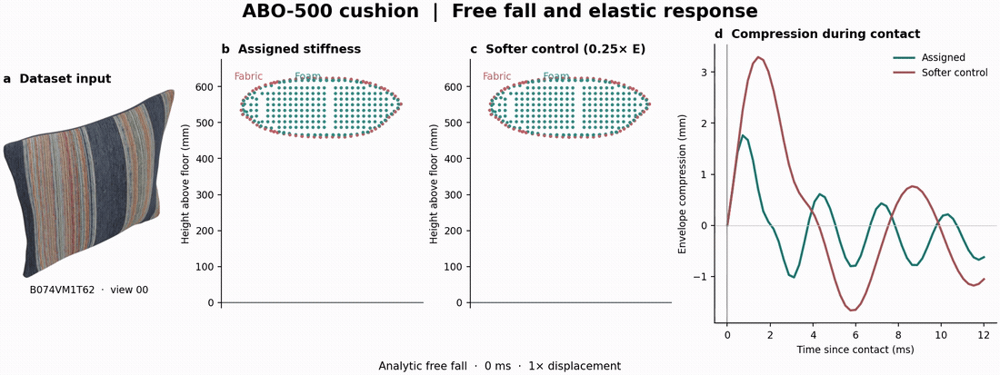
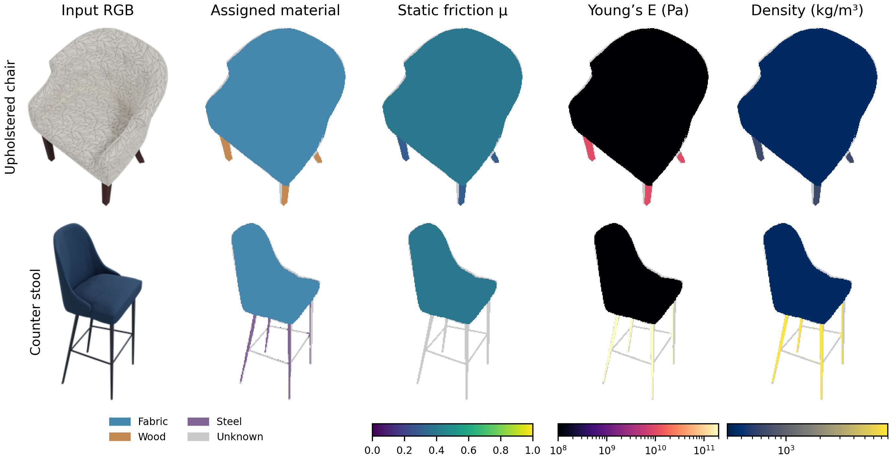

# PartPhy3D

Part-level physical inference, task-aware mesh simplification and editing with
multi-view VLM evidence and geometric constraints.

[Latest figures](paper_assets/chaise_reference_20261111_final/README.md) ·
[Results](docs/results/chaise_reference_20261111_zh.md) ·
[Reproduction](docs/REFERENCE_MESH_STUDY_zh.md) ·
[Mass baselines](docs/baseline_mapping.md) ·
[Server setup](docs/SERVER_SETUP_zh.md) · [Data](docs/DATA.md) · [中文](README_zh.md)

## Physics demonstrations

### Free fall and elastic contact



Adaptive material points from ABO-500 cushion B074VM1T62. The left contact view uses the assigned Young’s moduli. The right contact view uses 25% of those moduli with the same particle masses, geometry and initial conditions. The free-fall segment uses the analytic trajectory. The contact segment shows the MLS-MPM result at 1× displacement with slowed playback.

[HD video](paper_assets/gallery/pillow_drop.mp4) · [Figure PDF](paper_assets/gallery/pillow_drop.pdf)

### Spatial material properties



Friction, Young’s modulus and density are material-conditioned priors. Grey marks missing assignments. The friction prior specifies contact with a dry stainless-steel slider.

[Property maps PDF](paper_assets/gallery/surface_priors.pdf)

## Run

```bash
python -m pip install -e ".[study]"
python scripts/run_reference_mesh_study.py prepare --output outputs/reference
python scripts/run_reference_mesh_study.py infer --output outputs/reference
python scripts/run_reference_mesh_study.py evaluate --output outputs/reference
python scripts/run_reference_mesh_study.py figures --output outputs/reference
```

VLM inference additionally requires a GPU, local model weights and training
dependencies; see the setup guide. Use `all` for the complete workflow or
`--resume` to reuse completed stages. Figures are written inside the run directory.

## Layout

- `src/tactile3d/`: inference, geometry, physics and editing modules.
- `scripts/run_reference_mesh_study.py`: the current experiment entry point.
- `configs/`, `tests/`: configuration and verification.
- `paper_assets/chaise_reference_20261111_final/`: current figures and source data.
- `docs/`: methods, data preparation and historical text records.

Dataset images, reference models, checkpoints and intermediate exports are local
resources, not bundled in Git. Current figures describe a reference-geometry
development study. The new [whole-body retention comparison](docs/baseline_mapping.md#vlm-construction-and-component-support-integration-2026-11-12)
uses completed component domains; earlier physical comparisons cover four legs.

Code is MIT licensed. Data and third-party components retain their own licenses;
see [THIRD_PARTY.md](THIRD_PARTY.md).
