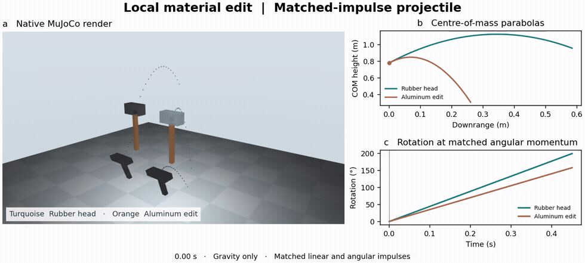
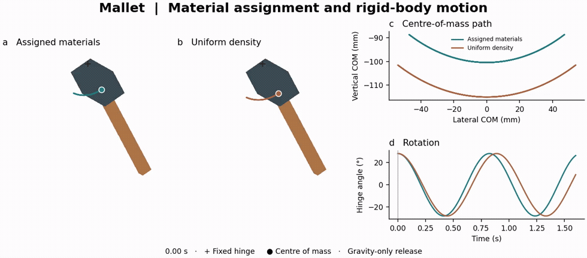
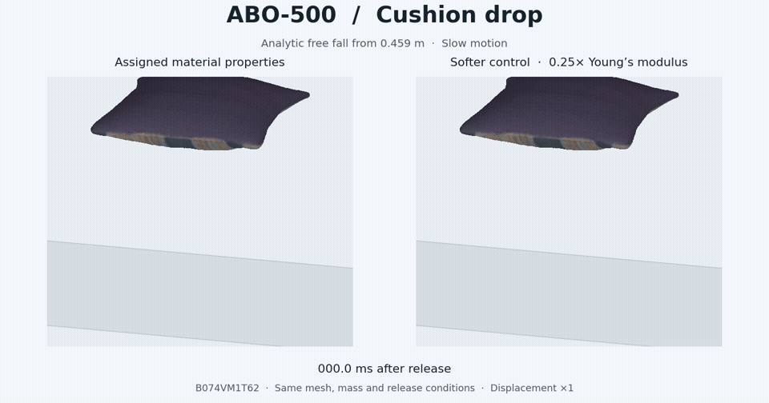
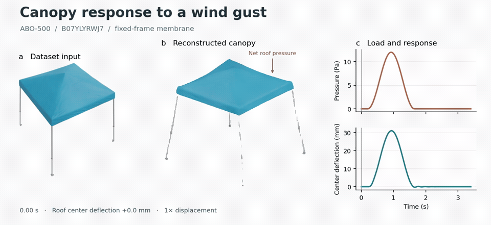

# PartPhy3D

Part-level physical inference, task-aware mesh simplification and editing with
multi-view VLM evidence and geometric constraints.

[Latest figures](paper_assets/chaise_reference_20261111_final/README.md) ·
[Results](docs/results/chaise_reference_20261111_zh.md) ·
[Reproduction](docs/REFERENCE_MESH_STUDY_zh.md) ·
[Mass baselines](docs/baseline_mapping.md) ·
[Server setup](docs/SERVER_SETUP_zh.md) · [Data](docs/DATA.md) · [中文](README_zh.md)

## Physics demonstrations

### Material editing and projectile motion



Only the head material is replaced. The part edit updates mass, centre of mass and inertia before exporting to MuJoCo. Matched impulses produce different launch velocities and trajectories.

[Video](paper_assets/gallery/mallet_material_edit.mp4) · [Paper figure](paper_assets/gallery/mallet_material_edit.pdf) · [MuJoCo MJCF scene](paper_assets/gallery/mallet_material_edit.xml)

### Centre of mass and rigid motion in MuJoCo



The designed rubber-head and wood-handle mallet has an analytic centre of mass. Both simulations use the same geometry, total mass and hinge. The colored mesh, centre-of-mass marker and trajectory cursor are synchronized.

[Mallet video](paper_assets/gallery/mallet_com.mp4) · [Mallet figure PDF](paper_assets/gallery/mallet_com.pdf) · [ABO-500 sofa video](paper_assets/gallery/sofa_com.mp4) · [ABO-500 sofa figure PDF](paper_assets/gallery/sofa_com.pdf)

### Free fall and elastic contact



Both columns show the colored reconstruction of ABO-500 cushion B074VM1T62. The surface follows the simulated textile particles. Original material properties are on the left, 25% Young’s modulus on the right. The fall is analytic and contact is MLS-MPM. Both are shown at 1× displacement with slowed playback. No physical ground-truth trajectory is available for this object.

[HD surface video](paper_assets/gallery/cushion_motion.mp4) · [Particle section GIF](paper_assets/gallery/pillow_drop.gif) · [Compression curves PDF](paper_assets/gallery/pillow_drop.pdf)

### Canopy under a wind gust



The assigned textile parameters drive a reduced membrane model. The supports stay fixed. The input pressure and calculated displacement are shown on the same time axis.

[HD video](paper_assets/gallery/canopy_wind.mp4) · [Figure PDF](paper_assets/gallery/canopy_wind.pdf)

### Spatial material properties


Friction, Young’s modulus and density are material-conditioned priors. Grey marks missing assignments. The friction prior specifies contact with a dry stainless-steel slider.

[Property maps PDF](paper_assets/gallery/surface_priors.pdf)

## Run

```bash
python -m pip install -e ".[study]"
python scripts/run_reference_mesh_study.py prepare --output outputs/reference
python scripts/run_reference_mesh_study.py infer --output outputs/reference
python scripts/run_reference_mesh_study.py evaluate --output outputs/reference
python scripts/run_reference_mesh_study.py figures --output outputs/reference
```

VLM inference additionally requires a GPU, local model weights and training
dependencies; see the setup guide. Use `all` for the complete workflow or
`--resume` to reuse completed stages. Figures are written inside the run directory.

## Layout

- `src/tactile3d/`: inference, geometry, physics and editing modules.
- `scripts/run_reference_mesh_study.py`: the current experiment entry point.
- `configs/`, `tests/`: configuration and verification.
- `paper_assets/chaise_reference_20261111_final/`: current figures and source data.
- `docs/`: methods, data preparation and historical text records.

Dataset images, reference models, checkpoints and intermediate exports are local
resources, not bundled in Git. Current figures describe a reference-geometry
development study. The new [whole-body retention comparison](docs/baseline_mapping.md#vlm-construction-and-component-support-integration-2026-11-12)
uses completed component domains; earlier physical comparisons cover four legs.

Code is MIT licensed. Data and third-party components retain their own licenses;
see [THIRD_PARTY.md](THIRD_PARTY.md).
