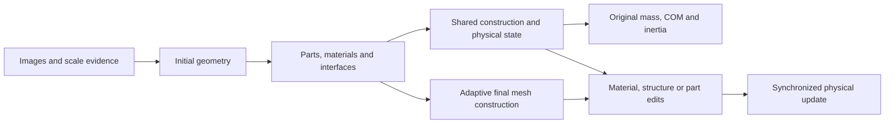
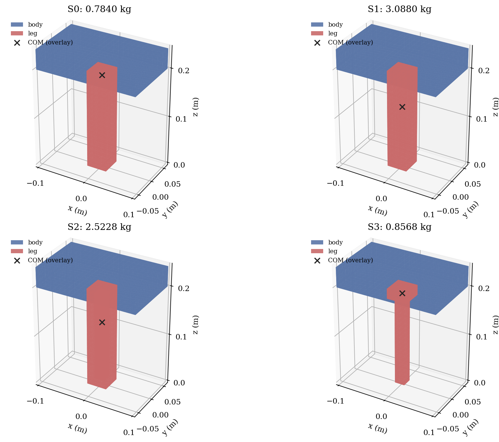
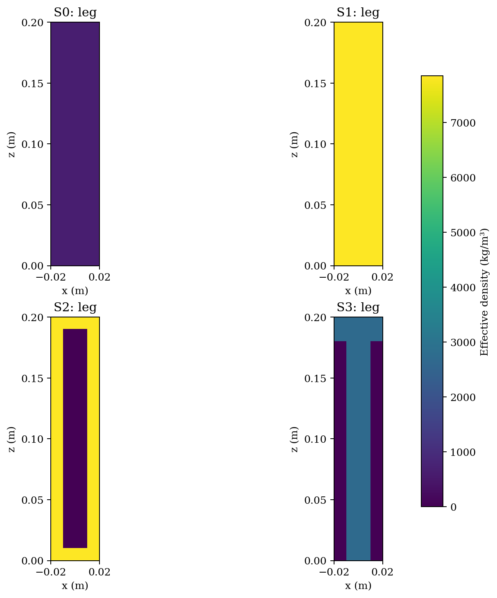
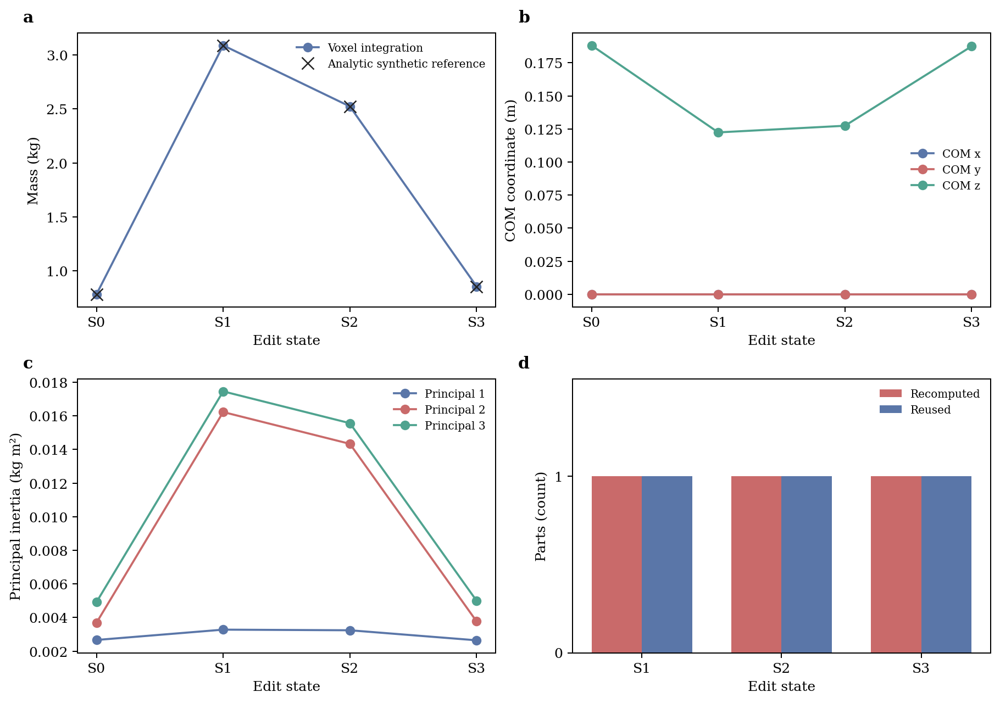

# PartPhy3D

**Part-level physical inference and editable 3D objects.**

[](https://github.com/fanyizhi/PartPhy3D/actions/workflows/tests.yml)
[](LICENSE)

[中文说明](README_zh.md) · [Implementation status](docs/IMPLEMENTATION_STATUS.md) ·
[Reproduction](docs/QUICKSTART_zh.md) · [Documentation](docs/README.md) ·
[Roadmap](docs/ROADMAP.md)

PartPhy3D is research software for construction-aware physical inference and
shared-state material, structure and part editing. This is a **development
prototype**, not a completed or peer-reviewed paper method.

The mathematical editing engine runs without a GPU, model weights or an external
dataset. Actual image reconstruction, learned multimodal fusion, generation-stage
adaptive construction and real-object physical validation remain in development.

## Research scope



The diagram describes the research target. Current QEM postprocessing does not
accelerate the initial reconstruction.

## Quick start: CPU, no dataset

Use Python 3.10 or later in an existing environment:

```bash
git clone https://github.com/fanyizhi/PartPhy3D.git
cd PartPhy3D
python -m pip install -e ".[dev,figures]"
python scripts/edit_parts.py
python -m pytest -q
```

The demo creates a new directory under `outputs/edit_commands/`. It executes
material substitution, a closed hollow-box construction and an interface-compatible
donor replacement. Every step is checked against full recomputation. The default
assembly also has an independent analytic mass/COM/inertia reference.

| State | Specified design | Analytic assembly mass (kg) |
| --- | --- | ---: |
| S0 | Original wooden support | 0.7840 |
| S1 | Solid steel support | 3.0880 |
| S2 | Closed hollow steel support | 2.5228 |
| S3 | Compatible aluminum donor | 0.8568 |

These are specified synthetic designs, not predictions of an ABO object.





The panels show the edited support's effective-density sections in world
coordinates (kg/m³). Empty cells have zero density.



These figures are generated by the default CPU demo. The numerical source table
is available in [synthetic_edit.csv](docs/results/synthetic_edit.csv).

## Editing interfaces

```bash
python scripts/edit_parts.py \
  --command '将 leg 的材料 wood 改为 steel，密度 7850 kg/m3' \
  --command '将 leg 设为空心盒，材料 steel，壁厚 10 mm'
```

A strict JSON example is included:

```bash
python scripts/edit_parts.py --plan examples/wood_to_hollow_steel.json
```

Replay a saved experiment, replacing `<run>` with an actual output directory:

```bash
python scripts/edit_parts.py \
  --state outputs/edit_commands/<run>/state_000 \
  --plan outputs/edit_commands/<run>/program.json
```

The language interface is explicit grammar, not a trained Qwen model. Unsupported
commands, stale versions, incompatible interfaces, overlapping cells and unresolved
walls are rejected. Failed computations do not mutate source states or commit a
partial sequence.

## Outputs and limitations

- Replayable `program.json`, versioned JSON/NPZ states and voxel-boundary PLYs.
- CSV mass/COM/principal-inertia tables, check reports and source/output hashes.
- Geometry, physical quantity and density-slice figures in PNG/SVG/PDF.

The engine currently uses a common axis-aligned cubic grid and explicit fixed
interfaces. Hollow editing supports closed rectangular shells. Arbitrary-pose
revoxelization, free-form layers, mechanical strength and joint uncertainty updates
are not implemented.

## Data and comparisons

Dataset archives, checkpoints and private server configuration are not distributed.
Reference ABO geometry and generated geometry must be evaluated separately.
See [data preparation](docs/DATA.md), [experiment commands](docs/EXPERIMENTS.md)
and [recorded results](docs/results/README.md).

The comparison runner keeps a fixed cohort, reports missing/failed methods and
computes ADE/ALDE/APE/MnRE with paired source data. Executed ten-object results use
untrained rules and reference geometry; paper baselines remain pending.

The ABO material-color preview requires a separately prepared image, matching
camera and GLB. Run `python scripts/preview_material_edit.py` after preparing them.
It edits surface colors and does not claim absolute physical mass.

## Layout

```text
src/tactile3d/    geometry, physics, editing, evaluation and research modules
scripts/         runnable demos and experiment entry points
configs/         inference settings and material/construction priors
examples/        executable editing programs
tests/           dataset-independent software checks
docs/            protocols, status, roadmap and recorded evidence
.github/         Linux CPU continuous integration
```

## Evidence and attribution

Software success, correct integration and plausible animation do not establish
physical accuracy. VLM confidences are not automatically calibrated probabilities.
The ten development objects have been seen and are not untouched test data.
Published scores are not substituted for reproduced predictions.

Project code retains the [MIT license](LICENSE). Dataset, pretrained-model and
upstream-project terms remain separate; see [third-party notes](THIRD_PARTY.md).
[CITATION.cff](CITATION.cff) contains software citation metadata.

There is no associated published paper, DOI or model checkpoint for the complete
method at this stage. Cite the software and the upstream resources actually used
in your experiment. Report bugs using the repository issue templates.
