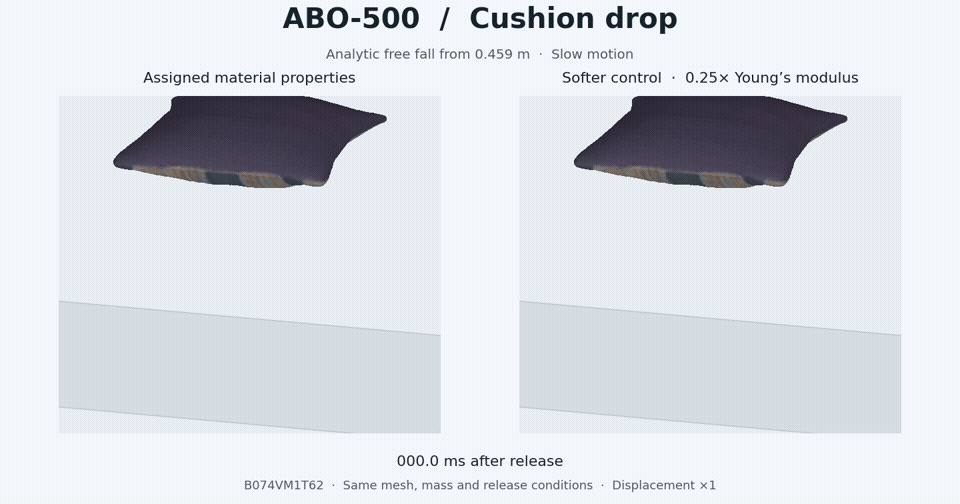
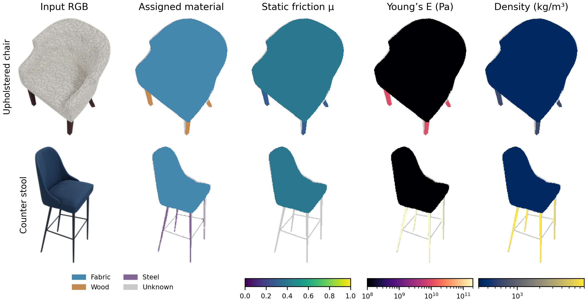

# PartPhy3D

多视角 VLM 与 Mesh 几何约束结合的部件物理推断、减面与编辑研究。

[最新图件](paper_assets/chaise_reference_20261111_final/README.md) ·
[实验结果](docs/results/chaise_reference_20261111_zh.md) ·
[方法与复现](docs/REFERENCE_MESH_STUDY_zh.md) ·
[服务器安装](docs/SERVER_SETUP_zh.md) · [数据准备](docs/DATA.md) · [English](README.md)

## 物理演示

### 靠枕下落与弹性接触



两列使用同一个 ABO-500 条纹靠枕重建网格。外表随 MLS-MPM 求解得到的织物粒子运动。左列用原始赋值，右列只将杨氏模量降至 25%。掉落段采用解析轨迹，接触段采用 MLS-MPM，按一倍位移慢放。该对象缺实拍运动真值。

[高清外观视频](paper_assets/gallery/cushion_motion.mp4) · [内部粒子动图](paper_assets/gallery/pillow_drop.gif) · [压缩曲线 PDF](paper_assets/gallery/pillow_drop.pdf)

### 空间物性图



摩擦、杨氏模量和密度来自材料先验。灰色表示缺少赋值。摩擦先验以干燥不锈钢滑块为接触条件。

[属性图 PDF](paper_assets/gallery/surface_priors.pdf)

## 运行

```bash
python -m pip install -e ".[study]"
python scripts/run_reference_mesh_study.py prepare --output outputs/reference
python scripts/run_reference_mesh_study.py infer --output outputs/reference
python scripts/run_reference_mesh_study.py evaluate --output outputs/reference
python scripts/run_reference_mesh_study.py figures --output outputs/reference
```

VLM 推理另需 GPU、模型权重与训练依赖，配置见服务器安装说明。
`all` 顺序运行四步；`--resume` 复用已完成阶段；图件默认保存在实验目录内。

## 文件结构

- `src/tactile3d/`：推理、几何、物理和编辑模块。
- `scripts/run_reference_mesh_study.py`：当前实验的统一入口。
- `configs/`、`tests/`：配置与验证。
- `paper_assets/chaise_reference_20261111_final/`：最新结果图和源数据。
- `docs/`：方法、数据、复现及历史文字记录。

数据集图片、参考模型、模型权重和中间产物保存在本地，不随 Git 克隆分发。
当前图件来自参考几何开发实验。[新版整物体减面对照](docs/baseline_mapping.md#vlm-construction-and-component-support-integration-2026-11-12)
使用部件补全物理域；早期图件的质量矩范围为四条木腿，各图分别注明。

代码采用 MIT 许可；数据和第三方组件遵循各自许可，见 [THIRD_PARTY.md](THIRD_PARTY.md)。
