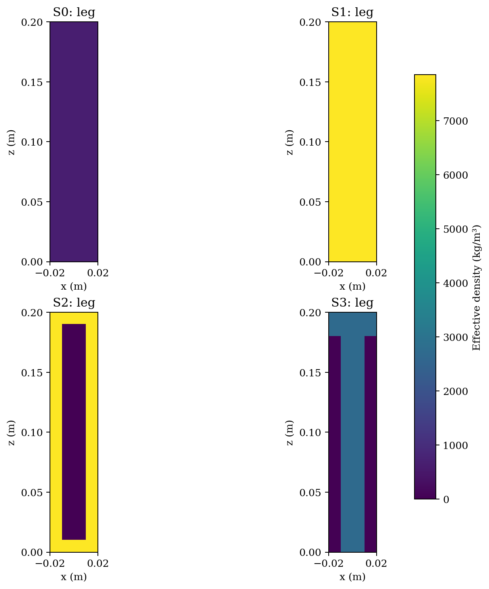
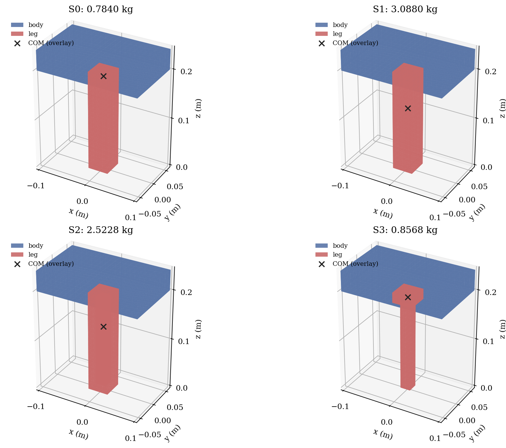
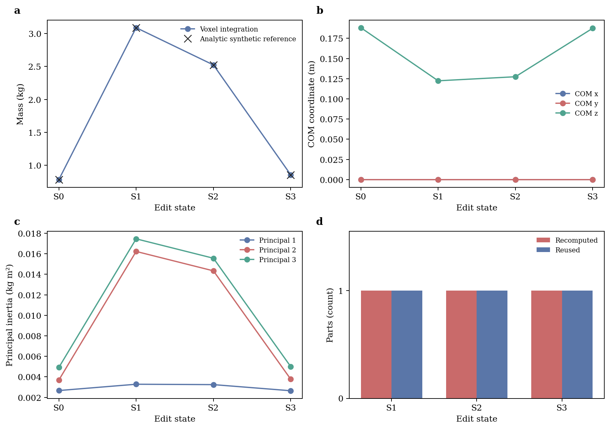

# PartPhy3D：部件物理估计与可编辑三维对象

目标是从图像与几何证据推断部件构造和物理状态，准确估计原物体质量，并在材料、
内部结构或部件替换后同步更新。当前是科研开发原型，完整论文方法尚未完成。

[English](README.md) · [文档导航](docs/README.md) ·
[自动测试](https://github.com/fanyizhi/PartPhy3D/actions/workflows/tests.yml)

## 无数据CPU验证

在项目根目录、已有Python 3.10及以上环境中运行：

```bash
git clone https://github.com/fanyizhi/PartPhy3D.git
cd PartPhy3D
python -m pip install -e ".[dev,figures]"
python scripts/edit_parts.py
python scripts/edit_parts.py --plan examples/wood_to_hollow_steel.json
python -m pytest -q
```

不需要GPU、ABO数据或大模型权重。输出包括Mesh、物理状态、质量/质心/惯量表、
内部密度截面和可重放指令。默认装配体有独立解析参考，属于指定构造的合成验证。







上述图来自已知尺寸和密度的合成装配体；不是ABO预测效果或真实材料测量。
原始数值见[合成实验表](docs/results/synthetic_edit.csv)。

## 实现状态

已实现显式部件状态、密度积分、质量矩、受限中文/严格JSON编辑、回滚、接口兼容
donor替换与重放。本机当前通过86项测试；Linux/Python 3.10的自动测试和演示
结果请查看页面上方的CI链接，并对应到具体提交。

真实InstantMesh/Qwen/部件模型链、学习式联合构造推断、生成侧自适应网格构建及
真实编辑/交互准确性尚未完成。现有QEM是后处理基线，不证明初次生成加速。

## 数据与科研边界

数据、权重和服务器设置不随源码发布。参考Mesh与生成Mesh分轨报告；原物体
重量不能当作编辑后重量；开发集不称未见测试集。VLM建议、材料先验、主观感知
评分与独立物理测量分开记录。

十物体规则基线和未运行论文对照见[结果说明](docs/results/README.md)。当前复杂
构造先验并未全面优于薄壳，不能预设加入内部假设一定提高准确性。

## 文档

- [完整研究设计草案：方法、损失、比较与验收](docs/research_blueprint_2026-11-04_zh.md)
- [安装、数据与复现](docs/QUICKSTART_zh.md)
- [数据目录与许可](docs/DATA.md)
- [实验入口与复现范围](docs/EXPERIMENTS.md)
- [模块完成状态](docs/IMPLEMENTATION_STATUS.md)
- [下一阶段验收](docs/ROADMAP.md)
- [逐步方法审阅](docs/method_step_review_2026-11-04_zh.md)
- [生成侧与材料颜色预览](docs/generation_and_material_preview_2026-11-04_zh.md)
- [统一状态与编辑契约](docs/part_state_and_edit_contract_zh.md)

完整研究依赖仍统一放在`requirements.txt`。上面的CPU快速安装不需要先安装训练
组件。未发表论文、原创性、基线优势和期刊录用均不作为既成结论。
