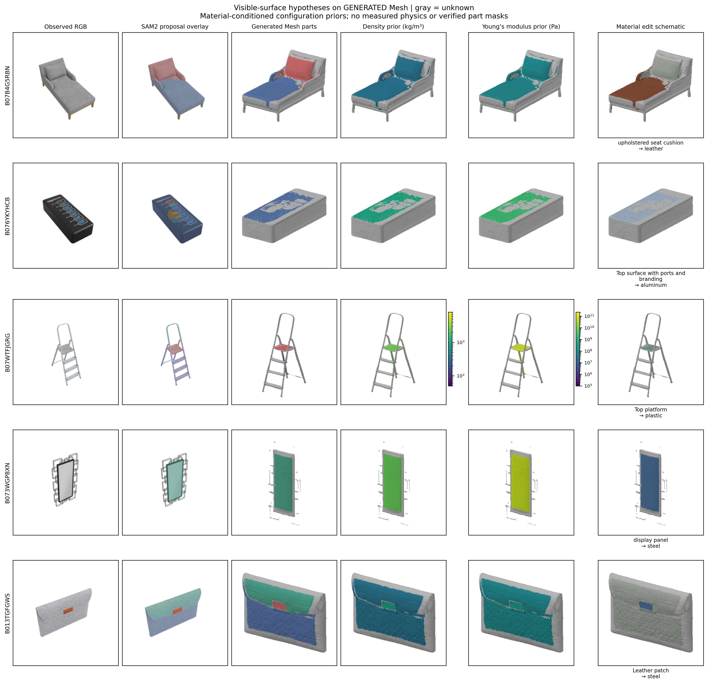
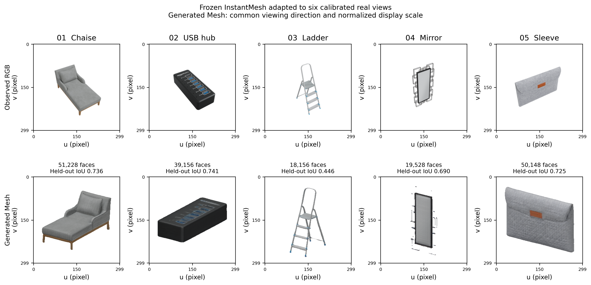
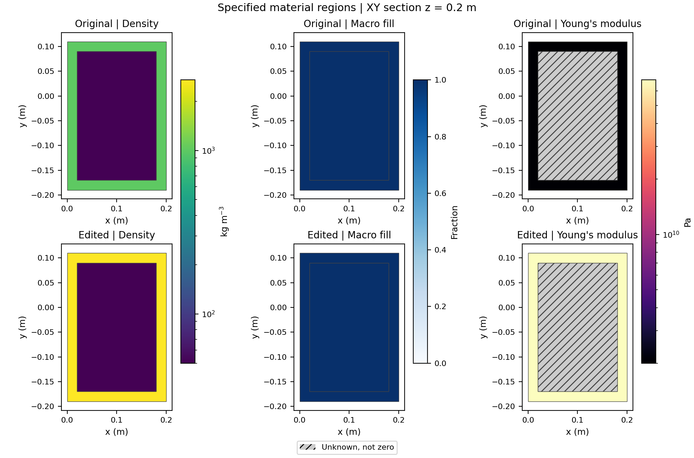

# PartPhy3D

**v0.6.4**：生成阶段稀疏权重解码、图片尺度训练与独立校准、部件条件闭合材料域、
换材后的局部物理矩与刚体响应已实际执行；新增独立人工标注及分割评价入口。
[当前方法、范围和复现](docs/METHODS_V064_zh.md) ·
[本轮真实结果和不足](docs/results/geometry_physics_20261107/README_zh.md)。
完整整物体质量和内部物性准确性仍未验证。

**2026-11-07 更新**：已在五个真实生成 Mesh 上执行 Qwen 定位、SAM2 分割、
遮挡检查、表面密度/E 先验图和局部换材；已运行 NeRF2Physics 发布缓存属性阶段。
[逐条想法、实现和缺口](docs/RESEARCH_IDEA_AUDIT_20261107_zh.md) ·
[论文任务、模块与验证架构](docs/PAPER_ARCHITECTURE_zh.md) ·
[实际结果、失败和重放命令](docs/results/surface_physics_20261107/README_zh.md)。
精细分割仍不完整，物性图是条件先验，完整方法质量尚未验证。



面向部件构造、物理属性推断和物理一致编辑的研究工程，当前版本 **0.6.4**。
源码包含可执行程序和研究设计；尚未完成真实联合模型，不能据此宣称优于论文方法。

[English](README.md) · [完整方法、程序与复现](docs/METHODS_AND_REPRODUCTION_zh.md) ·
[实现状态](docs/IMPLEMENTATION_STATUS.md) · [运行结果和不足](docs/results/reproduction_v0.5.0_zh.md)

**2026-11-06真实服务器先导实验**：5个物体的Qwen 2B/8B单/三视角质量估计、
真实六视角冻结InstantMesh适配诊断、两步QLoRA工程验收已经执行。
8B单视角APE为34.76%，三视角为46.53%；五物体生成Mesh的未输入视角轮廓IoU
均值为0.6675。完整物理推断、精细分割和生成预算创新仍待实现。
[结果图、逐物体数值、失败与复现命令](docs/results/server_pilot_20261106/README_zh.md)。



**本版新增Mesh原生主线**：用互斥封闭材料域的三角边界直接积分质量、质心和
完整惯量，换材时复用几何矩；新路径不调用体素化。旧体素原型保留作对照。
[新主线的步骤、公式、输入格式与局限](docs/mesh_native_v0.6_zh.md)。
[实际执行结果和不足](docs/results/mesh_native_v0.6_zh.md)。

**当前先导规模已于2026-11-05改为5个真实物体**，保持原冻结队列的前5个；先检查
第一个，再继续其余4个。准备命令和运行入口见[五物体复现说明](docs/QUICKSTART_zh.md)。

**下载仓库即包含**`data/abo500_five/`：固定5物体的150张图、相机、参考GLB、
质量标签和数据许可。默认路径已连接真实先导入口。
[统一安装与服务器迁移](docs/SERVER_SETUP_zh.md) · [数据结构](docs/DATA.md)。

新增[完整ABO-500质量监督训练流程](docs/ABO_MASS_TRAINING_zh.md)：官方300/100/100对象划分、真实质量标签、8B QLoRA和相同NF4条件下的训练前后评价；该任务不提供内部材料或其它物性真值。

## Linux统一安装与验收

在MobaXterm终端中：

```bash
git clone --depth 1 https://github.com/fanyizhi/PartPhy3D.git
cd PartPhy3D
python3 -m venv .venv
source .venv/bin/activate
python -m pip install --upgrade pip
python -m pip install -r requirements.txt
python scripts/check_installation.py --training --frontend
python -m pytest -q
python scripts/reproduce_mesh_native.py --output outputs/mesh_first
```

建议先用Python 3.10；Linux CI检查3.10，本地另测3.13。
数学验收使用CPU，不加载预训练权重，也不连接服务器或恢复队列。
请在新环境安装，不要直接升级其他人正在使用的共享环境。
完整依赖统一在`requirements.txt`，不再分`requirements-train`。
该安装命令同时安装几何、绘图、测试、视觉和微调依赖，以及项目命令行入口。
`check_installation.py`检查导入与内置数据，不执行训练或GPU测试。

需要一次上传到服务器时：

```bash
python scripts/package_server.py --output outputs/server_bundle
```

得到`PartPhy3D-with-data.zip`，内含代码、配置、文档和5物体，解压后仍使用上面的
requirements安装命令。Python依赖通过pip联网下载，预训练权重按上游另行准备。

## 新主线实际完成什么

1. 对实心、空心、外壳＋填充的Mesh积分，与独立解析体积/惯量核对。
2. 固定构造换材，同步示意颜色、密度、E、ν，重算质量/COM/I并核对全量积分。
3. 导出可重放的部件/区域资产、物理CSV、多视角图和材料截面属性图。
4. 用四类Mesh候选的积分体积训练小型共享状态模型，比较质量和编辑响应监督。
5. 在分族独立测试集报告原物体及编辑质量误差，输出封存预测和校准区间。

默认9.7728→25.1136kg是**指定构造**的解析核对；学习使用384个合成对象的
11维代理观测，不是千问微调或ABO结果。新主线不执行图像重建和精细语义分割。

```text
outputs/mesh_first/editing/mesh_edit_views.png         三视角换材对照
outputs/mesh_first/editing/mesh_property_sections.png  外壳/填充的ρ、填充率、E
outputs/mesh_first/editing/mesh_physics.png             质量、COM和惯量
outputs/mesh_first/editing/physics.csv                 完整物理数值
outputs/mesh_first/editing/original/part_tokens.json   部件统一数据结构
outputs/mesh_first/learning/learning_results.png       真实执行的合成学习结果
outputs/mesh_first/learning/metrics.csv                质量误差表
outputs/mesh_first/suite.json                          状态与尚未完成项
```



## 历史体素原型与曲面诊断

`python scripts/reproduce_all.py --output outputs/legacy_first`仍可运行旧版验收：

1. 用独立解析构造生成384个合成对象，按对象族划分训练、校准、测试集。
2. 用三种初始化训练质量监督、共享状态＋编辑响应、直接回归三个对照。
3. 评测前封存预测，输出原物体、已见材料编辑、未见钢材编辑的质量误差。
4. 输出构造分类、密度、宏观占用和体积误差，以及混合预测和MAP资产质量差距。
5. 导出预测的可编辑状态，改为钢材后重新积分质量、质心和完整惯量。
6. 验证独立解析装配体的材料、空心构造、部件替换、接口检查和事务重放。
7. 对比均匀与任务加权曲面构造，记录面数、场查询数、误差、水密性和耗时。
8. 生成PNG/SVG图、CSV/JSON、NPZ、PLY和SHA-256产物清单。

**学习实验使用11维观测代理特征，不是图像编码器或千问微调，也不是ABO结果。**
真实模型入口和数学验收链分别记录，不把占位模块称为训练成功。

## 图片和数据在哪里

```text
outputs/first_run/learning/learning_results.png       质量散点、误差和校准区间
outputs/first_run/learning/physical_fields.png        密度、占用及材料编辑切片
outputs/first_run/learning/metrics.csv                原物体和编辑质量指标
outputs/first_run/learning/state_metrics.csv          密度、构造、占用指标
outputs/first_run/learning/seed_17/example/           原始/编辑状态和PLY
outputs/first_run/editing/                           三种编辑及物理、几何变化图
outputs/first_run/adaptive/adaptive_construction.png 稀疏构造成本与误差
outputs/first_run/suite.json                         整体状态、作用范围和耗时
```

图同时导出SVG，CSV提供数值来源。目录存在时拒绝覆盖，请换新目录。
程序不会隐藏失败，也不会把未运行的论文分数补成零。

## 真实数据与模型

材料编辑第一版已接通：指定部件/材料区域，保持几何和占用，颜色和物理参数从
同一状态更新。先运行已知构造示例：

```bash
python scripts/edit_material.py --output outputs/material_first
```

输出多视角换色图、质量/质心/惯量、材料参数和可重放资产；默认总质量为
5.120→6.432kg，属于设计预设核对。[用法与边界](docs/material_edit_v1_zh.md)。
完整CPU复现也包含该实验，位于`bound_material/`。

- ABO图像、相机和称重标签放在`data/abo_500/`，参考GLB与生成Mesh分目录。
- 已下载资产支持`data/abo500_ten/<scene_id>/model.glb`。
- `scripts/reconstruct_instantmesh.py`适配官方`run.py`，默认仅检查；显式增加
  `--execute`才运行。由单张观测生成的辅助视角不能当作真实多视角。
- `configs/abo500_mesh_vlm.yaml`连接已部署的千问兼容服务；缺失依赖时明确失败。
- 几何聚类是当前基线，不等于PartField或精细语义分割。
- 非水密Mesh可明确选`voxel_envelope`近似包络，不等于恢复真实空腔和材料。
- 真实图像→精细部件→学习构造状态→编辑的联合模型仍待完成和独立验证。

两物体检查命令、文件格式和实际误差见[完整手册](docs/METHODS_AND_REPRODUCTION_zh.md)。
两个物体的数据通路实测成功，但规则质量预测很差，失败与误差已如实记录。

## 打包与安装

```bash
python scripts/package_project.py --output outputs/release --results outputs/mesh_first
```

输出源码ZIP、wheel、sdist、CPU结果ZIP和校验文件。
不含ABO、模型权重、私钥或服务器配置，第三方依赖仍需通过pip安装。
拿到wheel后可在其他环境安装运行：

```bash
python -m pip install "outputs/release/dist/tactile3d-0.6.1-py3-none-any.whl[figures]"
partphy3d-mesh-reproduce --output outputs/wheel_check
```

## 研究说明

- [每一步的方法、代码、损失、指标和实验](docs/METHODS_AND_REPRODUCTION_zh.md)
- [部件状态、版本、接口和编辑契约](docs/part_state_and_edit_contract_zh.md)
- [编辑指令与重放](docs/edit_commands_2026-11-04_zh.md)
- [完整论文设计和验收条件](docs/research_blueprint_2026-11-04_zh.md)
- [问题、方法和待验证优势](docs/problem_solution_advantages_2026-11-04_zh.md)
- [公平对比协议](docs/evaluation_protocol_zh.md)
- [上游方法与许可](THIRD_PARTY.md)

统一数据结构、标准损失和红绿细分不自动构成原创贡献。需要公平对照证明：
共享可执行构造状态与独立编辑响应监督能否提高**原物体及编辑后的物理准确性**，
并在几何和物理误差约束下减少资源开销。
