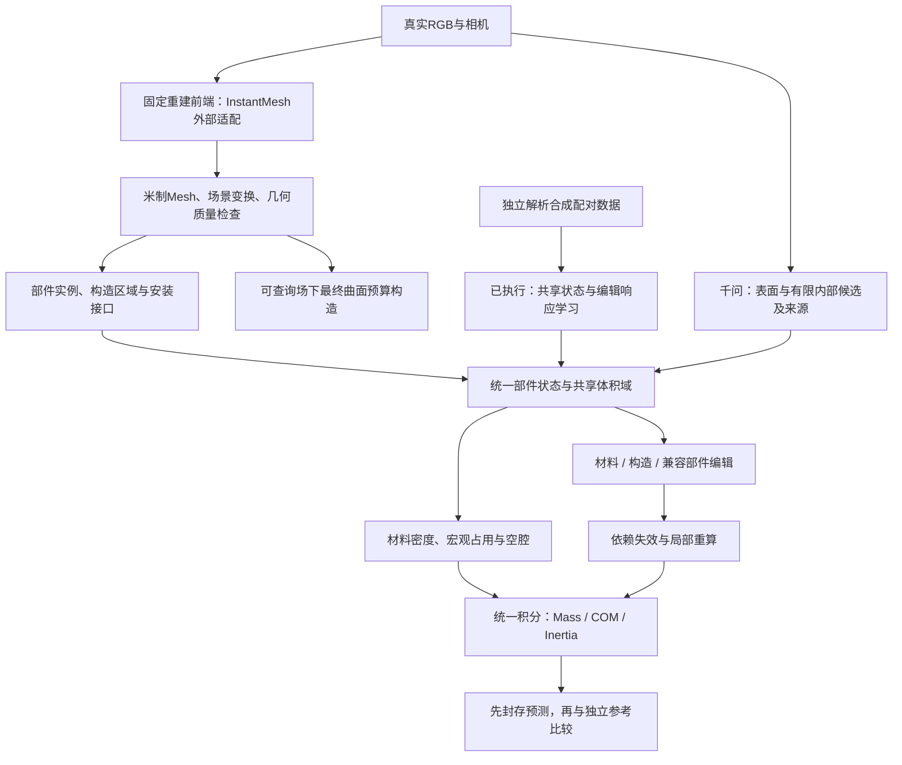

# 完整方法、程序与复现手册

版本0.5.0，2026-11-04。源码打包完整不表示整套科学主张已经得到验证。

## 科学问题和核心假设

从有尺度的图像/几何估计部件构造、材料与宏观占用，支持材料、构造和兼容部件
编辑。首先评价**未编辑物体的质量**，再评价编辑后的物理准确性，最后评价效率。
外观相同的薄壳、夹层和实心物体可以具有不同质量；外表面与总质量通常不能唯一
确定内部。增加提示词和重复猜测不会产生新的独立测量。

候选核心机制：用同一可执行构造状态产生原始与编辑响应，通过独立配对编辑参考
减少密度与占用的相互补偿。标准MLP、损失、JSON、缓存或红绿细分不作为独立
原创贡献；真实增益必须通过强对照验证，不能保证期刊接受。

## 总流程



真实联合模型尚未训练。当前部件模型是几何聚类基线；学习只验证已知盒构造；
曲面预算模块用解析场验证，尚未接入InstantMesh固定网格解码器。图中流程是研究
目标和现有接口，不表示真实图像的端到端方案已经完成。

## 每一步做什么、解决什么问题

源码路径相对`src/tactile3d/`，脚本除外。

| 步骤 | 方法与目标 | 程序 | 证据和待补条件 |
| --- | --- | --- | --- |
| 数据切分 | 按对象族分集合，尺度独立标定 | `abo500/dataset.py`, `research/data.py` | 原始/生成视角必须分开；测试质量不能进入推理 |
| 重建入口 | 执行官方单图重建命令，记录哈希和日志 | `research/frontend.py` | 协议已测；本轮未运行权重/GPU |
| 场景加载 | 保留GLB实例、平移、旋转与缩放 | `mesh/io.py` | 多实例变换有解析回归测试 |
| 几何检查 | 水密、定向、体积；显式选择修复 | `mesh/repair.py`, `volume.py` | 近似包络不是内部真值，禁止静默凸包替代 |
| 多视角对应 | 投影、遮挡近似、部件裁剪 | `vision/multiview.py` | 需先配准；全图回退不能证明局部可见 |
| 部件识别 | 当前是位置/法向等特征聚类和平滑 | `mesh/segmentation.py` | 不是PartField，不保证细连接件和语义边界 |
| 材料/内部 | 有限候选，区分外层和内部及来源 | `vision/vlm_interior.py` | VLM是先验，概率未校准；旧材料别名需审查 |
| 数据统一 | 槽位ID、实例ID、版本、局部坐标、来源、接口 | `physics/part_state.py` | 同维投影不等于空间配准 |
| 共享状态学习 | 同一状态产生原始和编辑响应 | `research/construction.py`, `learning.py` | 已做合成学习与差分梯度验证，真实编码器待训练 |
| 物理积分 | 从同一字段计算质量、质心和完整惯量 | `physics/part_state.py` | 有限单元自身惯量与移轴项不可漏 |
| 编辑 | 明确目标、版本、材料/构造/兼容替换件 | `physics/part_editing.py`, `edit_program.py` | 原子失败、接口、互斥占用、重放与完整重算 |
| 曲面预算 | 共享边红绿细分与场投影 | `mesh/adaptive_construction.py` | 已检查水密；整体体积精度尚不合格 |
| 评价 | 原始/编辑质量，带参考的物理量，资源开销 | `research/workflow.py`, `eval/benchmark.py` | 固定队列、点估计、失败统计；无论文伪分数 |
| 图与产物 | PNG/SVG、CSV/JSON、NPZ、PLY、哈希 | `research/plots.py`, `physics/part_io.py` | 数值和作用范围可追溯 |
| 发布 | 从审计副本构建源码ZIP/wheel/sdist | `scripts/package_project.py` | 不含数据、模型、密钥或SSH配置 |

## 统一状态和体积物理

层次为Object→Part→ConstructionRegion→VolumeCell，另有Interface图。每个部件
记录局部米制坐标、槽位与实例、版本、材料字段、特征引用、证据与依赖。观测、
推断与显式编辑的来源分开；改成钢材后，旧木纹不能覆盖编辑指令。接口图还不是
接头应力或承载能力模型。

包含空腔的占用满足`alpha >= 0, sum(alpha)=1`：

\[
\rho_{eff,i}=\sum_k\alpha_{ik}\rho_k,\quad
m=\sum_i\rho_{eff,i}V_i,\quad s=\sum_i m_i x_i.
\]
\[
Q=\sum_i m_i(x_ix_i^T+h_i^2I/12),\quad c=s/m,\quad
I_c=tr(Q-mcc^T)I-(Q-mcc^T).
\]

先在局部坐标积分，再解析变换原始矩，避免大坐标下消减误差。密度kg/m³、体积m³、
质量kg、COM为m、惯量kg·m²。泡沫的表观密度已包含微观孔隙，不应再次乘孔隙率；
宏观填充、材料类别概率和微观材料密度是三种不同量。

## 已实现的学习模型与损失

已知`10×12×8`体素域有四个候选：实心、闭壳、壳＋填充、棱梁架＋填充。壳厚
一个单元，两个材料区域互斥，其余为空。此诊断不能直接把任意沙发包围盒当内部。

输入11维：尺度、材料类别先验、合成颜色、带噪上下文与语义线索。真实密度、
占用、构造和质量保存在独立标签文件。颜色不由真实质量生成，但整个特征分布是
人为设计的诊断，不能证明真实图像泛化。默认隐藏维32，输出4构造logit和两组
密度/占用参数；没有真实像素编码器或千问训练。

\[
\hat m_e=\sum_c p_\theta(c|x)\sum_r V_{c,r}f_r\rho_{e,r},\quad
\rho_r=\rho^{prior}_r\exp(1.5\tanh a_r),\quad f_r=0.02+0.98\sigma(b_r).
\]
\[
L=L_{Huber}(\log(\hat m_0/m_0^*))+
\lambda_eL_{Huber}\left(
\frac{(\hat m_e-\hat m_0)-(m_e^*-m_0^*)}{m_0^*}\right)+0.15L_{CE}(p,c^*).
\]

编辑差值有正负，不能取对数。`lambda_e=1/0`形成响应/无响应对照。密度限制在
先验附近，超出候选范围需要扩展或拒绝。内层不存在时对应参数不可辨识，只对
真值中存在的区域评价密度/占用。

| 对照 | 监督与结构 |
| --- | --- |
| `mass_only` | 共享状态，原始质量＋构造交叉熵；不用编辑质量 |
| `shared_response` | 相同状态网络，增加独立编辑响应 |
| `direct_response` | 同样观测、编辑质量和构造辅助标签，加编辑区域/密度编码直接回归质量 |

直接回归结构、目标和参数量不同，尚非完全预算匹配的论文消融。仍须增加直接
占用监督等强对照。当前没有用真实密度/占用标签拟合参数损失。
训练编辑：外层1200/2700kg/m³，内层50/150kg/m³；未见编辑：外层7850kg/m³。
真实编辑若改变胶水、尺寸或孔隙，必须额外建模，不能沿用无噪声干预假设。

标签通过解析长方体壳和棱梁的容斥体积独立计算，不用预测状态生成自己的真值。
质量积分和网络反传有中心差分测试。训练采用可微候选混合；导出MAP单一构造，
分别报告MAP质量与`soft_MAP_mass_gap_kg`，不能让软混合分数替硬资产背书。

## 切分、封存、区间和指标

- 数据种子20261104，64族×6变体，41/11/12族分训练/校准/测试。
- 归一化只拟合训练输入，训练只使用训练标签，推理接口不接收标签；修改测试
  质量不应改变权重，有相应测试。预测先哈希封存，再评测，不更换困难对象。
- 校准使用族内最大绝对对数残差。分位序号`ceil((G+1)*0.9)`，G为独立校准族数。
  太少时明确失败；`--objects 60`等小样本不一定能建立90%有限区间。
- `lower90_kg/upper90_kg`是族级conformal端点，不是网络q05/q95。覆盖解释依赖
  新族和校准族可交换；分布偏移时不自动保证。区间不表示内部构造正确概率。
- 三个种子共用同一数据集，只反映初始化差异，不是三个独立数据集。

质量：ADE(kg)、ALDE(自然对数)、APE(比例)、MnRE(越高越好)。
状态：构造准确率、存在区域密度MAE、宏观占用MAE、材料占用体积MAE。
COM/惯量由同一字段导出；合成盒域对称，COM缺乏辨别力，非对称装配体只验证
积分与编辑正确性。没有真实E、摩擦或硬度标签时不报其准确率。
E不等于结构刚度；摩擦需要接触材料对；硬度需量表与条件。手臂抓取成功不能
单独证明这些属性准确。先做受控刚体响应，MPM/FEM需要独立本构和边界标定。

## 曲面构造的作用与已发现问题

`refine_surface`接粗水密Mesh、曲面投影函数和任务权重，按边长、法向与任务区域
选择共享边，红绿细分保持邻接，投影新增顶点。非法投影、拓扑破坏、反向或退化
面立即失败。该成本只包含最终构造，不含上游网络。
演示是带隆起/波纹的解析径向场，均匀/任务加权各固定3级，完整导出所有结果。
误差是面积加权径向残差，不是Chamfer或真正SDF；体积参考来自高分辨曲面。
当前任务加权设置损害整体体积精度，尚不能用于质量估计。需增加全局误差约束、
预算不足升级策略和真实可控场适配，不能宣称已省掉InstantMesh解码或精度不变。

## 真实ABO与模型入口

```text
data/abo_500/filtered_product_weights.json
data/abo_500/splits.json
data/abo_500/scenes/<scene_id>/transforms.json
data/abo_500/scenes/<scene_id>/images/...
data/abo500_ten/<scene_id>/model.glb
data/generated_meshes/<scene_id>/mesh.glb
```

ABO-500的PLY若无face只是点云。原生GLB是参考资产，不是我们的生成结果。
GLB节点变换和相机配准必须检查，不能因为投影返回了裁剪就假定配准正确。
测试质量不能用于尺度推理。例中`1`仅用于已独立验证为米制的资产。

严格两对象检查，保持固定顺序：

```bash
python -m tactile3d.cli abo500-run \
  --root /data/abo_500 --mesh-root /data/abo500_ten \
  --mesh-unit-to-meter 1 --config configs/abo500_mesh_smoke.yaml \
  --vlm-backend surface_only --split test --limit 2 --output outputs/abo_strict
```

未闭合表面失败写入`run_summary.json`。显式接受近似包络作为诊断假设时：

```bash
python -m tactile3d.cli abo500-run \
  --root /data/abo_500 --mesh-root /data/abo500_ten \
  --mesh-unit-to-meter 1 --config configs/abo500_envelope_smoke.yaml \
  --split test --limit 2 --output outputs/abo_envelope
python -m tactile3d.cli abo500-evaluate \
  --predictions outputs/abo_envelope/predictions.json \
  --output outputs/abo_envelope/metrics.json
```

包络：48分辨率表面体素化、一次闭运算、外部泛洪填充。参数在`mesh/repair.py`
头部。可能封住真实开口、抹去细杆或错误填空腔；需要32/48/64等多尺度和独立
几何参考检验。闭合不意味着真实内部恢复。当前已跑两个物体，但规则质量很差。

一个成功对象导出属性图，ID换为真实scene_id：

```bash
python -m tactile3d.cli object-figures \
  --prediction outputs/abo_envelope/scenes/ID/prediction.json \
  --mesh outputs/abo_envelope/scenes/ID/mesh_metric.ply \
  --face-labels outputs/abo_envelope/scenes/ID/face_labels.npy \
  --output outputs/abo_envelope/figures/ID --formats png svg
```

官方[InstantMesh命令接口](https://github.com/TencentARC/InstantMesh/blob/main/run.py)：

```bash
python scripts/reconstruct_instantmesh.py \
  --repository /opt/InstantMesh --python /opt/instantmesh-env/bin/python \
  --image /data/object.png --output outputs/reconstruction \
  --unit-to-meter 0.1 --scale-source "independent calibration record ID"
```

默认只检查，不运行。`0.1`是接口示例，需替换为真实独立标定。确实要运行时增加
`--execute`。不安装/下载上游，不修改队列；单张观测生成的视角只能叫辅助视角。
本轮未运行此模型，协议测试不等于GPU验证。

千问复用现有HTTP实现，服务需独立部署：

```bash
python -m tactile3d.cli abo500-run \
  --root /data/abo_500 --mesh-root /data/generated_meshes \
  --mesh-unit-to-meter 1 --config configs/abo500_mesh_vlm.yaml \
  --vlm-base-url http://127.0.0.1:8000/v1 \
  --vlm-model Qwen/Qwen3-VL-8B-Instruct \
  --split test --limit 10 --output outputs/abo_qwen
```

该配置仍是几何聚类＋构造先验管线，不是新的学习构造模型。缺连接处标签、区域
场和训练权重时，不能宣称真实联合方法完成。旧解析包含材料别名等假设，正式
研究须审查原始响应、标注材料/区域证据。无服务时不回退成规则模型冒充千问。

## 微调、对比与下一阶段

`training/dataset.py`、`training/train_vlm.py`与`scripts/train_vlm_2x4090.sh`
保留SFT/LoRA/QLoRA入口；用`python -m tactile3d.cli train-vlm --help`查看。
专业资料作先验，心理评分是感知标签，不能当物理实测。先按对象族切分再生成
对话；不能把测试质量作为答案注入。GPU训练本轮未执行，旧torch2.1环境与当前
训练包兼容性未验证，需独立环境实测。

主要对比：NeRF2Physics/PUGS质量；VoMP/AdaVoMP体材料；PhysVGGT密集属性与
质量；Gen2Physics构造资产。输入、尺度、监督、预训练来源、失败与计时范围
逐项对齐。论文方法当前仍pending，不用论文均分冒充同对象复现。

顺序：10个开发对象先查配准、细部件、接口和候选覆盖；准备独立CAD/实物配对
编辑参考；训练真实编码→共享状态，增加直接占用监督等强对照；加入全局几何/
物理门限后再测效率；方案固定后用未开发的完整队列和受控交互评价。十个开发
对象不作无偏最终测试，也不能据此估算完整大模型训练时间。

## 安装、打包与常见故障

CPU安装见根README。完整项目依赖统一在`requirements.txt`：

```bash
python -m pip install -r requirements.txt
python -m pip install -e . --no-deps
```

先查CUDA/驱动，避免覆盖共享服务器torch。上游重建模型与VLM服务另有编译和
模型依赖，一份本项目requirements不能保证所有上游兼容。`environment.yml`
是可选conda路线，不是CPU验收前置条件。

打包：`python scripts/package_project.py --output outputs/release --results outputs/first_run`。
含源码ZIP、wheel、sdist、CPU结果ZIP、SHA256SUMS；源码另有逐文件哈希。
wheel安装后用`partphy3d-reproduce`；数据和配置复现优先用完整源码ZIP。

| 故障 | 处理 |
| --- | --- |
| 找不到`tactile3d` | 当前解释器执行`python -m pip install -e ".[dev,figures]"` |
| 用户目录包污染 | 用新venv，检查pip/python路径，不盲目逐个补旧包 |
| 输出已存在 | 换新目录，保留原结果 |
| 校准族不足 | 使用默认384；小样本不能声称有限90%覆盖 |
| 找不到Mesh | 查外部mesh-root与`<ID>/model.glb`或`mesh.glb` |
| 非水密 | 记录失败；接受近似假设后才显式选择包络 |
| 缺GPU/权重/服务 | 先做CPU验收，不能以规则算法冒充模型 |
| 属性/质量很差 | 查尺度、配准、候选覆盖和占用；不利用测试真值改提示词 |

本轮没有在共享服务器运行训练、GPU测试或恢复MAHENet队列。
