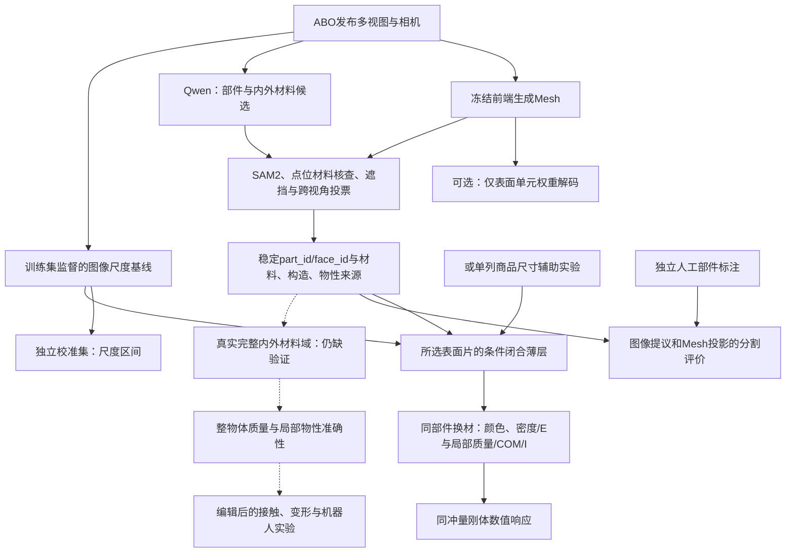

# v0.6.4：部件状态、生成期计算、尺度与局部闭合材料域

这是研究原型的当前实现说明，不是已验证完整论文贡献的声明。
[逐项研究审计](RESEARCH_IDEA_AUDIT_20261107_zh.md)记录原始目标，
[本轮实测结果](results/geometry_physics_20261107/README_zh.md)记录支持范围。

## 1. 保持不变的研究主线



`T` 是已经执行的数据契约。视觉/几何/材料投影到共享潜空间的真实联合模型
仍未训练。`S` 是生成期工程优化；接口、薄结构和物理敏感度共同决定构建预算
的研究机制仍未接入真实解码器，不能用 `S` 代替那项贡献。

## 2. 生成阶段的稀疏计算

`research/sparse_decoder.py` 保留全部三平面采样、SDF 和形变查询，沿用冻结模型
及同一规则网格。只有一个网格单元八个角点的 SDF 同时出现负值与非负值时，
才为该单元运行权重 MLP。其它单元权重置零，不参与表面提取。
这是成熟零交叉判定的应用，不是提出新的零交叉理论。

实现只允许 eval、批量1；原始空场修正会改变 SDF 时明确拒绝使用该替代。
作用域退出后恢复原方法，包含异常退出。稀疏/全量比较共用相同三平面，
暖机一次后交替重复三次，记录几何解码及提取时间、峰值分配和实际单元计数。
另比较拓扑、顶点、体积、COM 和单位密度惯量的数值差异。

结果只支持这个阶段的提速。图像编码、Qwen、SAM2、数据读写等没有获得同等倍数
的端到端加速；三角面数没有减少。最终前端入口：

```bash
python scripts/run_observed_instantmesh.py \
  --scene data/abo500_five/scenes/B013TGFGWS_A1F83G8C2ARO7P \
  --repository external/InstantMesh \
  --checkpoint weights/InstantMesh-observed/instant_mesh_large.ckpt \
  --encoder-config configs/pretrained/dino-vitb16 \
  --output outputs/sparse_sleeve --sparse-surface-weights
```

安装和固定前端资源见 [观察视图入口](OBSERVED_FRONTEND_zh.md)。
物理积分不体素化，冻结前端内部仍查询规则 SDF 网格，不能据此声称整个系统无网格。

## 3. 尺度的两种证据与学习协议

D盘完整 ABO-500 的500对象、15000图像与质量标签已核验；其 `info.json` 是候选材料
和厚度信息，不是内部材料真值。该目录未包含明确的商品尺寸字段。
另从 [ABO官方发布](https://amazon-berkeley-objects.s3.amazonaws.com/index.html)
提取了500对象的 `item_dimensions`，原始归档SHA256为
`b7f7ceacb328fa5ab6e143b88e1f948443a877cfc95b67ff09c8ebabd50644e3`。
只导出尺寸、市场、对象匹配和来源信息，排除 `item_weight` 和包装尺寸。
这些是商品目录信息，仍不是实验室独立测量。

尺寸辅助实验用商品最大边长与生成 Mesh 的最大轴对齐包围盒边长建立统一缩放。
这是近似辅助标定，受商品尺寸误差、朝向和几何重建误差影响；它增加了输入信息，
必须单列为 catalog-assisted，不能冒充纯 RGB 推理。

纯图片尺度基线使用冻结 CLIP ViT-B/16 特征和对数长度岭回归：

\[
\min_{w,b}\sum_{i\in train}(w^Tz_i+b-\log L_i)^2+\lambda\|w\|^2.
\]

采用官方300训练、100验证、100测试对象；验证对象按固定顺序分为50个参数选择、
50个独立校准对象。只在前50个选择正则强度，在后50个计算绝对对数残差的有限
样本保形分位数。测试预测先封存，再评价。长度区间是：

\[
[\hat L\exp(-q),\hat L\exp(q)],\qquad
q=r_{(\lceil(n+1)0.9\rceil)}.
\]

这里使用已有的 split-conformal 方法，不将它当作原创贡献；其统计保证有可交换性
等条件，参见 [Angelopoulos与Bates](https://arxiv.org/abs/2107.07511)。区间只针对商品
最大尺寸，不是材料后验、内部结构概率或整物体物理参数的置信区间。

```bash
# 若还没有384×384派生图片，先准备完整ABO-500。
python scripts/prepare_abo_mass_sft.py --root /path/to/abo_500 \
  --output data/abo500_mass_sft --runtime-root "$PWD/data/abo500_mass_sft"
python scripts/train_image_scale.py --dataset data/abo500_mass_sft \
  --catalog configs/evidence/abo500_catalog_dimensions.json \
  --checkpoint weights/clip/open_clip_pytorch_model.bin \
  --output outputs/image_scale
```

尺度训练只读取上述目录的图片及数据清单，不使用问答中的质量答案。
该模块是尺度支撑基线，不是 Part Token 的多模态联合训练或新的 VLM 微调。

## 4. 部件表面如何连接到闭合材料域

`physics/patch_volume.py` 将所选部件的有向三角面沿公共方向挤出，封闭内外表面与
开放边界。带孔的表面保留孔，不自动填凸包。若公共方向不适用，按26个固定方向
和连通性分片；夹接边界等失败可细分到独立三角柱，再对所有构造片取布尔并集，
最后与外包域取交集。任何输入面都不能被悄悄删去以获得“成功”。

单方向薄层的独立体积检查是
\(V=t\sum_f A_f(n_f\cdot d)\)。厚度是轴向厚度，不是处处相等的法向偏移。
分片的并集避免重复计算重叠材料，孔洞、法向、流形、正体积及两种体积算法的一致性
均有检查。失败会记录为拒绝，不输出貌似合理的物理量。

有向四面体边界积分允许中间项为负，不要求物体是星形；这与把中心连接到全部
表面面片、并将每个四面体当成独立实心材料的“填充”不同。后者可能重叠，
不能通过对每项取绝对值来计算材料质量。当前闭合域仍使用有向边界积分。

每个域绑定原 Mesh 哈希、部件 ID、面标签文件哈希、长度来源和厚度假设。
所有资产的 `evidence` 字段明确标注条件构造。换材复用该域的几何矩，重算局部
质量、COM、完整惯量，并与全量重新积分核对。多部件已知构造的总量组合沿用
`physics/mesh_native.py`；当前真实图像实验仅建立了所选局部薄层，不能把它的
质量标为整物体质量。单一均匀局部域换材通常不会改变其自身 COM。

```bash
# 默认例子为保护套的皮革片；无需GPU，可直接重放。
python scripts/run_conditional_patch_physics.py --piecewise \
  --catalog-dimensions configs/evidence/abo_five_catalog_dimensions.json \
  --output outputs/catalog_patch
python scripts/validate_conditional_rigid_response.py \
  --source outputs/catalog_patch --output outputs/catalog_patch_response
```

默认固定厚度/最大边长比为0.001、0.002、0.005，是公开的敏感性设置，未按测试质量
挑选。`--scale-predictions outputs/image_scale/test_predictions.json` 可替换商品尺寸
输入；两者不能同时指定。尺度区间按立方传到局部质量时，仅表示固定材料和构造下
的尺度不确定性传播，不能称完整质量90%区间。

## 5. 刚体响应验证的边界

`physics/rigid_response.py` 检查质量、惯量正定与主惯量三角不等式，按
\(\Delta v=J/m\)、\(\Delta\omega=I^{-1}(r\times J)\) 给定相同外加冲量，
使用自由刚体欧拉方程和四元数积分，核对世界角动量、能量及四元数范数漂移。
有独立解析球体和非球体守恒测试。

当前实验是局部材料片的零重力运动，无接触、摩擦和变形。它检查代码与物理矩
更新链路，不验证真实材料的 E、摩擦、硬度，也不等价于机器人抓取或 MPM 验证。

## 6. 人工核验与分割指标

```bash
python scripts/build_annotation_pack.py --fields outputs/my_surface_pipeline/refined_fields \
  --output outputs/human_annotations
```

打开 `outputs/human_annotations/index.html`，浏览器可离线运行。页面只显示原图与
固定部件字典，支持画笔、未标注标签、撤销、逐图PNG与核验JSON导出；默认不勾选
“人工核验”。必须由实际标注者完成检查，AI操作页面的功能测试不是人工真值。
关闭页面前需逐图导出文件。部件定义不清楚时先修订统一字典，再开展一致标注。

```bash
python scripts/evaluate_part_annotations.py --fields outputs/my_surface_pipeline/refined_fields \
  --annotations /path/to/human_masks --prediction-source mesh_projection \
  --output outputs/part_metrics_mesh.json
```

评价默认使用 Mesh 逐面标签在对应视角的可见面投影；`--prediction-source image`
单独评价二维提议。核对原图哈希、字典和核验记录；255表示未标注，不当作背景。
同时报告人工前景覆盖率、每类 IoU、边界 F1 和小部件像素数，未标注的案例保持待办，
没有独立真值时不产生准确率。当前15张标注仍待独立人工完成。

## 7. 串行入口与完整复现

先按前端文档生成固定五个物体，采用 `outputs/observed_five/<scene_id>/` 目录。
随后绑定来源与哈希，并执行 Qwen 三视角假设和后续步骤：

```bash
python scripts/build_generated_mesh_manifest.py --runs outputs/observed_five \
  --output outputs/generated_mesh_manifest.json
python scripts/run_local_vlm_pilot.py --model-path weights/Qwen3-VL-8B-Instruct \
  --view-count 3 --output outputs/qwen8b_three
python scripts/run_observed_surface_pipeline.py \
  --predictions outputs/qwen8b_three --model weights/Qwen3-VL-8B-Instruct \
  --sam-checkpoint weights/sam2/sam2.1_hiera_small.pt \
  --clip-checkpoint weights/clip/open_clip_pytorch_model.bin \
  --mesh-manifest outputs/generated_mesh_manifest.json \
  --edit-spec docs/results/surface_physics_20261107/edit_specs.json \
  --conditional-layer-physics --scale-predictions outputs/image_scale/test_predictions.json \
  --limit 5 --output outputs/my_surface_pipeline
```

此入口串行执行7阶段，逐步保留命令、日志、成功与失败状态，不覆盖历史输出。
需要全部对象都已有前端 Mesh、材料假设和尺度预测；它不会伪造缺失资源。
完整安装仍是根目录的 `python -m pip install -r requirements.txt`，推荐 Python3.10。
没有增加新的第三方依赖。训练、投影、数学验证与图像重放的证据范围保持分开。

## 8. 对原研究贡献的影响

- 统一状态与编辑：从表面标签进一步连接到局部闭合域和物理矩，数据流更完整；
  真实整物体内部分区、共享潜空间训练及编辑后实物精度仍未完成。
- 质量与物性准确性：补上可测试的尺度基线及独立尺度校准；完整质量方法尚无分数，
  之前的质量问答 QLoRA 相对误差退步仍保留，不能被尺度结果替换。
- 效率：生成阶段确实减少一部分网络计算，已有真实五物体等价性对照；接口/薄结构/
  物理敏感度的构建预算仍是待验证研究机制，不把已有优化拼成新的独立理论贡献。

最终科学评价仍需独立部件标注、内部结构/材料或力学参考，以及同输入预算的完整方法
和已复现基线对比。任何期刊接受与真实物理精度都不能由软件测试通过代替。
