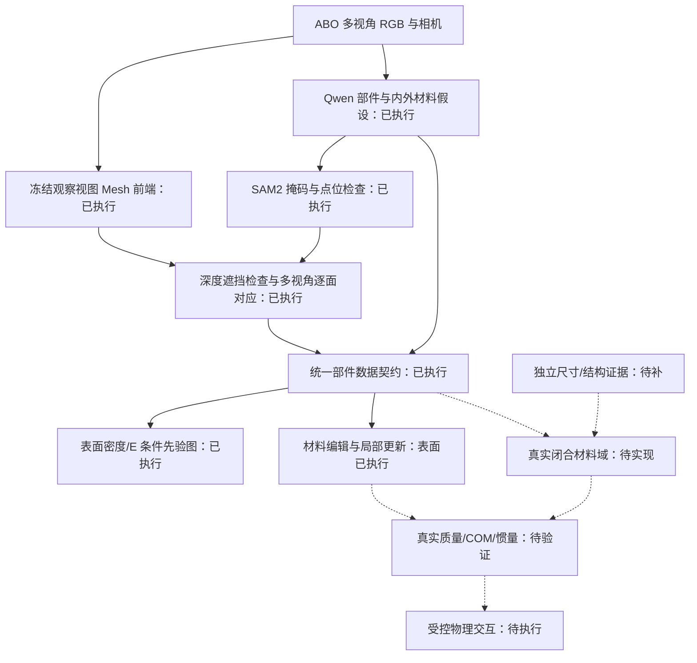

# 面向论文的任务、架构与验证边界

本文档规定拟研究的问题与代码接口，不将尚未完成的机制写成已获得的论文结果。
当前执行状态以 [逐项证据审计](RESEARCH_IDEA_AUDIT_20261107_zh.md) 为准。

## 1. 任务定义与可辨识性

输入为多视角 RGB/前景、相机标定；计算绝对体积时另需独立长度尺度。
输出目标是带稳定部件 ID 的 Mesh、表面/内部材料假设、封闭材料域以及相应物理量，
并支持局部材料编辑。仅凭 RGB 不能唯一恢复不透明物体内部结构，不能唯一确定
密度、质量、弹性或接触摩擦。系统必须允许 unknown 和结构假设区间。

对材料域 \(\Omega_{pk}\)，最终物理量为：

\[
m=\sum_{p,k}\int_{\Omega_{pk}}\rho_{pk}(x)\,dx,\quad
c=\frac{1}{m}\sum_{p,k}\int_{\Omega_{pk}}x\rho_{pk}(x)\,dx,
\]
\[
I_c=\sum_{p,k}\int_{\Omega_{pk}}\rho_{pk}(x)
\big(\|x-c\|^2\mathbf 1-(x-c)(x-c)^T\big)\,dx.
\]

`mesh_native.py` 已实现常密度闭合域的三角边界积分和缓存几何矩。
假设域不相交、单位为米、方向正确；空腔必须从材料体积中排除。
外表的材料标签尚不能定义上述域。所有真实 Mesh 的绝对尺度未核验时，禁止写 m³。

## 2. 总体数据流

拟议的接口/物理敏感度构建预算接入 B 内部；目前只有解析场原型，
不能把完成 B 的上游调用当成这一预算创新已实现。

## 3. 模块与具体程序

| 模块 | 代码入口 | 合同与验证 |
| --- | --- | --- |
| 数据与划分 | `abo500/subset.py`、`prepare_abo_mass_sft.py` | 对象级划分、图像哈希、来源许可，测试质量不进推理 |
| 真实重建 | `run_observed_instantmesh.py` | 冻结检查点、固定输入视角、显式相机变换；留出轮廓检查 |
| 内外材料假设 | `vision/local_vlm.py`、`run_local_vlm_pilot.py` | JSON 类型、候选、矛盾标记与原文留存；不伪造内部真值 |
| 部件对应 | `run_part_surface_maps.py`、`vision/part_lifting.py` | 掩码、深度、法向、视角投票；不可见面保持未知 |
| 冲突拒绝 | `observe_part_points.py`、`refine_surface_conflicts.py` | 可见点材料假设、重复与嵌套掩码；不使用质量标签调整 |
| 表面编辑核心 | `physics/surface_edit.py` | 验证后生成独立副本；目标外属性不变；不制造体积与质量 |
| 真实表面可视化 | `render_surface_maps.py` | 绘图使用编辑核心结果，导出数组、CSV、PLY、Token和图 |
| 串行入口 | `run_observed_surface_pipeline.py` | 已生成Mesh→定位→SAM→材料点位→冲突拒绝→编辑；逐阶段日志与失败停止 |
| 封闭域计算与增量更新 | `physics/mesh_native.py` | 独立解析解对照、几何域不相交、完整惯量验证 |
| 质量微调 | `training/train_vlm.py` | 答案 token loss、独立适配器、对象级训练/验证/测试 |
| 对照协议 | `run_nerf_cached_baseline.py`、`compare_available_baselines.py` | 原始官方函数、缓存输入哈希、预测封存、缺方法不填分 |

部件契约至少记录 `part_id`、`part_index`、Mesh 哈希、可见面索引、材料/内部构造
假设、物性来源、尺度状态和闭合域状态。编辑改变对应字段和逐面数组，
不会悄悄改变面索引。结构、几何改变时必须使相关几何缓存失效，不能复用旧体积。

这里的数据契约可运行；拟议的 \(P_v(F_v),P_g(F_g),P_m(F_m)\) 与融合 Token
是另一项需要训练、消融和标签的研究机制，尚未实现为真实共享潜空间。

## 4. 稀疏构建的正确研究问题

目标不是让所有三角形变大，而是在固定预算下保护部件边界、薄结构与物理矩。
候选重要性应分别反映曲率/误差、部件接口不确定性、薄结构与体积/惯量敏感度，
并受全局几何与物理误差上界检查。少数连接处不一定曲率高，不能只看二面角。

必须比较：均匀构建、纯几何预算、QEM、加入接口、加入物理敏感度。
先固定总面数，再固定实际耗时进行两组实验，报告峰值显存、前端耗时、几何误差、
部件边界、薄结构召回、体积/质量/惯量误差。当前解析场原型有全局体积退化，
所以先修复误差控制，再接入真实前端，而不是把失败原型改名为已验证创新。

## 5. 学习目标要对应监督

当前真实 VLM 训练是标准答案 token 的监督微调，不是已经实现端到端物理损失。
后续可在有相应训练真值时研究：

- 部件标签监督：交叉熵、边界项；没有标注时不能称 supervised segmentation。
- 质量监督：预测正质量或对数质量，采用稳健对数误差，避免只优化重物的 kg 误差。
- 几何监督：标定相机下轮廓/重投影与独立表面参考，尺度必须一致。
- 编辑监督：独立构造的编辑后质量/响应与目标外不变约束；不能用自己的积分结果
  同时作标签与“独立真实准确性”验证。
- 结构合法性：闭合、不相交、非负密度与厚度、空腔不计材料质量。

总质量不能唯一监督多个部件的密度和体积，更不能唯一监督 E、摩擦和恢复系数。
需要单独的结构/材料证据或力学试验；增加任意 loss 权重不会解决不可辨识性。
物性不确定性应在独立校准集上评价区间覆盖、区间宽度与分布评分，VLM 自报数字
和 SAM 分数都不能直接当作校准概率。

## 6. 拟议贡献与可否写入论文

1. **统一部件构造状态下的可解释物理估计。** 需要证明结构域和材料联合表示
   比单一表皮/查表的质量、物性与不确定性更好；当前未完成真实域与公平精度验证。
2. **局部可编辑且物理量一致更新。** 闭合已知构造上的正确性已验证，真实表面
   局部换材已执行；还需真实编辑参照与质量/COM/惯量精度及更新代价比较。
3. **接口与物理敏感度驱动的预算分配。** 属于独立研究假设，需要进入真实构建
   并通过等预算消融。现有缓存投影和调用上游 SAM2 均不属于这一原创贡献。

三项不能仅凭“组合了若干模型”成立。论文是否具备新颖性要查相邻工作、完成受控
机制验证和独立实验，不能保证期刊分区或接收。

## 7. 最低实验矩阵

| 问题 | 最小有效对照 | 指标 | 目前缺口 |
| --- | --- | --- | --- |
| 分割是否正确 | 自动方法 / 无冲突拒绝 / 人工 oracle | mIoU、Boundary-F1、小部件召回 | 无独立部件标注 |
| 内部建模是否有价值 | 全实心 / 单壳 / 多层域 | ADE、APE、对数误差、区间覆盖/宽度 | 独立尺度与内部结构 |
| 质量是否领先 | 同视角同尺度的已复现方法 | 对象级 ADE/APE/ALDE，预先固定失败处理 | 完整方法尚无真实质量输出 |
| 局部编辑是否正确 | 全量重算 / 局部增量 | 编辑后质量/COM/I误差、更新耗时、目标外变化 | 真实编辑参考 |
| 稀疏预算是否有效 | 等面数、等耗时的四类预算 | 几何/边界/物理误差及资源 | 未接真实解码器 |
| 物理交互是否有效 | 相同接触、初始条件和求解器 | 位姿/轨迹/力响应误差 | 实测与仿真验证器 |

开发集用于定位错误；不得在这五个开发物体上改完阈值后，把它们称作盲测。
训练、校准、验证、最终测试分别封存；没有运行的基线和指标一律保留为空。
