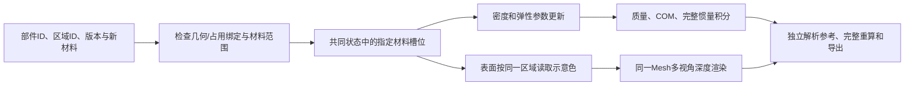

# 材料编辑第一版：区域、颜色和物理状态同步

2026-11-04，PartPhy3D 0.5.1。研究范围固定为：**指定部件材料区域，保持几何和
宏观占用不变，替换材料参数，并从同一Mesh重渲染示意色。** 不自动改变壁厚、
连接件或结构，也不以换色证明材料预测准确。

## 运行

完成根README的CPU安装后，在项目根目录：

```bash
python scripts/edit_material.py --output outputs/material_first
```

默认使用已知设计尺寸的四腿凳；无需数据集、模型或GPU。也可显式读取编辑JSON：

```bash
python scripts/edit_material.py --plan examples/material_edit_chair.json \
  --output outputs/material_json
```

重放导出的绑定资产和编辑：

```bash
python scripts/edit_material.py --asset outputs/material_first/before \
  --plan outputs/material_first/edit_spec.json --output outputs/material_replay
```

`partphy3d-edit-material`是安装后的同等命令。
`scripts/reproduce_all.py`也会运行本实验，输出到其`bound_material/`子目录。

## 指令与数据流

```json
{
  "target_part_id": "front_left_leg",
  "target_region_id": "bulk",
  "expected_part_version": 0,
  "new_material": {
    "name": "aluminum",
    "density_kg_m3": 2700,
    "youngs_modulus_pa": 69000000000,
    "poisson_ratio": 0.33,
    "display_rgba": [170, 185, 200, 255],
    "source": "specified_design_preset_not_measured"
  }
}
```

`part_id`选部件，`region_id`选该部件内材料区域。材料名称可以变化，区域通过稳定
的材料槽位关联占用列，不能因名称改变而丢失。当前每个槽位绑定一个区域；不做
隐式材料合并。指令包含预期部件版本，避免旧选择覆盖新的编辑。



颜色和物理参数保存于同一个`Material`记录，不在渲染器另建独立材料表。密度
可以是原有单元字段；弹性参数当前为区域级标量。E与泊松比表示声明的各向同性
材料诊断参数，不代表木材各向异性、接头强度或物体整体刚度。摩擦需要接触材料
对，硬度需要量表，因此本版不填任意默认值。

## 体积与表面对应

`MaterialRegion(part_id, region_id, material_slot)`把材料区域关联到
`PartPhysicalState.fractions[:, material_slot]`。`BoundSurface.face_regions`
将每个三角面关联到区域编号，允许内部区域没有外表面。

因此，外层换材只改变对应外表面；内部填充换材可以有质量变化而没有外观变化。
空腔不能作为正密度材料替换目标；删除或填实材料属于构造编辑。

绑定保存几何/占用/实例签名。姿态、构造、占用或实例变化后，旧表面绑定失效；
本版不会凭旧对应继续着色。签名只检查**后续状态一致性**，不证明初始人工或模型
标注正确。初始分割、相机配准和表面-内部区域对应仍需独立检查。

已有真实物体的体积状态和注册Mesh，可以通过Python建立资产：

```python
from pathlib import Path
import numpy as np
from tactile3d.mesh.io import load_triangle_mesh
from tactile3d.physics.part_io import load_object
from tactile3d.physics.material_binding import (
    BoundSurface, MaterialRegion, geometry_signature, save_bound_asset,
)

state = load_object("data/object_physical_state")
mesh = load_triangle_mesh("data/registered_metric_mesh.ply", process=False)
regions = (
    MaterialRegion("seat", "cover", 0),
    MaterialRegion("seat", "filling", 1),
    MaterialRegion("leg", "bulk", 0),
)
face_regions = np.load("data/face_regions.npy", allow_pickle=False)
surface = BoundSurface(
    mesh.vertices, mesh.faces, face_regions, regions,
    geometry_signature(state), "independently_checked_region_annotations",
)
save_bound_asset(state, surface, Path("data/bound_object"))
```

例中区域ID、槽位和文件必须对应实际数据；逐面标签不能有未标注的`-1`，坐标
必须为共同世界坐标的米制。没有这些数据时，不自动用包围盒或外表面替代内部。

## 输出与验证

| 产物 | 内容 |
| --- | --- |
| `before/`, `after/` | 物理JSON/NPZ＋表面NPZ＋区域绑定与哈希 |
| `before.ply`, `after.ply` | 同一几何、不同指定材料示意色 |
| `edit_spec.json` | 可重放的明确编辑，不依赖自然语言歧义 |
| `material_edit_views.png/svg` | 三个视角的编辑前后图，像素坐标轴 |
| `view_XX_face_ids.npy`, `view_XX_target.png` | 可见三角面ID与目标可见区域 |
| `material_edit_physics.png/svg` | 总质量、三轴COM和声明的目标E变化 |
| `physics.csv` | 两个状态的质量、COM、完整3×3惯量 |
| `report.json` | 新旧材料、区域体积、质量变化、缓存和逐视角检查 |
| `status.json`, `SHA256.json` | 完成/失败状态及产物哈希 |

默认凳子5个已知盒体：座面密度600kg/m³，腿650kg/m³；左前腿替换成2700kg/m³。
尺寸与参数都是设计预设，不是ABO或实物测量：

- 原始总质量5.120kg，编辑后6.432kg，增加1.312kg。
- 目标占用体积0.000640m³，质量变化等于区域体积乘密度差。
- 左前腿12个表面三角形换色，其他部件状态和面颜色不变。
- 单部件重算与完整重算的质量和原始质量矩一致。
- 原始/编辑的质量、COM和完整惯量与独立盒解析参考匹配。

测试另外覆盖：内部换材不染外表；旧版本、错误区域、过期几何、损坏文件拒绝；
颜色/物理属性往返保存；旧schema 1加载而不伪造弹性参数。新物理schema为2。

像素级“非目标变化为零”依赖本版固定光照、固定相机、不计算全局阴影/反射。
真实PBR中材料变化可能影响邻近反射，这个零变化指标不能原样套用。当前图是
示意色渲染，不宣称照片级材质真实性。

## 论文定位与后续

这项实现验证编辑数据流和计算一致性，不能单独证明创新或真实物理准确性。
科研主张仍是：独立编辑响应监督能否约束共享构造状态，改善原始与编辑后物理
预测。需要真实/CAD配对参考、仅原始监督、直接编辑回归、直接占用监督等对照。
局部缓存只在依赖不变时复用，不声称全局应力或学习特征永远不受影响。
默认验收还计算全域几何签名并执行完整重算核对，当前不提供端到端加速结论。

接真实分割和重建时，先核验区域绑定，再测准确性；保持十物体开发队列，保留
失败。当前不要求重训练大模型，服务器连接后再逐项核验真实模型。

## 编码规范与依赖

新增模块按Black、88字符行宽维护；函数有类型提示，重要入口和契约有中文
Google风格docstring。中文行内注释解释公式、可见性和边界假设，不逐行复述操作。
灯光、分辨率、容差、材料预设和示例几何集中于各模块头部。

本实验运行使用NumPy、SciPy、trimesh、Pillow、Matplotlib，均是项目已有依赖。
Black、Ruff、pytest是开发检查工具，不需要torch或CUDA。
