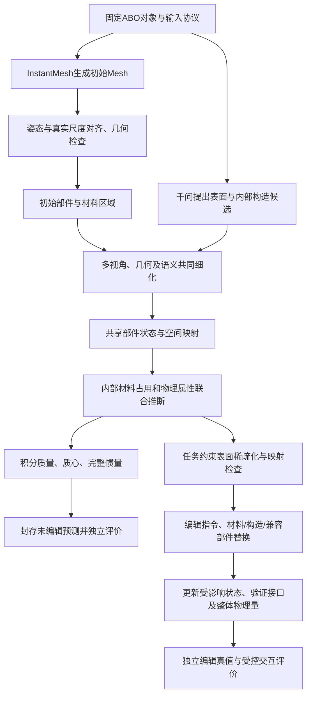

# PartPhy3D逐步方法审阅：做什么、改什么、如何证明

同日后续澄清：粗细分配的研究目标包括最终Mesh生成/构建，当前后处理QEM只作
基线。材料编辑先提供可见的颜色替换预览，详见
[生成阶段与颜色预览补充](generation_and_material_preview_2026-11-04_zh.md)。

日期：2026-11-04。本文将当前设想展开为可讨论的科研方案，并区分工程基础、
拟研究机制及现有证据。它没有新增模型运行或训练结果，不代表已经完成查新或
证明创新。现有执行主线仍是InstantMesh固定前端，物理估计与部件编辑是重点。

## 0. 研究问题与最小范围

研究问题：从物体外观和可声明的几何/尺度证据，建立可解释的部件内部构造与
物理状态，使未编辑物体的质量估计准确，并在材料、构造或部件替换后正确更新。

第一版主结果为原物体质量和编辑后质量；质心、完整惯量是结构与交互指标。
杨氏模量、摩擦、硬度等保留为局部属性方向，需要相应独立标签后评价准确性。
精细分割、统一映射和稀疏化服务这条主线，不将每一个基础工具都独立包装为贡献。

当前三个候选研究点：

1. 部件内部构造与材料/密度的受约束联合推断，改善原始质量及可验证局部属性。
2. 可追溯共享部件状态及编辑条件下的同步更新，保持编辑后物理准确性并减少重复处理。
3. 在接口和物理误差预算下的表面网格简化，减少特定下游算子的成本。

第三点先作为效率模块，是否单列贡献由实现差异、相关工作及实验决定。



训练是上述推理图之外的离线阶段；测试时不能读取真实质量选择构造或壁厚。

## 1. 数据：先保证输入条件和评价条件可以追溯

### 要做什么

对每个固定开发物体保存ID、重建输入图、原始证据视角、相机、掩码、尺度来源、
允许的类别/文本信息。真实质量和用于诊断的官方Mesh单独存放。

本地ABO-500包包含多视角数据和点云等文件，不能把无face的PLY当三角网格。
另行下载的官方GLB可用于物理模块诊断，主流程仍使用生成Mesh。

### 改进与原因

从“给一个数据目录就跑”改为固定输入清单和显式数据来源。分开两条轨道：
生成Mesh轨道测整个系统，参考Mesh轨道定位物理模块的误差。
同数据集但使用不同视角、尺度、几何或训练监督，不自动构成公平对照。

VLM输入不包含真实质量、质量区间或可直接读出质量的产品文本。尺寸若作为
输入则明确披露。尽量不用精确商品ID诱导模型检索记忆中的产品重量。

### 输出、验收、当前状态

目标输出为输入清单、输入文件哈希、评价标签清单。固定10物体已有开发选择；
完整真实模型路径尚未跑通。这10例已经参与开发，不再冒称独立未见测试。
正式评测遵守训练/验证/留出边界，缺失或失败不能通过取交集隐藏。

## 2. 重建：固定前端，检查结构错误，不与物理贡献混淆

### 要做什么

第一版固定[InstantMesh](https://github.com/TencentARC/InstantMesh)的权重与配置，
从按规则选定的图像生成初始Mesh，保存辅助生成图、原始Mesh及失败日志。
由模型生成的其他视角不是新的独立真实观测。

### 改进与原因

不立即重训大型重建器。先检测缺腿、薄板粘连、孔洞被封、靠背与支架合并等
会破坏物理估计和编辑的错误。后处理不能用凸包将所有空隙填满并声称恢复真物体。
轻微拓扑修复与推断隐藏制造构造分开记录，保留修复前后网格。

### 输出、验收、当前状态

输出原始Mesh、几何检查报告和可选修复Mesh。检查坐标/三角面有效性、退化、
自交、法向、连通和薄结构。水密仅说明外壳闭合，不代表内部实心或结构正确。
有参考几何时评表面距离、法向和轮廓；缺件等失败单独报告。
当前10例旧实验使用参考GLB，尚未实际执行InstantMesh路径。

## 3. 尺度与多视角对齐：绝对质量的前提

### 要做什么

将规范化Mesh对齐到数据相机，并依照明确可用的真实尺寸建立米制尺度。
记录坐标变换、相机裁剪/缩放后的内参及对齐残差。

### 改进与原因

使用可见轮廓、可靠图像对应和允许的尺寸证据，不在主轨道暗中读取参考Mesh
包围盒或体积完成校准。尺度不足时不能将规范化体积解释为立方米。
若只能依赖类别尺寸先验，就要报告先验和尺度不确定性。

对于相同形状，长度放大s倍、体积与均匀密度质量放大s³倍。长度偏大5%时，
质量可偏大约15.8%。因此不应将尺度误差全部归因于材料识别。

### 输出、验收、当前状态

输出米制Mesh、变换及尺度来源、多视角叠图。检查轮廓/对应残差，并分别做
固定正确尺度与预测尺度的误差分析。没有可靠绝对尺度的对象标记条件不足。
此前参考资产对齐不等于生成Mesh已经完成此步骤。

## 4. 分割：分别维护部件、材料区域与连接关系

### 要做什么

以[PartField](https://research.nvidia.com/labs/toronto-ai/partfield-release/)等模型
提供初始部件特征与层次分区。SAM类方法可以辅助二维边界，但不能仅靠二维
分割判断隐藏骨架、空腔或真实制造连接。

维护三个对象：可编辑部件身份、部件内部的材料/构造区域、部件之间的接口图。
四根木腿是四个可独立编辑的部件，可以共享一个材料类别；一块沙发坐垫可以
是一个部件，却包含皮革、泡沫和支撑层。两种分割不能用同一个标签数组替代。

### 改进与原因

在初始分区上引入几何边界、原始多视角可见边界、薄结构、材质变化及语义证据。
每个面聚合证据时过滤遮挡与不可靠投影，避免背景被投到背面。
候选细化可使用图优化/轻量预测头，但这些基础算法本身不认定为创新。

语义可拆分误合并的椅腿，也可合并同一靠背上的纹理碎片；几何则限制标签
跨越明显间隙。不能强制“同一材料必须为一个连通部件”，也不能把颜色变化
全部当成可拆装边界。

接口至少记录相对位置、方向、范围、连接类型及来源。第一版已知固定接口，
其他关节、接触、连接强度未知时保持未知，不自动当作焊死。

### 输出、验收、当前状态

输出部件标签、材料区域、置信/歧义图和接口图。用人工部件/材料参考分别计算
IoU、边界F-score，并放大连接处和薄结构。给出初始分割与细化后的对比。
现有10例的几何/颜色聚类不是语义分割真值；真实部件模型与细化尚未完成。

## 5. 千问：提出结构化候选，而不是自由猜到质量满意

### 要做什么

先询问全物体类别与大致构成，用于初始分区的语义解释；再对部件局部视图、
全局上下文及几何摘要询问表面材料、隐藏材料、空实心、层次、壁厚候选和依据。
全局建议与部件细化可以形成有明确预算和停止规则的迭代。

示例沙发坐垫候选：外皮+泡沫；外皮+泡沫+弹簧；织物外罩+纤维填充。
框架作为独立区域/部件建模，不能把整件沙发简单当成同心皮革层。

每个候选包含可见证据、常识先验、不可见假设、参数单位/范围及来源。
首轮可只保留少量候选，以验证复杂构造是否比实心/薄壳基线更有用。

### 改进与原因

从“VLM说木头→查一个密度”改为表面/内部/支撑结构分离的候选空间。
类别置信度不等于材料体积分数；模型自述0.8也不自动是校准概率。
多次问同一模型、生成相似视角并不是独立证据，不能不断相乘制造过窄区间。

重复问答和让模型自评不是独立验证；第一版不加奖励学习。若后续QLoRA，
以训练集构造标签或已知构造的合成数据监督结构化回答，而不是将另一模型
的猜测全部当作真实内部。

### 输出、验收、当前状态

输出构造候选与参数来源。检查格式、遗漏、单位、同义材料和候选数量；有
内部参考时评价候选覆盖与构造分类，没有参考就不能评价“真实内部恢复率”。
千问真实调用和微调尚未执行。

[Gen2Physics](https://arxiv.org/html/2608.23869v1)已经研究Mesh材料分解与VLM
空实心/壁厚推断。因此“Mesh加VLM猜内部”不足以区分我们的贡献。

## 6. 统一表示：空间对应、显式物理字段和学习特征各司其职

### 要做什么

组织为Object→Part→ConstructionRegion→VolumeCell，另外维护跨部件接口图。
部件具有稳定槽位ID、实例ID、版本、局部坐标系、几何支持、材料/构造及物理场。

同一位置的信息必须通过像素→可见Mesh面/表面锚点→部件局部坐标→体积支持
建立对应。不能把RGB的一个768维向量和另一部件的512维Mesh特征投影后就称对齐。

学习式投影可表示为：

```text
z_visual = P_visual(F_visual)
z_geometry = P_geometry(F_geometry)
z_semantic = P_semantic(F_semantic)
z_part = Fusion(z_visual, z_geometry, z_semantic, spatial_correspondence)
```

Token用于推断；真实尺度、占用、密度单位、接口和积分结果仍保留为显式字段。

### 改进与原因

每条信息记录observed/inferred/edited来源、证据版本及依赖。
用户将木腿改为钢腿之后，旧照片的木纹不应覆盖明确编辑；目标旧视觉/融合特征
失效或标为原始状态证据。新的合成渲染也不能冒充真实观测。

减面后旧三角形ID失效，需要重新建立受部件身份、法向、距离、可见性限制的
表面对应。donor替换保留安装槽位ID，但新实例ID、几何锚点和构造属于新部件。
相邻薄层之间的普通最近邻只能作为基线。

### 输出、验收、当前状态

输出共享部件状态、对应、版本及依赖清单。比较独立模块、字段直接拼接、
空间对应+学习融合的消融；检查同点匹配误差、错配率、编辑后无关部件漂移，
最终仍看质量、分割和编辑物理误差。

当前显式状态、共同体素域、版本与缓存已实现；同部件近邻绑定仅为近似。
学习式融合、可靠跨LOD锚点迁移及完整全局依赖传播尚未完成。

## 7. 内部构造与物理联合推断：主要研究工作

### 要做什么

从部件Token、几何尺度、候选构造和材料先验共同预测构造、参数及不确定性。
先支持实心、封闭薄壳、外层+填充等少量可解释构造；骨架另用已声明候选区域
或模板表示，不把所有内部结构强行当均匀填充率。

外几何域与材料占用分开：几何域内可以是材料或空腔。对每个单元，含空腔的
各材料占用alpha非负且总和为1；材料类别不确定性在构造候选/采样中表达。

```text
rho_eff(x) = sum_k alpha_k(x) * rho_k(x)
m = sum_cells rho_eff(x) * cell_volume
```

### 几何约束

占用不超出允许域，部件材料不重复计量，内部层不穿出外壳，壁厚可由离散网格
分辨，接口有实际材料支持；薄结构、孔洞、材料区域与多视角可见证据一致。
完整矩形域可用明确内腔做精确盒壳；一般曲面需要合法内偏置/距离场和自交检查。
不能用任意包围盒填补缺失几何并称作内部构造恢复。

水密Mesh可在一致面朝向下用有符号四面体体积积分，内腔边界需正确朝向；
开放、自交或错误补全几何不能据此获得可信体积。复杂多材料情况优先以占用
场表达，再做网格分辨率收敛检查，而不是默认一切按表面材料实心化。

### 物理约束

密度和材料参数具有合理定义域，质量为有效密度积分，质心和惯量由同一空间
分布得到。泡沫表观密度已经包含微孔，不再按同一微孔额外扣一次占用。

杨氏模量是材料与状态相关参数，结构刚度还取决于几何、边界和载荷；复合材料
不能把各层E任意体积平均便当作真实等效模量。摩擦是接触对/状态属性，不是
每个内部体素统一使用的固有常数。无对应实测时只输出先验/预测标签。

### 怎样训练与验证

先固定基础模型，只训练小型融合与构造/参数预测模块。训练总质量损失可用
预测积分质量与训练标签的对数误差；有部件构造、局部属性、对应及编辑配对
参考时再加入相应监督，缺失项用标记屏蔽，不补成假真值。

外轮廓不能区分隐藏构造；训练总质量也可能被密度和占用相互补偿。因此需要
已知构造合成数据或独立内部标签，评价隐藏参数而不只看总质量。
如果这些证据不足，结论只能收敛到质量估计或候选不确定性，不能声称内部真实恢复。

[VoMP](https://research.nvidia.com/labs/sil/projects/vomp/)已有体积物理场和多视角
特征融合；[PhysGS](https://samchopra2003.github.io/physgs/)已有不确定性推断。
因此融合、体素场、概率分布本身都不是充分创新。需验证构造约束与可编辑状态
如何实际改善任务，并与这些近邻方法定位差异。

当前存在规则构造先验与密度场积分；上述学习式联合机制未实现。旧10例构造
先验并未全面优于仅薄壳，不能预设加入更多隐藏层一定改善质量。

## 8. 原物体质量、质心、惯量及不确定性

### 要做什么

用统一场积分质量、一阶矩和二阶矩，再恢复质心与完整惯量张量。
有限体素保留自身尺寸产生的惯量，所有部件在共同世界坐标下合并。
测试质量标签不进入推断；未编辑预测在评分和编辑前封存。

需要概率输出时，联合采样构造、材料参数、占用和尺度，保留相关性。
每个样本产生一组m/COM/I，再汇总分位数；点估计规则在验证集确定。
同一材料共享密度变量、同一尺度共享缩放时，不能将各部件全部独立采样。

### 改进与验证

原物体主表使用ADE、ALDE、APE、MnRE，并保留逐对象误差和失败。
对概率输出报告区间覆盖与宽度，并在独立验证协议下使用适用的分布评分；
区间很宽导致覆盖高不说明有用，自述范围也不能写成q05/q95。
COM、惯量有解析/可靠参考才评价准确性。质量正确不代表它们正确。

当前确定性积分通过解析检查，主表与固定清单入口已实现。当前采样先验不是
已校准后验；没有局部/内部真值的ABO对象不能获得这些变量的准确性成绩。

## 9. 自适应表面稀疏化：减少哪里、保护哪里

### 要做什么

在部件/材料/接口信息可信后，用边折叠等已有简化算子减少表面面数。
平坦、同材质、低影响区域多减面；薄壁、孔边、曲率变化和安装接口少减面。
“粗面/细面”用实际保留面数与误差表述，避免歧义。

大三角形通过简化产生，不是把外轮廓膨胀。可先锁定可靠接口/边界，再研究
质量矩变化与局部属性影响如何参与候选选择及预算分配。

### 改进与原因

以[QEM](https://www.mgarland.org/research/quadrics.html)为基础，研究在相同面数
下如何更好保留物理处理所需的信息。只检查整体体积可能保住总量却损坏细腿
和接口，因此还检查边界、薄结构、COM和完整惯量。

使用低成本敏感度近似选择候选，必要时完整核对；如果每次折叠都重新运行所有
模型或全体体素积分，新增开销可能抵消收益，需要测量并允许方法失败。
不可把不可靠初始分割的所有边界都锁死，否则会固化错误。

### 对照、验收、当前状态

比较原网格、普通QEM、几何边界保护、物理/接口约束四组；至少保留前三类核心
中的原网格、普通QEM和拟议方法。扫描实际面数预算，既比较同面数精度，也比较
同误差成本，报告预处理、映射、下游投影/查询/编辑及总耗时。

表面减面不自动减少体素、MPM粒子或VLM计算。复用原物理场时质量不变是设计
结果，只能验证几何查询和编辑收益；将减面用于重新建场需另行独立积分评价。

[AdaVoMP](https://research.nvidia.com/labs/sil/projects/adavomp/)已有自适应体积
物理场，表面简化需明确区别，不能仅靠“稀疏”命名主张新颖性。
当前有普通QEM及全局物理代理筛选，局部任务约束方法和端到端加速尚未验证。

## 10. 编辑：从目标条件到构造与物理状态同步

### 要做什么

分三类操作：材料改变、内部构造改变、接口兼容部件替换。
明确目标槽位和版本；换钢不自动空心，壁厚和新形状需要明确要求或有来源的候选。
材料编辑通常不必重新体素化；几何支持、空腔或层次发生变化才更新相应离散域。

新部件对齐安装坐标系并检验尺寸、接触与重叠；槽位ID保持，实例ID变化。
表面渲染材质可随后同步，但渲染颜色不能替代密度场与质量变化。
首次限定兼容donor，不强加任意自由形状生成或自动强度设计。

### 改进与原因

共享状态记录每个算子依赖，识别真正受影响的字段。目标材料变化使目标物理
及旧融合特征失效，其余输入未变的部件可复用。若网络使用全局注意力或求解
全局应力，改变一个部件可能影响全部，不能强行只更新邻近两三个部件。

对无重叠部件的原始质量矩(m,s,Q)，可减去旧贡献再加入新贡献，恢复整体COM/I。
这是已有积分可加性，不将其公式单列创新；需要研究和验证依赖识别、映射及
构造同步带来的实际收益。现有引擎仍做全局网格/接口检查，不能称全程只计算目标。

若命令要求减重同时维持承载，需要明确载荷、材料模型和强度/稳定性求解；
单凭密度比例不能自动设计安全壁厚。该功能不纳入第一版自动几何适配。

### 验证与当前状态

分别比较仅改外观、只改参数不改构造、完整重算和同步增量更新。
评价独立编辑后质量、COM/I、接口误差、无关部件漂移、失败率及总时间。
相同状态下完整重算是数值参考，不是现实准确性的真值。

现有指令程序已支持受限中文和严格JSON、连续编辑回滚、版本检查、实际donor
快照、保存/重放、确定性质量矩和盒壳边界。39项相关测试及独立CLI重放通过。
当前不支持任意姿态重体素化、自由分层编辑、学习式更新、强度和联合不确定性同步。
演示10mm体素不能表达2mm壁厚，实际物体还需要选择可分辨网格及收敛验证。

## 11. 交互与真实验证：区分数值正确、预测准确和控制有效

### 数据与实验分工

ABO用于原始物体质量；已知构造合成数据用于内部场和编辑解析参考；
小型可拆装实物用于真实材料/结构变化的独立称重与适用的局部属性测量。
原物体ABO重量不能当作编辑后重量。合成结果也不能自动证明实物泛化。

先做固定参考参数和外力/接触条件的刚体实验，检查质心、惯量、质量和摩擦
造成的受控响应；再根据机械臂条件设计相同控制器/轨迹下的演示。
自由落体动画不能证明质量估计准确，预测参数在自身仿真中运动也不构成验证。

若主张E准确，需要适用的变形参考、力—位移和边界条件；MPM/FEM只是求解工具，
没有独立参考的压缩动画不能证明材料模量真实。刚体软件跑通不能验证柔性参数。

“连接处好不好”先分为几何装配是否合格与载荷下是否可靠。前者用对齐、穿插、
接触检查；后者需连接形式、载荷与力学/实物数据，现有程序不做强度认证。

### 需要的图和表

| 输出 | 要表达的证据 |
| --- | --- |
| 流程图 | 基础工具、我们的方法与评价数据分开 |
| 原图/生成Mesh/对齐叠图 | 外形及尺度是否可靠 |
| 部件与材料分割、接口放大 | 分清制造部件、材料和薄结构 |
| 内部剖面与候选不确定性 | 展示构造假设，不把假设标成真值 |
| 密度/可评价局部属性图 | 统一单位、色标，未知或先验明确标记 |
| 原物体质量散点和主表 | 同对象、同协议的真实误差 |
| 编辑前后几何、剖面、质量/COM/I | 同步更新效果与独立参考 |
| 速度—误差、面数—误差、阶段耗时 | 简化与缓存是否真正值得 |
| 消融及失败案例 | 哪个机制起作用、在哪些对象失效 |

### 当前执行与下一顺序

当前真实模型、论文基线、任务约束稀疏化和交互均未完成。先解决一个开发物体
的真实模型链、尺度、可检查部件和构造；然后处理同一固定10例并定位误差。
在训练/验证数据上逐项训练和比较小模块，确认哪些机制有效，再完成消融及
留出测试评测。几何尺度、积分或输入对应尚未可靠时，先定位这些错误，不用
QLoRA、完整数据集或MPM掩盖基础问题。

用户提过的专业知识与心理物理数据可以保留，但监督目标分开：密度、质量和
力学参数对应物理测量；主观软硬、触感与舒适度对应感知评分。后者可用于附加
感知预测或编辑偏好，不能直接充当真实E、密度或质量标签。第一版不强制加入
该分支，以免和机械臂、柔性仿真、基础模型微调一起扩大范围。

服务器队列仍处于用户暂停状态；本文不是启动训练、GPU测试或操作其他进程的授权。

## 12. 贡献、对应实验与停止条件

| 候选贡献 | 对应步骤 | 最小可证实内容 | 不成立时的处理 |
| --- | --- | --- | --- |
| 构造感知联合物理估计 | 4—8 | 原物体质量改进；有参考的内部/局部属性也改进；去构造/几何/融合消融 | 若只是密度补偿或隐藏参数不可识别，收缩主张或改机制 |
| 统一状态下的部件编辑 | 6、10—11 | 编辑后独立物理误差、映射可靠性、更新代价均有依据 | 若仅有JSON与缓存，作为工程基础，不单列方法贡献 |
| 物理与接口约束稀疏化 | 9 | 同面数更准或同误差更省，完整计入预处理和失败 | 若无净收益，作为负结果或可选优化，不硬凑贡献 |

基础数学正确→真实模型可运行→明确机制有效→独立测试泛化，四个层次逐级
验收。论文定位需要最终证据与相关工作差异，不能从模块数量或39个软件测试
推导IEEE Transactions录用或分区。

关联实现：[编辑模块](edit_commands_2026-11-04_zh.md)、
[统一状态契约](part_state_and_edit_contract_zh.md)、
[稀疏化协议](physics_lod_protocol_zh.md)、
[比较入口](comparison_implementation_2026-11-03_zh.md)。
