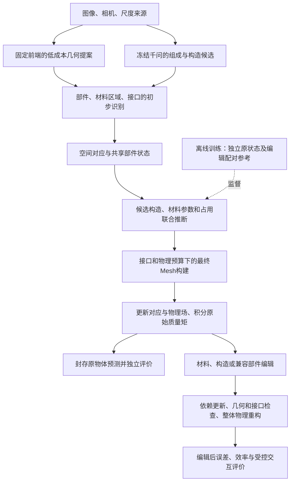

# PartPhy3D完整研究设计草案

日期：2026-11-04。状态：研究设计，未经完整训练和实验验证。

本文件按讨论中的研究目标设计，不以现有代码的完成范围为边界。新增的编辑响应监督、
可辨识性分析和构建预算设计均为待验证建议，不表示已经证明原创性、超过基线或获得
期刊接收。软件单元测试通过与科学假设成立分别记录。

## 1. 任务与范围

研究从图像、相机和明确披露的尺度证据推断可编辑部件物理状态。第一目标为未编辑物体
的质量准确性；第二目标为材料、构造或部件改变后的物理准确性。质心、完整惯量及接口
支持结构解释和交互，计算效率作为受精度约束的目标。

第一篇以刚体质量分布为主。密度是核心字段；杨氏模量、摩擦、硬度可在有相应独立参考
的子集上评价。不给未测量属性填写准确性分数。没有触觉输入时，将任务称为视觉物理
属性估计与可编辑资产构建；触觉／机器人交互属于另行披露的验证条件。

原物体、编辑后的对象、物理模块诊断和端到端生成几何分开评价。复杂沙发适合作为展示
和挑战案例；机制验证先使用构造可核验、部件可独立替换的对象。

工作标题可暂用：PartPhy3D: Construction-Aware Physical Estimation and Part Editing
with Shared Physical States。标题不宣称已完成或首次提出。

## 2. 需要验证的研究假设

| 假设 | 新增机制 | 成立所需证据 | 不能支持的情形 |
| --- | --- | --- | --- |
| H1 | 构造受约束的共享部件状态，同时接受原状态和独立编辑响应监督 | 同等数据和预算下，原质量、内部参考和未见编辑准确性改善 | 只增加训练标签或直接体积监督便获得相同结果 |
| H2 | 同一状态绑定空间对应、证据来源和可执行编辑，依据依赖更新 | 编辑后独立误差低，更新与完整重算一致，成本更低 | 只有颜色变化、缓存自洽或未经核验的局部更新 |
| H3 | 在最终构建阶段按接口及物理／编辑响应误差分配计算 | 同误差更低总成本，或同成本更低误差，粗细过渡合法 | 完成密集重建后简化，或额外估计开销抵消节省 |

先验证H1和H2。H3保留在完整设计中，但独立验收；没有足够方法差异和收益时作为效率
模块。不得用三个已有算法的串联代替三项原创贡献。

## 3. 最近工作与差异边界

| 工作 | 已有内容 | 本项目需要比较的部分 |
| --- | --- | --- |
| NeRF2Physics | 语言候选、特征场与物理估计 | 原质量；适用的局部属性 |
| PUGS | 3DGS、几何及区域约束、属性传播和体积积分 | 原质量、区域质量、端到端成本 |
| PhysVGGT | 单图像稠密属性与独立整体质量分支 | 单图像质量；直接回归对照；有参考的局部属性 |
| Gen2Physics | Mesh材料分解、VLM细化、空实心／壁厚、部件补全 | 共享Mesh条件下的材料、质量分布与资产质量 |
| VoMP／AdaVoMP | 体积材料属性与自适应表示 | 物理场、适用数据上的属性和计算预算 |
| PhysChoreo／CoPhy | 部件物理编辑或干预条件下的物理推理 | 与共享构造、编辑监督的机制关系 |

候选差异是：针对密度与内部占用的歧义，选择有区分能力的编辑监督，通过同一个可执行
构造状态预测原始和编辑后质量矩，并检验该状态在不同构建预算下的准确性。
这尚未构成完整查新结论。反事实学习、材料编辑、统一latent及稀疏表示均已有研究。

## 4. 整体计算图

训练参考不进入测试推理。模型生成的辅助视角不属于独立真实观测。
粗提案必须确实低成本；先运行完整密集前端再降面，不能算初始生成加速。

## 5. 数据、监督与划分

### 5.1 ABO主评价

审计官方划分、重量单位、视角、相机坐标、尺寸来源和近重复对象。沿用发布划分进行
可对照评价；发现同商品或几何家族跨划分时，另行做按家族分组的泛化诊断，不暗改主表。
此前固定十物体为开发集，不再称未见最终测试。正式测试只在方法和超参数固定后使用。

生成Mesh为端到端主轨道，原生参考GLB为诊断轨道。主轨道不读取参考包围盒或体积
暗中建立尺度。无face的PLY不作为三角网格。测试重量与可直接泄露重量的商品文本不进
VLM提示、构造选择、壁厚调节或几何修复。精确商品ID不作为引导记忆商品重量的提示。

### 5.2 已知构造合成集

用独立参数化生成器产生实心、闭合薄壳、外层加填充、框架加填充；保留精确几何域、
相密度、部件身份、接口、原状态和编辑状态参考。模板尺寸、壁厚和材料变化必须合理。
几何和材料参数作为指定设计记录，不伪称实测。密度资料保留来源、条件和不确定性。

先用少量几何家族完成软件和辨识试点，随后由学习曲线决定扩展规模。按模板家族及对象
划分，所有材质变体、视角和编辑版本随基础对象进入同一划分。保存同外观不同内部、
同质量不同质心的歧义样本；它们不应被强制学习成可由视觉唯一识别。

### 5.3 实物配对集

以少量可拆换的刚体装配为起点，独立测量原件、替换件、装配后质量及重复误差。
对可获得的样本增加支撑／平衡质心参考；完整惯量参考需独立、经验证的测量程序。
更换螺栓、胶层、支架或线缆时记录附加质量。给定精确CAD的结果与视觉重建结果分列。
实物数量在试点方差、测量成本和统计分析后确定，不能把十例演示当充分泛化证据。

### 5.4 标签类型

每条标签标记measured、analytic_synthetic、independent_annotation、pseudo或prior。
ABO总质量不能替代内部BOM、局部密度、E或编辑后的质量。心理学评分单独用于感知目标。
缺失标签使用有效掩码，不填零，不用另一模型的猜测生成独立真值。

## 6. 输入协议与公平条件

第一组为固定单图像输入，适合与PhysVGGT比较；第二组为固定真实多视角输入，适合与
NeRF2Physics/PUGS比较。同一方法分别运行两组，不能将多视角结果写成单图优势。
同组披露相同尺度证据、允许文本和校准信息。主质量比较先确认质量标签、单位和对象ID。

物理模块控制试验可共享同一生成Mesh或参考Mesh；只与原本支持该输入的方法直接比较。
把PUGS改成Mesh输入属于适配版本，必须另命名。完整原方法比较允许各自重建，但输入
观测条件相同，完整成本包含重建、VLM、映射、体积推断和物理积分。

额外编辑配对监督属于额外训练信息。必须加入同数据、同容量、同预算的直接回归和独立
分支基线，以及直接体积／占用监督对照，检验收益是否只是更多标签带来。

## 7. 几何、尺度与精细分区

### 7.1 固定重建前端

使用InstantMesh作为第一版固定前端，固定版本、权重、输入、随机种子和提取配置。
检查缺件、粘连、薄结构、表面距离、轮廓与法向；保存原始和修复结果。小孔修复与隐藏
构造推断分别记录。外壳水密不代表内部实心；凸包不能代替真实部件补全。

### 7.2 尺度

先检查数据坐标是否米制，不因存在相机位姿就认定绝对尺度已知。保存允许尺寸证据和
所有图像裁剪变换；同时做已知尺度和估计尺度两组。尺度未知时保留其不确定性，不能
将归一化体积标成立方米。训练早期固定几何及尺度，防止用几何变化补偿材料错误。

### 7.3 部件、材料区域与接口

部件、部件内材料区域、部件连接图分别维护。使用冻结PartField等提供初始特征，二维
SAM类工具提供可见边界辅助；不把这些工具算作本项目原创。面邻接图融合遮挡过滤后的
多视角标签、几何间隙、法向和薄结构证据。只有训练边界模块时才增加对应监督。

接口输出位置、安装坐标系、范围、连接类型候选、证据和置信度。几何接近不等于固定
连接。初版限定固定兼容接口；预测接口端到端实验与给定接口的机制诊断分别报告。
接口附件可以作为独立部件或显式附加区域。几何装配检查不支持承重安全结论。

输出部件IoU、边界F-score、接口误差和薄结构保留情况。材料mIoU与部件分割分开。
对随机及困难对象做人工复核，记录模型错误和标注歧义，不只展示最漂亮案例。

## 8. VLM候选、统一表示与学习模块

### 8.1 冻结VLM的角色

千问先提出全局组成，再按部件提出表面、内部、框架候选，输出结构化字段、单位、来源
和可核验的可见依据。保留少量候选和固定问答预算。模型自报置信度不当作校准后验。
专业材料资料作为可追溯先验；候选若遗漏真实构造，应报告覆盖失败，而非强选一个。
先选可本地运行、支持多视角和结构化输出的官方模型，通过单物兼容测试后固定版本。
QLoRA仅在错误分析证明专业候选生成是主要瓶颈且有监督数据后启动。

### 8.2 共享状态

Object -> Part -> ConstructionRegion -> VolumeCell，附加接口图。
每个Part保存slot_id、instance_id、version、局部坐标、几何域、材料占用、参数、
特征引用、observed/inferred/edited来源及依赖。材料变化保留槽位和几何；donor替换
保留槽位，更新实例、几何锚点和构造。编辑后的合成外观不冒充真实新观测。

空间对应为像素 -> 可见Mesh面／锚点 -> 部件局部坐标 -> 体积支持。可见性、距离、
法向、部件身份共同过滤；跨薄层普通最近邻只作为基线。重新构建Mesh后迁移对应并
检查覆盖和错配，不能只保留旧三角形编号。

### 8.3 初始网络设计

冻结视觉／几何前端并缓存特征。部件输入包括多视角池化特征、米制几何摘要、材料候选
嵌入和接口邻接。起步使用小型投影与部件图网络；256维投影和两层消息传递可作试点
配置，最终规模通过验证选择，网络尺寸本身不作为创新。

输出构造分支、条件材料类别和合法连续参数。构造分支共享同一状态及物理积分器，
不为原始和编辑后的质量各设一个自由预测器。直接质量预测器保留作强对照。

### 8.4 构造生成器

初版支持实心、合法闭合壳、外层加填充，以及有模板约束的框架加填充。框架用有限梁域
或已声明区域表达；拒绝自由逐体素密度拟合重量。含void的占用非负且和为一，材料域
不重复计量，壁厚可分辨，内层不超出允许域，接口有材料支持。泡沫表观密度不重复扣
同一微孔占用。材料类别概率与材料体积分数分别表示。

开放容器、任意曲面内偏置、多层薄壳和非固定接口按支持范围逐步增加；失败对象保留。
不能把候选空间之外的对象静默当作实心。

## 9. 核心机制：编辑响应约束共享构造

令共享构造状态S由F_theta(I,M)预测，物理算子Phi(S)输出m、COM、I。
给定明确编辑e，使用同一状态的T_e(S)计算编辑后结果；T_e改变指令指定的物理变量。
训练参考Phi*_0、Phi*_e来自独立合成构造或实物测量，不来自预测状态自身。

### 9.1 需要解释的歧义

合成示例：外包络1L，rho=500 kg/m3且占用1，与rho=1000 kg/m3且占用0.5，
均为0.5kg。保持宏观占用并替换为rho'=2000 kg/m3，编辑后分别为2kg和1kg。
这只是解析示例，不是已执行模型的实验成绩。

对单部件且V>0已知、rho>0、0<f<=1的简化模型，m=rho*f*V。
令a=ln(rho/rho0)、b=ln(f)，其中rho0>0为固定参考密度，
原质量的对数响应对(a,b)的导数为[1,1]；已知新密度且保持占用的编辑响应导数为[0,1]。
联合观测在该简化模型下可增加局部辨识秩。多部件、未知尺度和多材料下不自动成立。
需分析归一化响应Jacobian的秩、奇异值及条件数，避免将很弱的敏感度写成可辨识保证。

训练编辑应覆盖材料改变、构造改变和兼容替换，检查是否真正区分当前候选。重复添加
等价编辑不一定增加信息。新增监督仅约束学习阶段；测试时不读取编辑后真实重量。
外观完全不可区分的隐藏变量依旧不能唯一恢复，应保持多候选与相应不确定性。

2026-11-04补充：其余装配质量也未知时，简化模型通常需两个互异密度编辑才能补足
三个未知量的观测秩。重复编辑无新增秩，接近重复的编辑可能病态。已执行的解析审计
与适用条件见[问题、解法与优势](problem_solution_advantages_2026-11-04_zh.md)。
这仅完成G0的一部分，不证明图像模型或一般多材料构造的可辨识性。

### 9.2 必要反证对照

直接给予同等体积／占用标签，可能与某些编辑质量监督等效。必须比较直接监督、同配对
数据的独立质量分支与共享构造模块。若优势由标签数量或标注成本解释，应调整贡献，
不能把编辑损失的符号改写称为新理论。需要检验跨材料、跨编辑类型、跨几何家族泛化。

## 10. 训练目标与梯度路径

点估计起步时，L_mass=Huber(ln(m_hat/m*))；正质量、SI单位及有效标签需显式校验。
状态项按独立标签加入构造／材料交叉熵、正参数对数比值误差及适用占用监督。
编辑项同时检查绝对结果和变化量；不必同时给予重复目标很大权重。

L_response = sum_e D(Phi(T_e(S_hat))-Phi(S_hat), Phi*_e-Phi*_0)。
主训练目标为L_mass + lambda_s L_state + lambda_r L_response。
D按量分别定义：质量变化除以参考质量尺度，质心误差除以物体长度L，惯量误差除以
固定参考m*L^2。变化量可能为零或负，不对其直接取对数。没有标签的项按有效计数屏蔽。

密度／占用合法性优先由参数化保证；质量积分恒等式不重复作为恒零loss。接口、水密
及碰撞检查不因加入软罚项就被认定满足。冻结分割时不增加无梯度的分割loss。
没有本构、载荷、边界和独立响应，不增加形式化PDE残差声称真实力学验证。

硬体素化、argmax及壁厚取整会中断梯度。先验证有限差分与自动微分、非零有限梯度和
单参数敏感度。构造类别通过条件分支的似然边缘化／有标签分类学习；连续参数采用
可微解析域或平滑占用。导出离散状态后重新积分，记录软硬表示差异，不能只报软结果。

训练阶段先固定几何和基础模型，使用合成状态监督建立合法参数与积分路径；再混合
ABO训练重量和编辑配对监督。大模型输出不作为独立物理真值。按对象均衡采样，避免
同一对象的大量视角和编辑版本主导训练。学习率、权重和规模先小范围验证，不宣称某组
超参数预先最优。每项新机制至少做多随机种子复核。

## 11. 不确定性与点估计

区分VLM先验权重、学习到的候选概率、连续参数分布和经独立校准的质量预测区间。
共同尺度及同材质参数在联合采样中共享，不把重复证据当独立样本。

概率训练使用边缘化后的质量似然或其他适当评分，不单纯通过扩宽区间追求覆盖。
验证调参和区间校准分开；材料类别概率只在有材料参考的集合评价。
报告覆盖、宽度、适用的概率评分及候选覆盖失败，校准结论声明适用分布条件。

原物体及编辑后主结果使用预先固定的点估计规则。第一版优先报告所选合法资产状态
积分得到的质量；分布均值／中位数作为另外声明的统计结果。若采用分布均值作质量主表，
同时报告可执行资产的积分质量及差异。不能测试后在均值、MAP和中位数之间挑最优。
不能用一个独立自由质量头的结果冒充场积分结果。

## 12. 自适应最终构建

### 12.1 前端兼容门槛

InstantMesh官方实现依赖规则网格、固定形状重排、网格索引和与分辨率有关的变形。
保留编码特征并局部解码需要实测，不是替换成八叉树即可。
先在相同细网格上实现分块查询，验证与密集查询一致；再验证多分辨率的SDF、变形、
提取权重及粗细过渡。必要的局部解码器修改／微调计入方法、训练和总成本。

### 12.2 任务预算

构建优先级来自几何离散误差、薄结构、接口、材料边界和物理／预设编辑响应敏感度。
对隐藏材料未知增加面数通常无效，应与几何离散不确定性分开。
用有限局部细化估计误差代理；高分辨率完整参考仅用于离线评价，不免费参与在线选择。

优化目标为最小化实际成本，并限制几何、质量矩、预设编辑响应及接口误差。
代理约束不等于真实误差保证，必须报告约束违反率和失败。粗细交界采用合法的过渡
处理并检查裂缝、孔洞、重复面、法向和体积。重新绑定语义和物理支持。

比较密集构建、均匀低分辨率、普通QEM、几何保护及任务预算方法。扫描多个预算，报告
同成本精度和同误差成本，计入特征预测、查询、构建、映射、积分与编辑成本。
复用同一密度场而质量不变只验证复用行为，另做重建物理域的独立积分检查。

若局部构建不能保持几何或不节省完整成本，保留固定前端并收缩效率结论；H1/H2继续
独立评价，不通过重命名后处理来宣称生成加速。

## 13. 编辑、组合与交互

材料改变明确目标相及新参数来源；保持几何或结构必须由指令语义规定。换金属不自动
空心。构造改变更新占用，兼容部件替换更新实例、安装变换和锚点。外观颜色用于预览，
需要同时显示状态及参数变化，不能把颜色变化当作物理编辑完成。

同一世界坐标中的原始矩(m,s,Q)用于合并；有限单元保留自身惯量。局部积分后解析变换
减少数值误差，仍对大世界坐标下的消减误差声明限制。编辑后用总矩减旧部件矩加新部件
矩更新，并恢复COM和I；不要直接相加不同质心坐标系下的惯量。

算子记录字段依赖。未改变输入及依赖的部件可复用；全局注意力或应力解需要扩大更新
范围。非法版本、接口、重叠或不可分辨壁厚拒绝并回滚。未知承载能力保持未知。
对照完整重算，记录独立误差、数值一致性、映射及检查开销。

先在已知参考资产上验证受控已知外力、力矩或平衡响应，再增加真实机械臂实验。
固定控制策略、几何和接触条件，比较参数来源及测得响应。单纯自由落体或抓取成功不
足以验证质量、E或摩擦。变形物体与MPM/FEM在独立材料曲线和边界条件具备后再扩展。

## 14. 比较矩阵与指标

### 14.1 主表

| 表 | 范围 | 对照 |
| --- | --- | --- |
| T1 | 原物体质量，固定官方测试清单 | NeRF2Physics、PUGS、PhysVGGT、适用的Gen2Physics/VoMP与本方法 |
| T2 | 同输入同训练信息的机制控制 | 直接质量回归、VLM规则、实心／薄壳、独立编辑分支、直接体积监督 |
| T3 | 已知构造／实物配对编辑 | 统一状态与独立模块、局部更新与全量更新 |
| T4 | 构建效率 | 密集、均匀、QEM、几何保护、物理／编辑预算 |
| T5 | 有独立参考的局部属性及接口 | 相应可执行方法、原始和细化部件结果 |

优先使用官方可运行代码／权重并记录版本。缺失官方实现时记录访问日期及阻塞，不把
未经验证的自写近似命名为原论文复现。只能获得论文表格时，放在单列文献参考表，
不得与同对象重跑分数混成主排名。Gen2Physics与PhysVGGT等最新工作需逐项核验可运行
资源。原方法输出范围中点、分布统计和分位数不能互换。

### 14.2 质量指标

按NeRF2Physics官方实现统一：ADE=mean|m_hat-m|；ALDE=mean|ln(m_hat/m)|；
APE=mean(|m_hat-m|/m)，以比例或百分数显示并统一表头；
MnRE=mean min(m_hat/m,m/m_hat)，前三项越低越好，MnRE越高越好。
主指标预先定为ALDE，ADE作为并列实用指标，APE/MnRE完整报告。
预注册成功条件，不能看到测试结果后换主指标。主任务必须有原质量的独立改善证据，
编辑效率不能代替它。指标冲突时如实讨论，不宣称所有方面领先。

### 14.3 其他指标

COM用米制距离和相对长度误差；I用完整张量的归一化误差，不只比较三个特征值。
构造类型、壁厚、材料占用及密度仅在有真值时评价。E用适用的正值／对数误差，摩擦
说明接触对和条件，硬度说明Shore量表；表观材料参数不等同于结构刚度。

表面距离、法向、轮廓、薄结构、接口和边界指标说明采样与匹配规则。效率报告实际
墙钟时间、峰值显存／内存、查询数、面数和失败，区分冷启动及缓存后更新。

### 14.4 统计与失败

以对象为主要统计单元，多视角和同一对象的编辑版本不当独立样本。配对bootstrap和
多种子区间用于解释效果，区分训练随机性与测试对象不确定性。预先定义汇总和类别分析。
固定全清单，报告失败率与原因；缺失预测不填零、不靠取交集隐藏。
不能完整覆盖时不提供完整清单误差排名，成功子集仅作为明确标注的诊断。
十开发例用于排错，不做显著优于论文或最终泛化的结论。

## 15. 必做消融与否定实验

1. 同一输入和网络，仅原质量监督。
2. 加独立构造／参数标签，检查内部错误及原质量。
3. 同样编辑配对数据，独立分支直接回归原始和编辑结果。
4. 共享构造状态与解析编辑，比较绝对和响应监督，检查未见编辑泛化。
5. 相同标注预算的直接部件体积／占用监督，检验编辑监督的信息或成本价值。
6. 独立模块、特征直接拼接、空间对应融合、字段级编辑证据管理。
7. 给定正确尺度／分割／接口的诊断，与实际预测的端到端误差分解。
8. 原密集、均匀稀疏、QEM、几何保护、物理／响应预算的成本精度曲线。
9. 同外观不同内部的负控制，检查是否保留歧义而非虚假高置信。
10. 几何扰动、薄壁、边界错配、候选遗漏、尺度误差及域外材料压力测试。

每项新增loss先检查可用标签、梯度和优化影响。仅有训练loss下降或自洽缓存不足以验收。
额外数据、参数量或调用次数带来的收益必须通过控制实验识别。

## 16. 图表与论文论证

| 图表 | 必须回答的问题 |
| --- | --- |
| F1 方法总图 | 同一状态如何服务原估计、构建和编辑 |
| F2 歧义与编辑响应 | 相同质量如何掩盖不同内部；何种响应能区分 |
| F3 分割和接口放大 | 薄结构、连接处实际改善多少 |
| F4 密度／占用剖面与表面属性 | 材料类别、内部占用和参数是否被区分 |
| F5 原质量与误差分布 | 全部对象的点预测、误差和失败 |
| F6 编辑前后状态 | 颜色、几何、m/COM/I和独立参考如何变化 |
| F7 精度成本曲线 | 自适应和缓存是否带来完整流程收益 |
| F8 受控交互与失败 | 参数准确性是否转化为可测量响应 |

附表保留逐对象结果、输入条件、监督来源、VLM开销、版本和硬件。属性图统一量纲、
范围和色标，预测、指定参数、实测和先验区分标注；不同方法使用同视角和相同尺度。
不通过漂亮图片、自由落体或隐藏失败样本代替定量证据。

## 17. 审稿问题与提前准备的证据

| 可能质疑 | 需要准备的证据 |
| --- | --- |
| 只是拼装已有工具 | 明确共享构造／编辑约束，最近工作差异与同预算机制消融 |
| 编辑loss只是更多标签 | 同配对数据直接回归、直接体积监督及标注成本控制 |
| RGB无法恢复真实内部 | 歧义负控制、已知构造监督、限定结论和校准不确定性 |
| 重量正确但局部属性错误 | 独立构造、COM、I和可测局部参数；不使用伪真值评分 |
| 使用了更多视角或更强监督 | 按输入与监督分组，披露辅助数据和前端权重 |
| 参考Mesh或尺度泄漏 | 主／诊断轨道、尺度来源、预测封存和文件溯源 |
| 编辑后只更新颜色 | 导出实际构造域与物理状态，独立编辑结果测量 |
| 自适应已有工作且没有加速 | AdaVoMP/SparseFlex等定位、局部构建机制与完整成本曲线 |
| 连接处能装但不一定可靠 | 限定几何接口检查，强度结论需要独立力学实验 |
| 只靠十个对象或个别成功例 | 固定开发集，正式留出评价、失败清单与对象级统计 |
| 大模型黑箱或不可复现 | 固定权重／API版本、输入哈希、结构化输出及调用预算 |

这份设计不能消除所有审稿问题。发现假设不成立应修改结论和机制，不能用包装回避。
具体投稿方向在机制与实验结果明确后选择，期刊分区按当年及机构采用体系核验。

## 18. 实施顺序与验收门槛

| 阶段 | 交付 | 进入下一阶段的条件 |
| --- | --- | --- |
| G0 解析与数值可行性 | 已知构造、干预响应、Jacobian和梯度检查 | 有效监督、梯度正确，明确不可辨识情况 |
| G1 单物真实链路 | 实际InstantMesh、千问、部件与尺度及日志 | 不以规则或参考几何冒充真实链路 |
| G2 固定十例 | 全部对象预测、错误分类、输入／成本清单 | 保留失败，确认主要瓶颈和数据需求 |
| G3 学习机制 | 配对数据、共享状态、直接回归及体积监督对照 | 收益超过标签数量／容量差异的解释 |
| G4 自适应构建 | 局部解码、粗细过渡和多预算实验 | 相同误差实际成本降低或同成本精度改善 |
| G5 正式比较 | 完整留出集、实际基线、统计与溯源 | 原质量及编辑准确性有可重复证据 |
| G6 交互和写作 | 独立实物／受控响应、图表与限制 | 论断均有对应实验，不超出支持范围 |

先做G0到G2，不因目标期刊高而直接启动完整大模型微调。两张4090的规划优先采用冻结
前端、顺序推理与特征缓存、小模块训练；两张24GB不是单卡48GB。真实峰值和耗时由
单物profiling决定。完整数据、实际基线和实物采集是主要时间风险，日历工期在试点后
根据实际吞吐与测量资源估计，不承诺几天完成可接收论文。

G3无效时回到数据、可辨识性与机制；G4无效时降低效率贡献；主质量不改善时不能仅靠
编辑演示满足原目标。服务器任务执行需要用户后续明确指令；此设计不启动任何训练。

## 19. 工程交付约定

每阶段保存输入、配置、版本、随机种子、尺度、标签可见性、预测封存、失败和成本。
开发模块围绕输入清单、空间对应、共享状态、构造生成、物理算子、编辑、构建预算和
独立评价划分；不因论文图有很多方框就创建很多重复服务。

数学与数值测试包括解析质量矩、姿态变换、占用计量、有限单元惯量和不同原点误差。
状态测试包括版本冲突、回滚、接口、重叠、字段失效及重放。学习验证包括梯度、标注
掩码、划分、原／编辑监督和软硬导出差异。完整测试与研究结果分别记录。

第一版输出原始与最终Mesh、部件／材料／接口标签、构造候选、密度占用场、质量矩、
版本化编辑状态、原／编辑后CSV、属性和剖面图、预测区间及可审计日志。
数据／权重遵守各自许可，不把秘密、服务器私有配置或未经许可资产发布到仓库。

## 20. 一手参考来源

- [NeRF2Physics论文](https://arxiv.org/abs/2404.04242)
  与[官方评价实现](https://github.com/ajzhai/NeRF2Physics/blob/master/evaluation.py)。
- [PUGS论文](https://arxiv.org/html/2502.12231v2)
  与[官方代码](https://github.com/EverNorif/PUGS)。
- [PhysVGGT论文](https://arxiv.org/html/2609.18920v1)。官方可运行资源尚需独立核验。
- [Gen2Physics论文](https://arxiv.org/html/2608.23869v1)。官方可运行资源尚需独立核验。
- [VoMP项目](https://research.nvidia.com/labs/sil/projects/vomp/)
  与[官方代码](https://github.com/nv-tlabs/VoMP)。
- [AdaVoMP项目](https://research.nvidia.com/labs/sil/projects/adavomp/)。
- [SparseFlex论文](https://arxiv.org/abs/2503.21732)。
- [PartField项目](https://research.nvidia.com/labs/toronto-ai/partfield-release/)。
- [InstantMesh官方几何实现](https://github.com/TencentARC/InstantMesh/blob/main/src/models/lrm_mesh.py)。
- [PhysChoreo论文](https://arxiv.org/html/2511.20562v2)。
- [CoPhy论文](https://arxiv.org/abs/1909.12000)。
- [共形预测说明](https://arxiv.org/abs/2107.07511)。

论文主表不收录未经运行的本项目成绩。本文是用于实现与验收的研究草案，不是已完成
方法或论文录用承诺。
