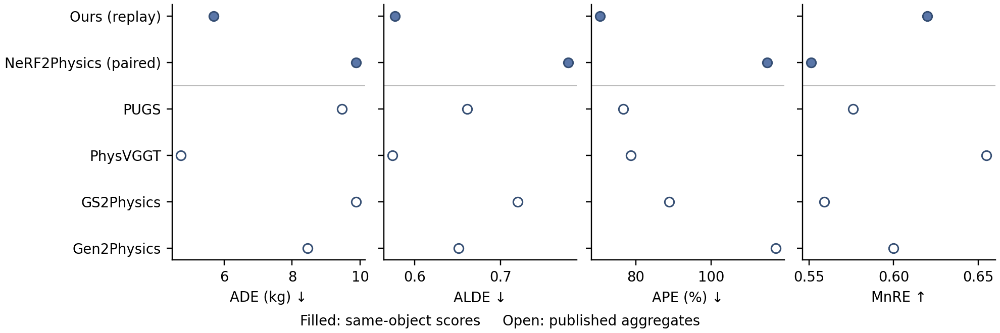
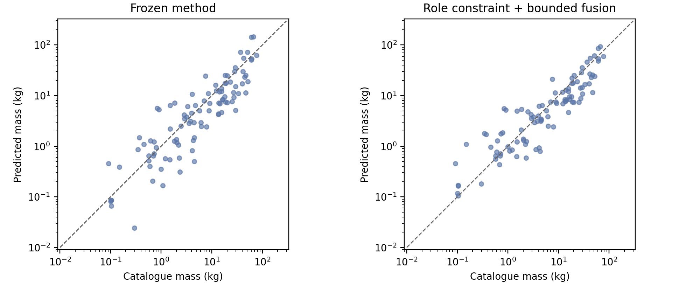
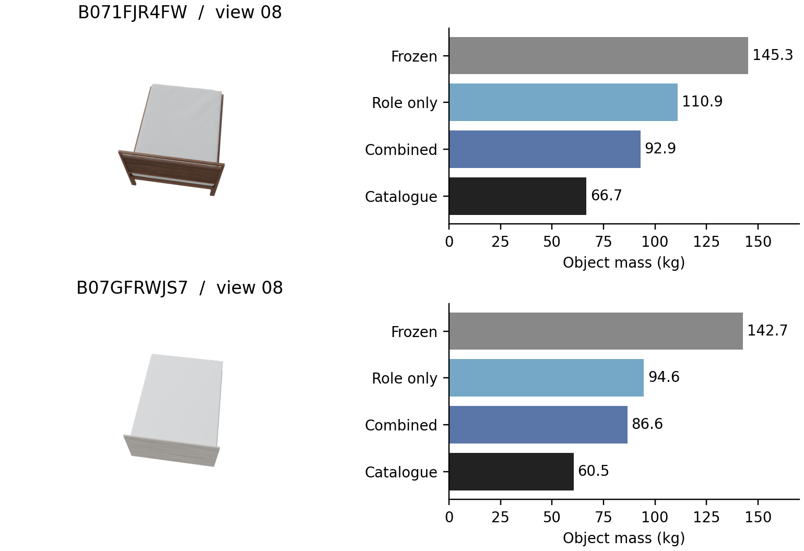

# ABO-100 构件薄层约束与质量融合实验

在官方顺序的 100 件上复用封存的六视图重建、构造预测和三视图图像先验。本次只重跑质量计算。由于两例床的目录误差已用于发现问题，整组按探索性回放报告。所有对象使用同一规则。预测文件写出后才载入质量标签评分。[原冻结实验](abo100_extension_20261120_zh.md)

## 五篇基线

| 方法 | 数据与输入 | ADE (kg) ↓ | ALDE ↓ | APE (%) ↓ | MnRE ↑ |
|---|---|---:|---:|---:|---:|
| Ours，本次回放 | 同对象 100 件 | 5.696 | 0.5770 | 70.62 | 0.6199 |
| NeRF2Physics | 同对象 100 件，官方区间中点重算 | 9.871 | 0.7787 | 114.79 | 0.5511 |
| PUGS | 原文 ABO-500 表 I | 9.461 | 0.661 | 76.7 | 0.576 |
| PhysVGGT | 原文 100 件，单图全局质量头 | 4.730 | 0.574 | 78.7 | 0.655 |
| GS2Physics | 原文 Test1–3 共 500 件 | 9.884 | 0.720 | 88.8 | 0.559 |
| Gen2Physics | 原文参考资产输入 | 8.447 | 0.651 | 117.0 | 0.600 |

配对 bootstrap 按对象重采样 2,000 次。相对 NeRF2Physics 的 ADE 差为 −4.175 kg，95% 区间为 [−7.576, −1.277] kg。APE 差为 −44.18 个百分点，区间为 [−97.82, +2.21] 个百分点。这些区间以本次方法和样本为条件，未计入观察误差后提出规则的选择效应。其余四篇缺少同对象同输入的配对结果。[五篇来源与原表位置](abo50_physical_comparison_20261119_zh.md)

## 方法与问题记录

1. 部件语义与材料占据冲突。服务器记录中，床垫罩为实心织物。先以部件质量之和与选中物理分支一致为条件核对证据，89 件匹配，另有 10 件保留原物理估计、1 件原本回退到图像。对明确命名为罩、衬层或包覆面、材质为织物或皮革且被判实心的部件，用 V壳 = min(V外, A部件 × t) 估计薄层占据。面积来自网格面积和归一化部件面积份额；厚度有提议则采用，否则暂取 2 mm。此处为一阶近似，真实厚度及份额待测。
2. 内芯材料无法从外观唯一确定。把其余部件质量加新壳层质量记为 L，以 max(L, 图像先验) 作为条件可行质量。剩余内芯贡献非负。该步骤保留未知量，只约束总质量，不能据此输出已验证的填料或真实内部分布。
3. 两条支路强烈分歧导致异常放大。图像估计 I、构造估计 P 均以 kg 表示。令 s = ln 2，输出 I × exp[(s/2) tanh(ln(P/I)/s)]。接近一致时恢复原等权对数融合的一阶响应；分歧增大时，输出相对 I 的倍数限制在 [1/√2, √2]。s 是本次设定的固定尺度；图像先验发生系统偏差时，该约束也限制物理支路纠错能力。
4. 两件床都触发约束。B071FJR4FW 采用模型提议的 10 mm，罩质量从 133.44 降到 4.71 kg。B07GFRWJS7 厚度缺失，以 2 mm 得到 1.46 kg，原为 173.70 kg。两件整床最终仍各高估约 26 kg。输入图仅给出外观，仍需核对目录称重是否包含图中床垫，以及框架的厚度、木材体积和不可见构件。
5. 下游接口。当前更改输出对象级质量。既有沙发和凳子的 MPM 粒子案例仍单列，应用新版质量于 MPM 需要把未知内芯分配给有空间支撑的体元，再验证粒子总质量、质心、形变和时间步稳定性。[粒子与 MPM 验证](mesh_interior_mpm_20261119_zh.md)

## 同对象消融

| 方法 | ADE (kg) ↓ | ALDE ↓ | APE (%) ↓ | MnRE ↑ |
|---|---:|---:|---:|---:|
| 原等权融合 | 7.559 | 0.7040 | 72.17 | 0.5630 |
| 仅加部件薄层约束 | 6.736 | 0.6971 | 70.86 | 0.5665 |
| 仅加有界融合 | 5.788 | 0.5780 | 70.76 | 0.6192 |
| 两者合用 | 5.696 | 0.5770 | 70.62 | 0.6199 |
| 仅图像先验 | 5.154 | 0.5747 | 76.82 | 0.6293 |

新旧两批各 50 件的新版 ADE 分别为 5.207 和 6.184 kg。整体收益主要来自限制分歧的影响。薄层约束在有界融合之上再降低 0.092 kg ADE，差值区间为 [−0.247, 0.000] kg，仅两例触发。与图像先验相比，组合方案的 APE 降低 6.20 个百分点，另外三项点估计仍落后。独立测试应冻结上述规则，核对称重对象和渲染组成的一致性，并对软包与单材质物体分别报告构件级几何误差。

原图来自 Amazon Berkeley Objects，Collins 等，CVPR 2022，CC BY 4.0。[ABO 数据](https://amazon-berkeley-objects.s3.amazonaws.com/index.html)

[逐件预测及构件修改](../../paper_assets/abo100_extension_20261120/role_replay/predictions.json) · [配对误差区间](../../paper_assets/abo100_extension_20261120/role_replay/metrics.json) · [复现脚本](../../scripts/run_abo100_role_replay.py) · [已有躺椅参考网格物性图与证据范围](../../paper_assets/chaise_reference_20261111_final/CAPTIONS.md)
