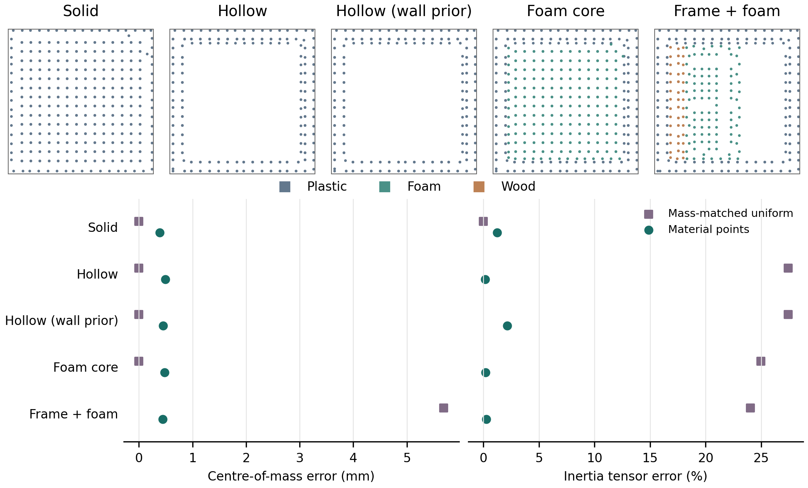

# ABO-500 主实验与结构贡献的证据

## 与五篇基线重叠的内容

NeRF2Physics 已有厚度体积积分；PUGS 的表 IV 比较厚度积分与高斯积分；GS2Physics 学习语义区域一致性。三者构成质量、材质与表面物性的对照。[NeRF2Physics 实现](https://github.com/ajzhai/NeRF2Physics/blob/master/predict_property.py) · [PUGS 原文表 IV](https://marcyu0303.github.io/assets/pdfs/gs_physics.pdf) · [GS2Physics](https://ieeexplore.ieee.org/document/11653536/)

Gen2Physics 已输出按材质划分的闭合子网格，并在表 3 单独消融 VLM 的实心/空心判断。引入该判断后，APE 从 218.9% 降至 117.0%，ADE 从 7.636 kg 升至 8.447 kg。PhysVGGT 将稠密物性与全局质量分别评测，表 13 的全局头比密度体积路径具有更低的 ADE。单个质量值和空间分布应分别验证。[Gen2Physics 表 1、3](https://arxiv.org/html/2608.23869v1#S4) · [PhysVGGT 表 12、13](https://arxiv.org/html/2609.18920v1#A1.T13)

其他相关工作已经包含内部填充、VLM 判断 MPM 是否需要填充，以及按材料赋粒子物性。候选贡献可落在一个更具体的问题上：对存在多种可行内部构造的资产，可见证据约束了哪些内部域，这些约束能在多大程度上改善编辑后的质量分布和受力响应？[PhysGaussian](https://openaccess.thecvf.com/content/CVPR2024/papers/Xie_PhysGaussian_Physics-Integrated_3D_Gaussians_for_Generative_Dynamics_CVPR_2024_paper.pdf) · [PhysGen3D 补充材料](https://openaccess.thecvf.com/content/CVPR2025/supplemental/Chen_PhysGen3D_Crafting_a_CVPR_2025_supplemental.pdf) · [SOPHY](https://openaccess.thecvf.com/content/WACV2026/papers/Cao_SOPHY_Generating_Simulation-Ready_Objects_with_Physical_Materials_WACV_2026_paper.pdf)

## 已知构造的空间物理验证

所有外形均为边长 0.20 m 的立方体。用长方体矩的解析式逐域相加得到质心和质心处惯量真值；均匀对照获得正确的总质量。材料点直接从此前导出的 MPM 输入读取，惯量相对误差使用张量 Frobenius 范数。下表中的误差同时包含体积分和离散粒子位置的影响。

| 已知条件 | 均匀模型质心误差 mm | 材料点质心误差 mm | 均匀模型惯量误差 % | 材料点惯量误差 % |
|---|---:|---:|---:|---:|
| 实心 | 0.00 | 0.39 | 0.00 | 1.25 |
| 空腔，显式边界 | 0.00 | 0.49 | 27.42 | 0.17 |
| 空腔，给定 20 mm 壁厚 | 0.00 | 0.45 | 27.42 | 2.16 |
| 泡沫芯 | 0.00 | 0.48 | 24.97 | 0.20 |
| 偏置木支撑、泡沫与空腔 | 5.69 | 0.44 | 24.03 | 0.27 |

切片展示距中平面 8 mm 以内的导出粒子。四种对称结构的解析质心均在原点；离散化引入小于 0.5 mm 的偏移。精确构造作为输入时，可以从粒子恢复惯量。由照片推断隐藏构造的误差需要另外测量。[惯量与质心源数据](../../paper_assets/abo500_20261120/particle_moments.json) · [原始 MPM 输入](../../paper_assets/abo50_mass_stability_20261119/matched_mpm/)

## 外观相似性的划分审计

验证与测试各 100 件分别对照 300 件训练物体。三幅原分辨率 RGBA 图像的像素哈希均与同一训练对象完全相同的对象数为零。按各帧前景裁紧、等比缩放并在白底居中后，一对不同商品在三个 32 像素视图上完全相同：验证物体 B07SCCB1H5 为 1.941 kg，训练物体 B07SCC6M4Q 为 2.898 kg。尺寸归一化可能抹去实际尺度差异。应把低距离对象用于人工核查产品族；相似距离本身不能证明两个商品同属一族。官方划分全部保留。新的外推实验应预先冻结商品族或其他外部独立来源。[两百组训练近邻及距离](../../paper_assets/abo500_20261120/split_render_audit.json)

## 支撑投稿主张仍需补的实验

1. 在训练集上生成折外图像估计、尺度和构造估计，分别学习各分支误差。预先固定选择规则，再在未用于诊断的商品族上比较图像先验、结构单支和完整方法。
2. 为板式家具、框架家具、均质物体分别收集带尺寸和内部证据的独立样本。对每个对象先封存闭合外观下的两种可行结构及其质量区间，再揭盲核对装配图、截面或拆解记录。报告构件判断准确率、正确构造落在候选中的比例、区间覆盖率和平均宽度。
3. 在同一真实对象上记录称重、质心或已知载荷下的位移。比较相同外形与相同总质量下，均匀模型和分材料模型的实测误差；控制接触、载荷和刚度来源。当前 MPM 守恒与解析惯量验证支持数值实现。
4. 论文主图串联同视角输入、材质分区、证据可见性、条件剖面、材料点和加载曲线，逐图注明实测、公开标注、参数先验或数值模拟。每项主张各用一张能区分竞争解释的表验证。
