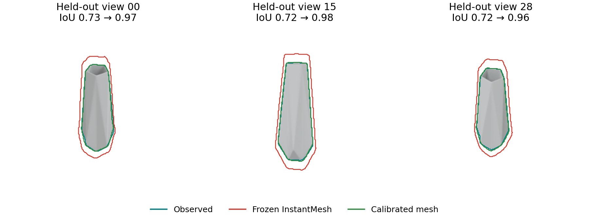

# PartPhy3D ABO-50 benchmark

The benchmark uses 50 scenes from the original ABO-500 test split. The selection
excludes the ten recorded development products and ranks the remaining 90 by
SHA-256 of a fixed prefix and the scene ID. Each scene has 30 original calibrated
PNG views. Index 08 is the shared single-image input and the qualitative display
view. The benchmark retains all 50 IDs when a run fails.

## Verified results

| Method and scope | Objects | ADE (kg) ↓ | ALDE ↓ | APE (%) ↓ | MnRE ↑ |
| --- | ---: | ---: | ---: | ---: | ---: |
| NeRF2Physics, official property stage with released intermediate caches | 50 | 8.8723 | 0.8105 | 156.3860 | 0.5291 |

The evaluator verified prediction seals and matched all 1,500 image hashes and all
50 camera-file hashes to the local dataset before reading the catalogue weights.
The metrics refer to the ABO-50 subset. The camera and image matches establish the
provenance of the cached prediction inputs. Catalogue weight is the benchmark label.

### Camera-space calibration

On the development object `B075HWK9QT_ATVPDKIKX0DER`, fitting an isotropic
scale and translation to foreground bounds from the six InstantMesh input views
increased mean silhouette IoU across the 24 held-out views from **0.7173 to 0.9670**.
This experiment assesses projected geometry in camera coordinates. Mass estimation
and metric scale require separate evidence.



RGB and alpha source: Amazon Berkeley Objects, Collins et al., CVPR 2022,
[CC BY 4.0](https://creativecommons.org/licenses/by/4.0/). Changes include resized
views, white compositing, and overlay contours. [ABO dataset](https://amazon-berkeley-objects.s3.amazonaws.com/index.html).
[Per-view development results](../../paper_assets/abo50_20261119/development_silhouette.json).

## Comparison protocols

| Method | Native inputs and comparison status |
| --- | --- |
| [NeRF2Physics](https://github.com/ajzhai/NeRF2Physics) | Thirty calibrated views for the reconstruction protocol. Above row scores its official cached property stage. |
| [PUGS](https://github.com/EverNorif/PUGS) | Calibrated multi-view Gaussian reconstruction and a VLM proposal. The queued PUGS-Qwen run uses view 08 for the proposal, the pinned reconstruction code, and catalogue dimensions for initialization. |
| [PhysVGGT](https://arxiv.org/abs/2609.18920) | Single RGB view. View 08 is the shared input. A usable public checkpoint has yet to be located. |
| [GS2Physics](https://github.com/momaiyc/GS2Physics) | Multi-view Gaussian method. The author repository hosts PhysSeg-15 and simulation results. Two benchmark scenes, `B07DBDX15Y_ATVPDKIKX0DER` and `B07QFRSC43_ATVPDKIKX0DER`, have published segmentation annotations. |
| [Gen2Physics](https://arxiv.org/html/2608.23869v1) | An input mesh and eleven renders for material inference. A usable release of the trained material decoder has yet to be located. Its reported ABO-500 comparison uses reference assets. |
| Ours, first mass prototype | Six calibrated views reconstruct the envelope. Views 00, 08 and 20 provide construction hypotheses and a scale estimate. Occupied volume is bounded by the allocated envelope volume per component. Direct VLM mass and an all-solid envelope are controls. |

Published full-cohort values use their source protocols. The benchmark table
receives same-cohort scores after per-object predictions have been verified.
The initial mass prototype evaluates a conditional volume allocation, with a
thin-shell approximation, and has no independent part-level material truth.

## Reproduction

```bash
python scripts/prepare_abo50_benchmark.py --source /path/to/abo_500 --output outputs/abo50
python scripts/evaluate_abo50_nerf_cache.py --help
python scripts/run_abo50_reconstruction.py --help
python scripts/evaluate_abo50_silhouettes.py --help
python scripts/run_abo50_mass_hypotheses.py --help
python scripts/evaluate_abo50_mass_hypotheses.py --help
python scripts/run_abo50_pugs_qwen.py --help
```

The observation archive contains calibrated images and poses. Evaluation labels
are supplied separately. The observed manifest SHA-256 is
`5a3545eb717b0accf03de2f826498e63da1ae64ed1367d1551bd6b5d311e219b`.
