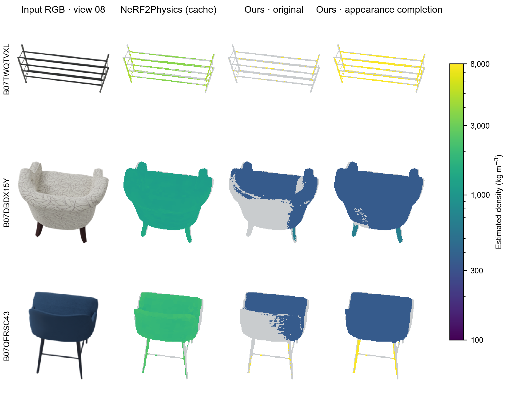

# ABO-50 覆盖率修复实验

重建主对照固定为各对象原来的六个相机视角，轮廓评估使用其余 24 个视角。材质分配复用原先的三个输入视图 `00、10、20`。质量构造查询继续使用 `00、08、20`。额外视角的实验仅用于诊断可见性。

## 几何与密度覆盖

六视角轮廓约束在同一相机坐标下求各前景锥的交集，再从体素占据提取网格。检验时同时统计几何召回、精度和 IoU，避免只追求覆盖而误占背景。

| 几何方法 | 对象 | 留出轮廓 IoU ↑ | 前景召回 ↑ | 前景精度 ↑ |
| --- | ---: | ---: | ---: | ---: |
| 校正后的 InstantMesh | 50 | 0.9178 | 0.9673 | 0.9438 |
| 所有对象使用六视角轮廓约束 | 50 | 0.8672 | 1.0000 | 0.8672 |
| 六视角按输入 IoU < 0.80 切换几何 | 50 | 0.9172 | 0.9736 | 0.9404 |

把轮廓约束直接用于所有对象会损失精度和 IoU。薄金属架的 24 视图 IoU 单独从 0.4859 提升到 0.5497。在五张事先按帧序等距取样、且未参与重建和材质推断的视角上，复用相同材质掩码并重新投影，几何覆盖由 **57.16% 到 99.39%**，密度覆盖由 **45.41% 到 64.97%**。该数字衡量获赋值的前景像素比例，逐像素密度精度仍需测量。轮廓约束输出的占据空间只用于此次几何和前景实验。

按输入 IoU 自动门控在 50 个对象中切换了两个。薄金属架的留出 IoU 小幅提高，另一个对象降低，整体 IoU 从 0.9178 到 0.9172。这一门控暂未用于主方法。

12 视角诊断同时增加了输入角度和网格提取分辨率。三个示例中，薄金属架在共同留出视图上的 IoU 从 0.4846 到 0.6312，两把椅子的 IoU 均下降。两个因素的独立贡献需要额外的等分辨率、等视角数对照才能区分。

## 材料识别复核

从各材质部件原来的三张 SAM2 掩码裁出局部图，用固定 OpenCLIP 权重重新核对候选材料。仅当至少两个裁图的首选材料一致，且各自较第二候选至少领先 0.015 个余弦相似度单位时，允许更新原材质。三个示例均未通过替换门槛。两个 PhysSeg 重叠对象仍为织物 IoU 68.14%、木材 IoU 15.43%、mIoU 41.78%。本轮保留原材质，对蓝椅腿仍需进一步局部实证。

薄金属架的原三张材质输入图，SAM2 有效覆盖为 0%、99.75%、99.85%。把空掩码改为弃权后，五张留出图密度覆盖仍为 64.97%。可见部件材料候选均为钢，且至少两个材质输入视角的掩码覆盖超过 90% 时，试验分支允许把同一材料先验赋给该网格的可见面。薄金属架在此条件下密度覆盖达到 **99.39%**。该单材质假设需要在更多对象上验证。

两把椅子使用更一般的外观补全。先在原三个输入视图用邻近的颜色和空间证据补掩码，再用重建网格的顶点颜色和三维面中心距离补足无标签的面。只有最近类别匹配在距离门限内、并相对第二类别有足够分离时才赋值。冲突时保留未知，已有标签固定。

| 材质赋值方法 | 花纹椅密度覆盖 ↑ | 蓝椅密度覆盖 ↑ | 织物 IoU ↑ | 木材 IoU ↑ | 两类 mIoU ↑ |
| --- | ---: | ---: | ---: | ---: | ---: |
| 同材质投票与拓扑局部传播 | 65.54% | 58.56% | 68.14% | 15.43% | 41.78% |
| 再补二维输入掩码 | 66.05% | 58.62% | 68.24% | 15.42% | 41.83% |
| 再补三维网格材质 | **96.44%** | **91.74%** | **95.55%** | **32.71%** | **64.13%** |

覆盖率使用原第 08 视角，IoU 使用同两个对象共十张 PhysSeg 标注图。花纹椅和蓝椅的共享网格覆盖上限分别为 98.14% 和 91.84%。外观补全属于两对象探索性诊断，木材识别仍弱。图中的密度为材料先验值，灰色为无密度输出。

局部编辑仍以原有三维部件的稳定 ID 为索引。外观补全输出按材料类别组织，来源应在面级保留，后续接入编辑时需要独立的部件归属验证。

## 构造质量失败回收

沿用图像估计尺度、同一网格和物性先验。仅把失败字段的诊断反馈给 VLM，每对象最多两次，在输出封存后计算四个指标。

| 版本 | 有效对象 | ADE (kg) ↓ | ALDE ↓ | APE (%) ↓ | MnRE ↑ |
| --- | ---: | ---: | ---: | ---: | ---: |
| 网格绕向修复后 | 37/50 | 5.813 | 1.0049 | 71.33 | 0.5031 |
| 字段错误反馈 | 43/50 | 9.750 | 1.0651 | 77.03 | 0.4720 |
| 编号材料与权重补全 | 50/50 | 90.992 | 1.2894 | 537.49 | 0.4288 |

43 个有效对象加入了六个较难对象，有效集合随阶段改变。七个仍失败的对象中，四个仍返回零总体积分配，三个仍返回不合规的材料字段。编号材料和相对权重由程序归一化到同一物理积分接口，补齐了七个结果，但三件开放式棚架的构造估计大幅偏高，部分支撑件被分配了外包络空腔的体积，三个预测分别为约 926、1,116、1,930 kg。该版本保留为失败诊断，主表使用已核验的 37 例结果。对开放式结构，后续应用薄壁与杆件的局部尺寸估体积。

图中 RGB 来自 [Amazon Berkeley Objects](https://amazon-berkeley-objects.s3.amazonaws.com/index.html)，Collins 等，CVPR 2022，CC BY 4.0。图中做了缩放、裁剪和白底合成。

[逐对象数据](../../paper_assets/abo50_coverage_20261119/) · [实验与修改日志](abo50_experiment_log_zh.md)
