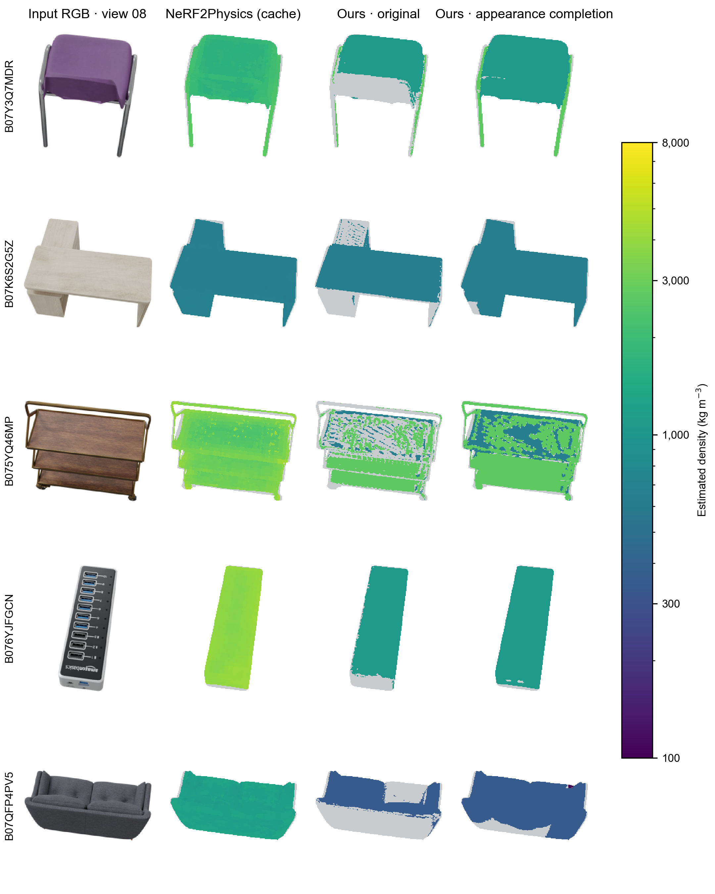

# ABO-50 局部构造积分与扩展密度比较

## 开放结构质量修复

编号权重版在三件开放棚架上给出了 925.893、1116.075 和 1930.134 kg。三件的绝对误差合计 3918.896 kg，占 50 件总绝对误差的 **86.14%**。问题来自整件闭合外包络：它包含棚布下的空气，而相对权重把部分空腔分给了布面、铝制支撑和小连接件。

在同样三张质量输入图上查询局部材料部件清单。棚布和薄板按面积乘厚度，空心圆管按环形横截面积乘长度，再乘件数和材料先验密度。板件分支允许镂空比例，少量致密连接件按局部尺寸。解析支持具名尺寸和以毫米表示的紧凑尺寸列表。验证管壁小于半径、零件尺寸为正，并检查部件尺寸与整物尺寸的一致性。质量标签在封存后用于评分。

| 方法 | 有效数 | ADE (kg) ↓ | ALDE ↓ | APE (%) ↓ | MnRE ↑ |
| --- | ---: | ---: | ---: | ---: | ---: |
| NeRF2Physics 官方缓存物性阶段 | 50/50 | 8.872 | 0.8105 | 156.39 | 0.5291 |
| 直接 VLM 控制组 | 50/50 | 6.316 | 0.9898 | 52.37 | 0.5013 |
| 编号权重版 | 50/50 | 90.992 | 1.2894 | 537.49 | 0.4288 |
| Ours（棚架局部构造回放） | 50/50 | 12.676 | 1.0369 | 98.54 | 0.4845 |
| Ours（棚架与板件局部构造回放） | 50/50 | 7.124 | 1.0384 | 80.34 | 0.4878 |

| 棚架 | 目录 (kg) | 原构造积分 (kg) | 局部构造积分 (kg) |
| --- | ---: | ---: | ---: |
| `B07YM1FZSJ_ATVPDKIKX0DER` | 15.649 | 925.893 | 14.674 |
| `B07YLZTGZ9_ATVPDKIKX0DER` | 19.278 | 1116.075 | 19.833 |
| `B07YM1D7B7_ATVPDKIKX0DER` | 18.280 | 1930.134 | 19.833 |

两件白棚得到相同估计尺寸和质量，表明当前视觉尺寸估计还无法区分它们。该路由是在观察到错误后设计的探索性复跑，后续需在开发集冻结路由和输入单位，再用独立对象检验。局部尺寸为视觉推断，实物验证还需单独测量。

板件分支按部件名称识别门、抽屉或格栅，并在整件外包络的实心分配超过 25% 时触发局部积分。在三例上触发，柜体从 190.840 降至 15.017 kg，机箱从 216.584 降至 3.034 kg，木桌从 75.538 降至 21.083 kg。相应目录标签为 23.360、51.891 和 47.000 kg。机箱的内部质量仍未充分建模。与 NeRF2Physics 缓存的同队列 ADE 差为 −1.748 kg，95% 对象配对 bootstrap 区间为 −5.939 至 1.764 kg。对直接 VLM 控制组，四项点估计仍有差距。

## PUGS-Qwen 同对象对照进度

从 AutoDL 逐个验证已完成 PUGS-Qwen 预测的 SHA-256 封存，共三例。区间取中点，比较原 50 队列里的同一对象。该小批次受完成顺序影响，完整批次仍在运行。

| 对象 | 目录 (kg) | PUGS-Qwen (kg) | Ours（棚架与板件局部构造）(kg) |
| --- | ---: | ---: | ---: |
| 金属架 | 1.846 | 158.000 | 13.405 |
| 花纹椅 | 15.667 | 6.582 | 4.499 |
| 置物推车 | 11.975 | 315.999 | 30.465 |

PhysVGGT 的质量指标、GS2Physics 的 PhysSeg-15 和 Gen2Physics 的 PartNet-Material 结果继续保留在[原论文对比表](abo50_physical_comparison_20261119_zh.md)。独立复测优先在相同对象、相同标注上核验相应任务。PUGS-Qwen 和原版 PUGS 的材料提议模型不同。

## 扩展对象

从原 ABO-50 选择紫色椅 `B07Y3Q7MDR`、木桌 `B07K6S2G5Z_A1F83G8C2ARO7P`、木板金属架 `B075YQ46MP_ATVPDKIKX0DER`、USB 集线器 `B076YJFGCN_A1F83G8C2ARO7P` 和灰色沙发 `B07QFP4PV5_ATVPDKIKX0DER`。选择依据是论文常展示的椅、桌、薄结构和电子小件类型，再加入带软包与支撑的沙发。尚未核实这些对象与论文图中是同一资产。

重建使用原六视角，材质使用原三视角，展示采用原始第 08 视角。共享网格投影中，NeRF2Physics 使用发布缓存查询密度，Ours 使用 SAM2 材质和外观补全。像素覆盖衡量前景赋值，密度数值由材料先验推断。

| 对象 | Ours 原始密度覆盖 | 外观补全后 | 共享网格前景覆盖 |
| --- | ---: | ---: | ---: |
| 紫色椅 | 60.27% | 95.27% | 95.73% |
| 木桌 | 72.82% | 95.20% | 96.47% |
| 木板金属架 | 53.16% | 90.45% | 93.31% |
| USB 集线器 | 87.39% | 97.29% | 97.69% |
| 灰色沙发 | 43.97% | 88.86% | 97.84% |

RGB 来源为 [Amazon Berkeley Objects](https://amazon-berkeley-objects.s3.amazonaws.com/index.html)，Collins 等，CVPR 2022，CC BY 4.0。图中进行了缩放、裁剪与白底合成。[源数据与协议](../../paper_assets/abo50_local_assembly_20261119/)。
