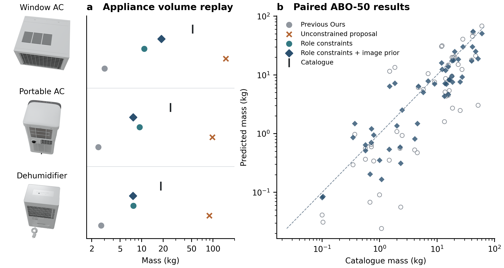

# ABO-50 质量稳定性：构造、尺度与数值精度

## 同对象质量结果

质量预测继续使用原 50 个对象和原视角 00、08、20。另从官方测试集中按固定哈希选取 12 个未参与这批方法开发的产品，排除原 50 和已声明的开发对象。图像 CLIP 回归控制组用官方 300 训练对象拟合，用 100 验证对象选正则化，推理包只包含训练和验证标签。旧构造积分与图像质量先验在对数域等权融合。针对家电的修正基于本批三个已分析的失败件，属于探索性回放。

| 方法 | n | ADE (kg) ↓ | ALDE ↓ | APE (%) ↓ | MnRE ↑ |
| --- | ---: | ---: | ---: | ---: | ---: |
| NeRF2Physics 官方缓存 | 50 | 8.872 | 0.8105 | 156.39 | 0.5291 |
| 直接 VLM | 50 | 6.316 | 0.9898 | 52.37 | 0.5013 |
| CLIP 质量回归控制 | 50 | 5.545 | 0.5771 | 72.59 | 0.6177 |
| 直接 VLM + CLIP 控制 | 50 | 5.685 | 0.6865 | 51.03 | 0.5652 |
| Ours 上一版构造积分 | 50 | 7.124 | 1.0384 | 80.34 | 0.4878 |
| Ours + 三件家电构造回放 | 50 | 6.730 | 0.9655 | 78.96 | 0.5016 |
| Ours + CLIP 先验 | 50 | 5.718 | 0.6810 | 58.32 | 0.5861 |
| Ours + 家电构造回放 + CLIP 先验 | 50 | 5.405 | 0.6445 | 57.36 | 0.5958 |

末行比上一版构造积分的 ADE 低 1.719 kg，同对象 bootstrap 区间为 −3.131 至 −0.548 kg。该区间描述这批样本内的不确定性，三件修正由同批错误启发。与直接 VLM 的 ADE 差为 −0.911 kg，区间 −2.170 至 +0.263 kg，APE 仍更高。CLIP 单独回归在 ALDE 和 MnRE 更好，必须作为控制保留。融合的输出是标量诊断，尚未约束到空间材料域和 MPM 粒子总质量。

## 误差定位与构造公式

所有路线遵守材料质量积分 \(m=\sum_i\rho_i V_i\)。各项 \(V_i\) 的计算由构造决定。实心材料用闭合域体积。薄板用有效面积乘材料厚度。圆管用 \(\pi L t(D-t)\)，其中 \(L\) 是长度、\(t\) 是壁厚、\(D\) 是外径。分层软包用不同内部区域的体积分别计算，粒子版按其材料点初始体积求和。换热器使用铝翅片和铜管分域，翅片体积用芯体包络乘翅片厚度与间距之比，铜管使用明确的体积比例先验。当前名义厚度、深度和比例均记录在回放协议，待训练或实测独立收敛。[内部材料点与 MPM](mesh_interior_mpm_20261119_zh.md)

同一批 37 个有效物体固定 mesh 和原构造字段，只把 VLM 的最大尺寸换为目录尺寸，ADE 从 5.813 kg 增至 10.665 kg，APE 从 71.33% 增至 214.15%。ALDE 从 1.0049 降至 0.8560。密度不变时，实心相似缩放的质量随长度倍率三次方变化，固定壁厚的薄壳近似随倍率平方变化。更准的尺度可以放大错误的实体体积，必须与材料占据一起诊断。

最大残差对象 `B07Y2B738L` 的数据集描述像机箱，型号认证列为 18,000 BTU 窗式空调。`B07N6RT9SM` 的数据集描述像净化器，产品型号对应便携制冷空调。`B07XHQQ95Y` 对应压缩机式除湿机。产品资料仅用于事后核验，保留 ABO 原标签。输入仍为 RGB。[窗式空调认证](https://m.media-amazon.com/images/I/91iztSJtBYL.pdf) · [便携式空调型号资料](https://iprpartesyrepuestos.com/wp-content/uploads/2021/02/ficha-tecnica-aire-acondicionado-portatil-midea.pdf) · [除湿机原厂说明书镜像](https://manuzoid.com/manuals/4ylmm-AmazonBasics%20B07XKGLMR8%20User%20manual)

| 对象 | 目录 kg | 旧积分 kg | NF4 无构造约束 kg | BF16 无构造约束 kg | NF4 按构造约束 kg |
| --- | ---: | ---: | ---: | ---: | ---: |
| 窗式空调 | 51.89 | 3.03 | 150.77 | 34.36 | 10.85 |
| 便携式空调 | 25.30 | 2.48 | 97.82 | 105.48 | 9.36 |
| 除湿机 | 18.60 | 2.71 | 88.83 | 99.66 | 7.69 |

同一台 RTX 4090、相同 RGB 和功能提示词，NF4 与 BF16 在三件上均判对功能，质量变化方向不一致。NF4 输出把罩壳和底盘分别填为接近实心的块。通过显式板壳和分材料换热器公式约束，三件的误差都比旧版和 NF4 无约束结果小，仍全部低估。只增加计算精度无法消除构造与尺寸偏差。

RGB 来自 [Amazon Berkeley Objects](https://amazon-berkeley-objects.s3.amazonaws.com/index.html)，CC BY 4.0，图中做白底处理。右侧散点是原 50 件逐对象的配对结果，虚线为单位线。

## 独立 12 件与失败消融

| 方法 | n | ADE (kg) ↓ | ALDE ↓ | APE (%) ↓ | MnRE ↑ |
| --- | ---: | ---: | ---: | ---: | ---: |
| NeRF2Physics 官方缓存 | 12 | 7.368 | 1.0229 | 100.85 | 0.5008 |
| 直接 VLM | 12 | 5.655 | 0.7289 | 69.39 | 0.5445 |
| CLIP 质量回归控制 | 12 | 2.177 | 0.4782 | 94.58 | 0.6987 |
| 通用零件积分 + 直接 VLM，格式失败回退 | 12 | 7.436 | 0.8311 | 137.00 | 0.5352 |

通用零件分解仅 5/12 和 18/50 通过格式与尺寸校验。常见失败是给实心杆三项尺寸，以及输出超过八组。纯零件积分有明显高估，组合方案在独立 12 件退化，因此保留为失败消融。三件家电回放尚无独立同类验证，当前 12 件结果不能验证该分支。CLIP 控制在该子集也存在高 APE，50 件后验融合仍需独立通用验证。

[逐对象数值、协议和图件](../../paper_assets/abo50_mass_stability_20261119/) · [实验记录](abo50_experiment_log_zh.md) · [构造判断和质量归因](construction_mass_attribution_zh.md) · [论文章节实验设计](research1_experiment_matrix_zh.md)
