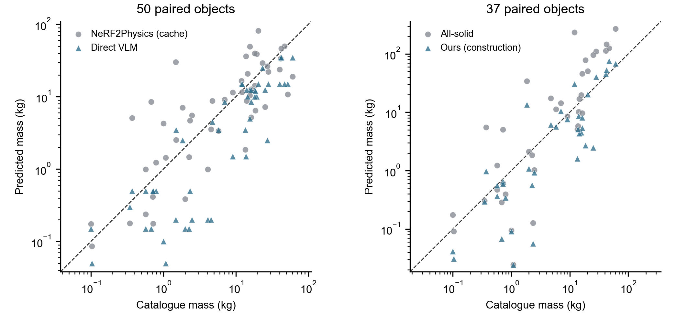
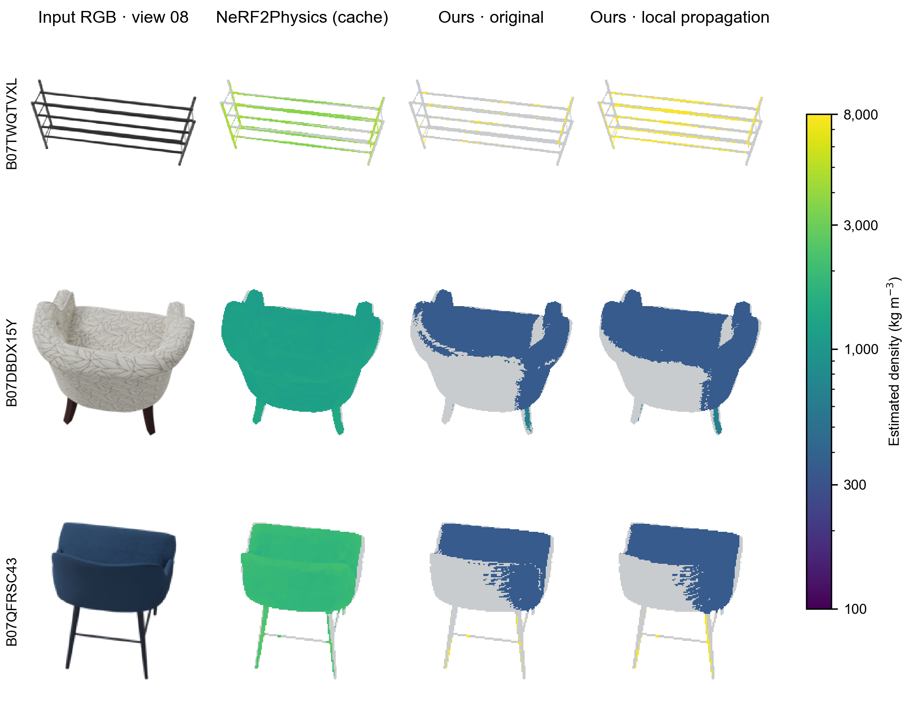
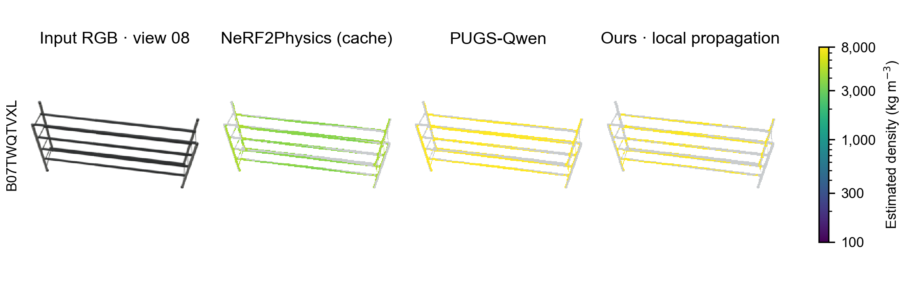

# ABO-50 物性实验与基线对比

[固定六视角的覆盖率修复与复跑](abo50_coverage_repair_20261119_zh.md)

[最新的 50 对象局部构造回放、PUGS-Qwen 进度与五件密度图](abo50_local_assembly_20261119_zh.md)

## 表 1　Ours 与基线的质量指标

| 方法 | ABO-500 口径 | ADE (kg) ↓ | ALDE ↓ | APE (%) ↓ | MnRE ↑ | 出处 |
| --- | --- | ---: | ---: | ---: | ---: | --- |
| NeRF2Physics | 原论文测试集，100 个对象 | 8.730 | 0.771 | 106.1 | 0.552 | [原论文表 1](https://arxiv.org/html/2404.04242#S4.T1) |
| NeRF2Physics（PUGS 报告的对照） | PUGS 表 I 的 ABO-500 协议 | 12.725 | 0.736 | 104.0 | 0.564 | [PUGS 表 I](https://marcyu0303.github.io/assets/pdfs/gs_physics.pdf#page=5) |
| PUGS | 论文 ABO-500 表 I | 9.461 | 0.661 | 76.7 | 0.576 | [PUGS 表 I](https://marcyu0303.github.io/assets/pdfs/gs_physics.pdf#page=5) |
| PhysVGGT（global mass head） | ABO-500 测试集，100 个对象 | 4.73 | 0.574 | 78.7 | 0.655 | [表 1](https://arxiv.org/html/2609.18920v1#S4.T1) · [表 13](https://arxiv.org/html/2609.18920v1#A1.T13) |
| GS2Physics | Test1 + Test2 + Test3，500 个对象 | 9.884 | 0.720 | 88.8 | 0.559 | [原论文表 I，第 8741 页](https://ieeexplore.ieee.org/document/11653536/) |
| Gen2Physics | ABO-500，参考资产输入 | 8.447 | 0.651 | 117.0 | 0.600 | [表 1](https://arxiv.org/html/2608.23869v1#S4.T1) |
| **Ours（完整构造积分）** | **ABO-50，37/50 个对象获得有效预测** | 5.813 | 1.0049 | 71.33 | 0.5031 | [本地实验，表 3](#表-3构造质量消融) |

APE 已统一为百分比。Ours 使用图像估计尺度和经三角面绕向修复的网格进行构造积分，四项指标基于 37 个有效预测。基线数值沿用各自论文的样本和协议，表 3 给出相同 37 个对象上的配对结果。GS2Physics 表 I 同一 500 对象协议中的 NeRF2Physics 为 13.480 / 0.748 / 204.0% / 0.563，PUGS 为 12.449 / 0.806 / 231.0% / 0.536。

GS2Physics 的分尺寸结果也出自[原论文表 I](https://ieeexplore.ieee.org/document/11653536/)。

| GS2Physics 子集 | 对象数 | ADE (kg) ↓ | ALDE ↓ | APE (%) ↓ | MnRE ↑ |
| --- | ---: | ---: | ---: | ---: | ---: |
| Test1，细长物体 | 150 | 4.044 | 0.722 | 75.0 | 0.562 |
| Test2，中等尺寸与多种形状 | 186 | 2.876 | 0.740 | 107.1 | 0.551 |
| Test3，大尺寸家具类 | 164 | 23.175 | 0.696 | 80.8 | 0.564 |

## 表 2　本地同队列质量对照

| 方法 | 有效对象 | ADE (kg) ↓ | ALDE ↓ | APE (%) ↓ | MnRE ↑ |
| --- | ---: | ---: | ---: | ---: | ---: |
| NeRF2Physics 官方缓存物性阶段 | 50/50 | 8.872 | 0.8105 | 156.39 | 0.5291 |
| 直接 VLM（质量对照） | 50/50 | 6.316 | 0.9898 | 52.37 | 0.5013 |

两行逐对象配对。直接 VLM 的 APE 低 104.02 个百分点，95% 配对 bootstrap 区间为 −205.61 至 −25.30 个百分点。ADE 差为 −2.556 kg，区间为 −6.037 至 0.426 kg。ALDE 和 MnRE 的点估计倾向 NeRF2Physics。PUGS-Qwen 已完成首对象，正在继续运行其余对象。

## 表 3　构造质量消融

以下各行均取构造预测有效的同 37 个对象，共请求 50 个。原始网格流程获得 29 个有效构造质量。9 个闭合网格存在三角面顶点顺序不一致，几何绕向修复后 9 个均通过体积检查，8 个恢复了可计算的构造质量。其余 13 个对象保留为构造失败。

| 方法 | 配对对象 | ADE (kg) ↓ | ALDE ↓ | APE (%) ↓ | MnRE ↑ |
| --- | ---: | ---: | ---: | ---: | ---: |
| NeRF2Physics 官方缓存物性阶段 | 37 | 7.201 | 0.8121 | 137.89 | 0.5194 |
| 直接 VLM（质量对照） | 37 | 4.850 | 0.8879 | 47.59 | 0.5359 |
| 全实心（相同外包络和材料先验） | 37 | 28.898 | 1.1049 | 249.10 | 0.4540 |
| Ours（构造积分） | 37 | 5.813 | 1.0049 | 71.33 | 0.5031 |
| Ours（构造积分，额外提供目录尺寸） | 37 | 10.665 | 0.8560 | 214.15 | 0.5176 |

相对全实心，构造积分的 ADE 降低 23.085 kg，95% 配对 bootstrap 区间为 −41.709 至 −9.203 kg。APE 降低 177.77 个百分点，区间为 −319.24 至 −67.45 个百分点。构造积分四项点估计都落后于同 37 个对象上的直接 VLM。目录尺寸消融使 ADE 和 APE 升高，ALDE 和 MnRE 有改善。 [绘图数据](../../paper_assets/abo50_comparison_20261119/mass_figure_data.json)

## 表 4　论文中的摩擦和硬度指标

PhysVGGT 表 2 使用 NeRF2Physics 的 13 场景实物数据。NeRF2Physics 原论文另在表 3、4 报告 PRA。每行保留原来源的口径。

| 物性 | 方法与来源 | ADE ↓ | ALDE ↓ | APE (%) ↓ | MnRE ↑ | PRA ↑ |
| --- | --- | ---: | ---: | ---: | ---: | ---: |
| 动摩擦系数 | [NeRF2Physics 原论文表 4](https://arxiv.org/html/2404.04242#S4.T4) | 0.155 | 0.321 | 36.0 | 0.736 | 0.800 |
| 动摩擦系数 | [NeRF2Physics，PhysVGGT 表 2 复现](https://arxiv.org/html/2609.18920v1#S4.T2) | 0.217 | 0.459 | 44.6 | 0.661 | — |
| 动摩擦系数 | [PhysVGGT 表 2](https://arxiv.org/html/2609.18920v1#S4.T2) | 0.102 | 0.206 | 22.5 | 0.831 | — |
| Shore 硬度 | [NeRF2Physics 原论文表 3](https://arxiv.org/html/2404.04242#S4.T3) | 34.295 | 0.315 | 27.6 | 0.765 | 0.710 |
| Shore 硬度 | [NeRF2Physics，PhysVGGT 表 2 复现](https://arxiv.org/html/2609.18920v1#S4.T2) | 66.21 | 0.672 | 110.5 | 0.546 | — |
| Shore 硬度 | [PhysVGGT 表 2](https://arxiv.org/html/2609.18920v1#S4.T2) | 7.05 | 0.103 | 11.1 | 0.908 | — |

ABO-50 的目录质量标签用于表 2 和表 3。密度、模量、动摩擦和 Shore 硬度的实测精度需要对应物性标注。

## 表 5　论文中的材质分割指标

PartNet-Material 口径，所有数值为百分比。以下三行出自同一张 [Gen2Physics 表 2](https://arxiv.org/html/2608.23869v1#S4.T2)。GS2Physics 仓库的 [PhysSeg-15](https://github.com/momaiyc/GS2Physics) 使用另一批标注，测试样本与类别口径单列。

| 方法 | 木材 | 织物 | 金属 | 塑料 | 玻璃 | 陶瓷 | 石材 | mIoU ↑ |
| --- | ---: | ---: | ---: | ---: | ---: | ---: | ---: | ---: |
| NeRF2Physics | 61.87 | 2.67 | 23.23 | 1.03 | 6.12 | 0.00 | 21.43 | 14.54 |
| PUGS | 69.50 | 4.94 | 15.66 | 0.61 | 3.90 | 0.00 | 29.84 | 15.56 |
| Gen2Physics | 86.23 | 35.72 | 84.38 | 71.93 | 40.11 | 43.49 | 24.32 | 48.27 |

## 热力图与基线发布状态

| 方法 | 代码与论文图 |
| --- | --- |
| NeRF2Physics | [官方仓库](https://github.com/ajzhai/NeRF2Physics)有代码和缓存。原文图 4 展示材料与密度，图 5 展示摩擦和硬度。 |
| PUGS | [官方仓库](https://github.com/EverNorif/PUGS)有重建、查询和渲染代码。原版支持 GPT-4o/GPT-4V 材料提议。本次用本地 Qwen 替换该阶段，版本命名为 PUGS-Qwen。原文图 5 是材质分区对照。 |
| PhysVGGT | 可获取 [论文图 4](https://arxiv.org/html/2609.18920v1#S4.F4) 的摩擦、硬度、模量和密度示例。暂未找到可运行的公开物性权重。 |
| GS2Physics | [作者仓库](https://github.com/momaiyc/GS2Physics)有材料标注和仿真结果，暂未找到完整推理实现。[论文](https://ieeexplore.ieee.org/document/11653536/)图 1 展示杨氏模量，图 5 展示密度与厚度，图 8 对照材质类别。 |
| Gen2Physics | 可获取 [论文图 4](https://arxiv.org/html/2608.23869v1#S4.F4) 的材料类别对照。暂未找到其训练完成的材料分解模型。 |

### PhysSeg-15 论文报告的分组 mIoU

[GS2Physics 原论文表 II，第 8741 页](https://ieeexplore.ieee.org/document/11653536/)的分组均值，转换为百分比。

| 方法 | Eval1 (%) ↑ | Eval2 (%) ↑ | Eval3 (%) ↑ |
| --- | ---: | ---: | ---: |
| NeRF2Physics | 48.5 | 31.1 | 41.2 |
| PUGS | 18.7 | 27.9 | 29.3 |
| GS2Physics | 68.9 | 58.7 | 81.7 |

论文表 III 的刚度应用评价使用 VBench 视频美学分数。网球为 PUGS 0.3829、NeRF2Physics 0.3745、GS2Physics 0.3829、实拍 0.4112。榕树为 PUGS 0.5090、NeRF2Physics 0.5090、GS2Physics 0.5235。该分数评价模拟视频观感，杨氏模量的误差仍需独立的力学测量。

### 三个 ABO-50 对象的密度热力图

第 08 视角是各对象编号为 `08` 的静态相机图。两个方法在同一份校正后的网格、同一视角、同一前景上绘图。NeRF2Physics 用发布缓存查询可见面中心的密度区间，颜色取区间中点。Ours 用三张图的 Qwen 部件定位和 SAM2 提升得到逐面材质，再查询固定材料先验。灰色前景表示该方法在该像素没有密度输出。统一色标为 100–8,000 kg/m³，对数归一化。

| 对象 | 共享网格前景覆盖 | Ours 原版 | 合并同材质票 | 再做局部传播 |
| --- | ---: | ---: | ---: | ---: |
| 薄金属架 | 57.24% | 8.01% | 25.43% | 38.24% |
| 花纹椅 | 98.14% | 57.81% | 60.99% | 65.54% |
| 蓝椅 | 91.84% | 53.99% | 55.83% | 58.56% |

在同两个有公开标注的对象、共十个视角的探索性回放中，织物 IoU 由 57.03% 到 68.14%，木材由 13.27% 到 15.43%，两类 mIoU 由 35.15% 到 41.78%。统计只使用标注明确的像素，几何缺失或未赋值计入漏检。这一小样本已用于诊断，后续泛化验证需要冻结方法后复测。薄金属架仍受前端网格覆盖上限影响，蓝椅仍存在腿部材料假设错误。

RGB 来自 [Amazon Berkeley Objects](https://amazon-berkeley-objects.s3.amazonaws.com/index.html)，Collins 等，CVPR 2022，CC BY 4.0。图中做了缩放、裁剪和白底合成。PhysSeg 标注来自 [GS2Physics 作者仓库](https://github.com/momaiyc/GS2Physics)。[密度数据与清单](../../paper_assets/abo50_comparison_20261119/)。

### PUGS-Qwen 首个对象

三种预测使用同一相机和网格。PUGS-Qwen 的原生高斯密度点用 3D 最近邻转到可见面中心，距离上限是网格跨度的 2%，该条件下前景覆盖 55.47%。封存的 PUGS-Qwen 质量区间为 156–160 kg，VLM 提供的材料实体体积为 0.020 m³。此对象目录质量为 1.846 kg，NeRF2Physics 缓存预测为 7.067 kg，Ours 构造积分为 13.405 kg，直接 VLM 为 2.500 kg。该行用于定位薄结构的体积偏差。
