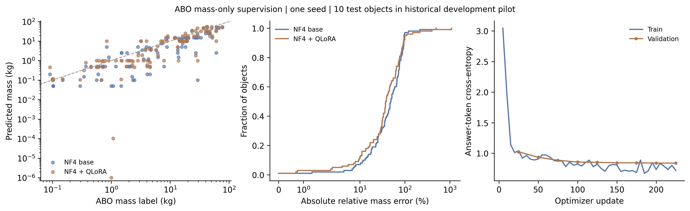

# ABO-500真实质量QLoRA：三轮训练与测试

本轮已完成真实数据训练，不再是两步合成工程测试。使用官方300个训练对象、
100个验证对象和100个测试对象，ASIN与完全重复图像跨划分检查通过。
监督来自ABO质量元数据，尚无经过核验的内部材料或其它物性标签。

## 配置与产物

基座Qwen3-VL-8B-Instruct，单RTX 4090；NF4双重量化、BF16计算，LoRA rank=8、
alpha=16、dropout=0.05。固定00号单视图，白底384×384。学习率5e-5，batch=1，
梯度累积4，3轮共225次更新；每25次验证、保存，最多保留两份检查点。
训练与数据种子为17，使用最终三轮适配器，不根据测试误差选择轮数。

训练运行789.6秒，平均训练损失0.9079，最终验证损失0.8382；252个LoRA_B张量
非零。运行期间观测到约8.5 GB显存占用，该读数不是完整过程的显存峰值。
适配器、训练状态、原始回答、预测哈希和日志均保存。

## 真实结果

前后采用相同NF4量化、同一提示/图像预算、贪心解码。两次测试均100/100有效输出，
预测封存后读取评价标签。不能与上一轮不同分辨率、BF16、长提示的五物体分数
直接拼成受控训练对照。

| 全100测试对象 | 训练前 | 训练后 | 变化 |
| --- | ---: | ---: | --- |
| ADE↓ kg | 6.3943 | 5.8833 | 改善 |
| ALDE↓ | 0.9739 | 0.9170 | 改善 |
| APE↓ % | 56.88 | 60.48 | 变差 |
| RMSE↓ kg | 11.0854 | 10.2926 | 改善 |

历史规则先导曾使用前10个测试对象，近期VLM开发使用其中前5个。准备清单最初
只记录近期5例，运行目录另存更正说明；训练数据、标签和预测没有因此改动。
补充排除历史10例后的90对象结果：ADE为6.6217→6.0158 kg，APE为57.50%→61.66%。
完整100、补充95和90对象的数值见[报告](report.json)。这些仍是开发诊断，不能
称作独立采集的盲测，也不能排除基座预训练接触过公开产品数据。

100个对象中，60例相对误差改善，35例变差，5例相同。按真实质量事后分组：

| 质量范围 | 个数 | 训练前APE % | 训练后APE % |
| --- | ---: | ---: | ---: |
| 小于0.5 kg | 10 | 49.37 | 63.42 |
| 0.5至5 kg | 39 | 75.03 | 86.93 |
| 不小于5 kg | 51 | 44.47 | 39.67 |

两个回答给出了约10⁻⁶ kg和10⁻⁴ kg的极端低估。原始JSON确认这是模型输出；
图保留这些点，没有剪裁预测、删除难例或用标签修正。训练标签最小值约0.00998 kg，
未发现小于1 g的训练质量标签。上述分组只是本次错误诊断，不能作为调参后复测的
独立证据。[逐对象CSV](per_object.csv)、[实际训练报告](training_report.json)。

## 判断与后续改进

这次微调改善了部分绝对/对数误差，却损害平均相对误差，**尚不能判定整体有效**。
验证交叉熵下降没有保证质量数值更准。当前损失监督JSON文本，缺少直接的质量
数值误差与几何、尺度、内部构造约束；仅靠单图也存在物理不可辨识性。

下一阶段应在训练/验证集合上设计数值或对数质量监督，并接入独立尺度与封闭材料
域积分，针对小物体和单位错误验证作用。需要重新预定实验协议和独立评价，不能
看着这100个测试分数反复改到好看。真实材料微调还需要可信材料标注；本次适配器
只验证质量任务，未建立材料、杨氏模量、内部结构或多任务能力保持的准确率。

[训练复现步骤](../../ABO_MASS_TRAINING_zh.md)。
