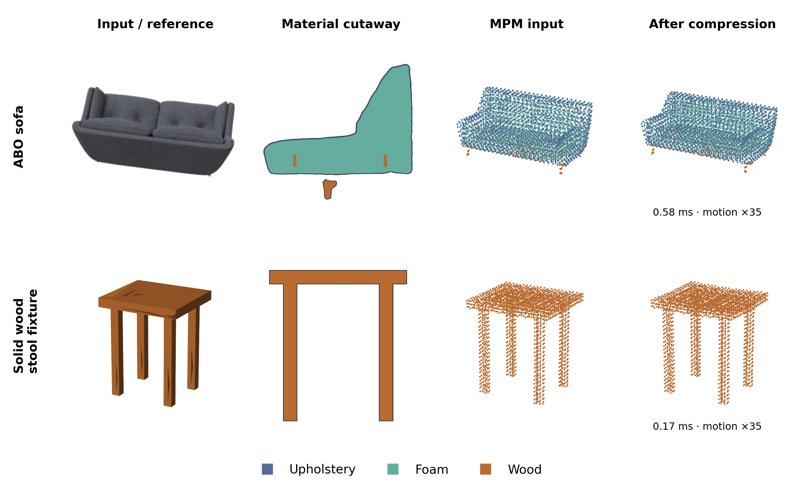

# Mesh 内部材料点与三维 MPM 验证

## 两种构造路径

旧 ABO-50 质量版以部件份额计算标量材料体积。这里把构造提议转为空间材料域，再输出带质量和本构参数的三维粒子。ABO 灰沙发 `B07QFP4PV5_ATVPDKIKX0DER` 沿用现有六视角闭合重建及原三视角的构造回答。按原回答的 1.6 m 最大边长换算到米。软包表面 5 mm 赋布料，内部赋泡沫。木框使用原回答的 20 mm 宽度和显式定义的四条底部支撑带，裁剪到壳层之内。根据木腿视觉提议，在水平截面中识别由细腿过渡到宽座体的高度，这一高度以下的实体独立赋木材。木框位置和泡沫填充范围是构造假设。重建中部分腿与主体有断开，座垫缝和内部空腔仍待建模。材料属性取项目先验均值，泊松比为设定值。

实木凳采用实心单材质路径。凳面和四腿的整个实体都赋木材，腿之间的空气排除在闭合实体外。该凳是具有设计真值的合成对照。构造入口要求显式实心或明确的分层证据，接收到“实心木材＋泡沫芯”等冲突时停止导出。仅有木纹证据时不足以判为实木，真实商品中的贴皮、木质复合板和混合材料仍需标签验证。

## 从内部点到 MPM

用闭合 mesh 的符号距离判定内部。八叉树在外边界、布料厚度界面和木框边界细分，均匀内部可以保留大单元。每个保留单元只赋一个材料。原始积分点另存为 `*_quadrature.npz`。试验用 MPM 文件将同一空间箱内同材料的点合并，保留原始内部位置作为代表点并保证该组质量和体积守恒。对已知均质实木实体，用三角边界积分体积冲销剩余积分误差。

`*_mpm_input.npz` 使用 SI 单位，包含 `position_m`、`volume_m3`、`mass_kg`、`material_id`、`density_kg_m3`、`youngs_pa`、`poisson` 和 `material_names`。CPU 三维 MLS-MPM 从这些文件重新载入粒子，以二次 B 样条做粒子到背景网格和反向传递，以可压缩 Neo-Hookean 模型更新各相应力。材料共享速度网格，相间按粘结处理。[MLS-MPM 方法](https://yuanming.taichi.graphics/publication/2018-mlsmpm/)

| 对象 | 积分点 | MPM 粒子 | 原始积分相对闭合 mesh 体积误差 | 估计总质量 |
| --- | ---: | ---: | ---: | ---: |
| ABO 沙发 | 1,873,503 | 4,492 | −0.0143% | 40.278 kg |
| 实木凳合成对照 | 1,540,800 | 2,172 | +0.0115% | 5.408 kg |

自由落体与解析轨迹的最大位置差在两组均小于 4×10⁻¹⁷ m，压缩中粒子到网格的最大总质量残差小于 1.5×10⁻¹⁴ kg。短时压缩由竖向速度梯度初始化。沙发在 0.584 ms 的最大压缩对应体积比 `J_min=0.99466`，弹性能 21.31 J。固定粒子位置、质量、初速度与时间步，将全体刚度换成泡沫先验，弹性能降到 16.09 J。该对照验证空间刚度赋值实际进入求解。木材体积从粗采样的 8.51 L 变为细采样的 6.19 L，说明总体积吻合时材料域仍可能有离散误差。沙发 MPM 网格间距 123 mm，属于接口与本构检查的粗网格，5 mm 面料的局部应变、接触和座垫回弹还需要网格收敛及实物载荷数据。



剖面按三种材料填色，末列显示同相机下的压缩后粒子，位移放大 35 倍。沙发 RGB 来自 [Amazon Berkeley Objects](https://amazon-berkeley-objects.s3.amazonaws.com/index.html)（CC BY 4.0），做了裁剪和白底合成。图的组织参考 [Gen2Physics 图 1 及图 5](https://arxiv.org/html/2608.23869v1#S4) 的材质分解与模拟示例，以及 [PUGS 图 1](https://marcyu0303.github.io/assets/pdfs/gs_physics.pdf) 的物性到下游应用流程。该验证图展示本方法的内部域和求解状态。跨方法图需要同一对象的基线材料分区或模拟输出。

## 复现

安装 `pip install -e '.[mpm]'`，从仓库根目录执行。

```bash
python scripts/run_mesh_mpm_pilot.py \
  --mesh paper_assets/mesh_interior_mpm_20261119/corrected_camera_space.ply \
  --proposal paper_assets/mesh_interior_mpm_20261119/construction.txt \
  --rgb-npz paper_assets/abo50_local_assembly_20261119/density/B07QFP4PV5_ATVPDKIKX0DER.npz \
  --output outputs/mesh_interior_mpm_20261119
```

[输入、粒子、响应和原始数值](../../paper_assets/mesh_interior_mpm_20261119/) · [实验问题与修复](abo50_experiment_log_zh.md)
