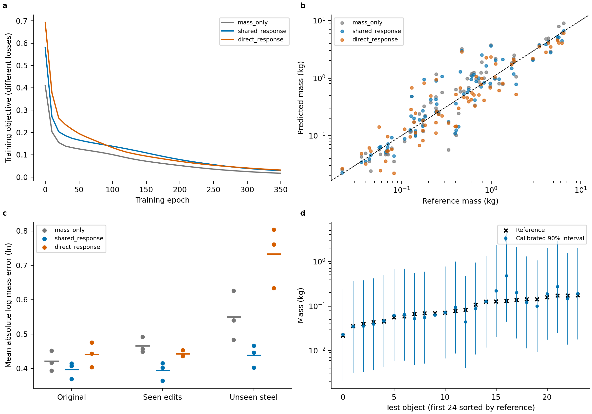
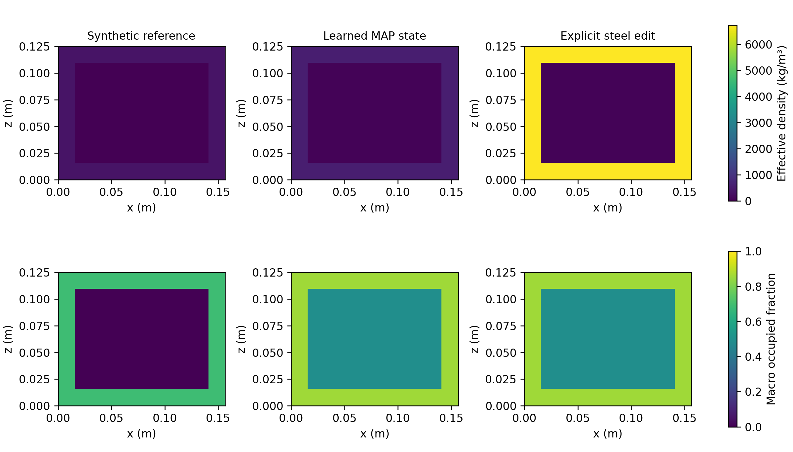
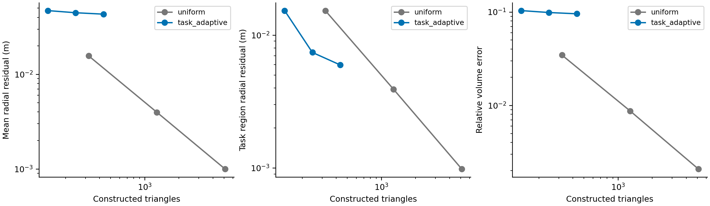

# v0.5.0执行记录：结果、失败与局限

2026-11-04，本地Windows / Python 3.13 / NumPy 1.26.4。
精确Linux修订验证查看对应提交的[CI](https://github.com/fanyizhi/PartPhy3D/actions/workflows/tests.yml)。
本轮没有在共享服务器启动训练、运行GPU测试或恢复队列。

## 已执行内容

- `python -m pytest -q`：检查积分、编辑、几何、评测、学习梯度、隔离、协议等。
  当前计数在`software_validation.json`；不把每项单元检查当成独立科学实验。
- `python scripts/reproduce_all.py --output outputs/full_reproduction_20261104_v4`：
  384合成对象、固定分组分割、350轮、种子17/29/43、三种设置。
- 学习、编辑、可辨识性和曲面构造整套耗时18.73秒，其中学习与导出8.19秒。
  此为本机该次计时，其他运行存在波动，**不是整套真实模型耗时**。
- 真实ABO固定两个对象的严格修复检查，以及明确近似包络的规则基线。

## 合成质量结果

表为三个初始化的均值，ALDE使用自然对数，越小越好。测试72个对象来自12个
未参与训练的族，但该数据生成分布完全受控，不代表真实物体泛化。

| 实际设置 | 原始ADE(kg) | 原始ALDE | 已见编辑ALDE | 未见钢材编辑ALDE |
| --- | ---: | ---: | ---: | ---: |
| mass_only | 0.4297 | 0.4204 | 0.4656 | 0.5493 |
| shared_response | 0.3615 | 0.3967 | 0.3937 | 0.4378 |
| direct_response | 0.3785 | 0.4405 | 0.4427 | 0.7324 |

原始质量的改善不大，残余误差仍大。直接回归在未见高密度编辑上更差，但不能由
这个设计的合成任务推出对论文方法的优势；还需同输入、监督和计算预算的强对照。
三种网络参数量约相同，结构/目标仍不同；参数量和训练时间保存于运行产物。

共享状态MAP资产的原始ALDE约0.4196，高于混合预测0.3967；必须保留这个差距。
构造准确率并未一致提高，表明改善密度/占用并不等于内部拓扑恢复成功。
族级校准区间较宽；高覆盖率也不代表准确性好。完整数字见：

- [逐种子质量指标](learning_v0.5.0_metrics.csv)
- [构造、密度、占用与软硬差距](learning_v0.5.0_states.csv)
- [覆盖率与区间宽度](learning_v0.5.0_intervals.csv)
- [逐对象原始预测](learning_v0.5.0_predictions.csv)
- [物理切片源数据](physical_fields_v0.5.0.csv)

图a目标不同，仅检查收敛；图b单种子质量；图c三个种子的误差和均值；图d单种子
前24个按参考质量排序的测试对象。没有把排序用于调参或选好结果。

固定第一个测试对象，未挑选更漂亮样本。其预测内部与真值仍不同，图中如实显示。
顶部统一密度色标，底部统一宏观占用色标，材料编辑保持占用不变。
这是已知盒域的模型输出，不是沙发内部材料的实测图。

## 曲面构造：没有通过全局物理精度要求

| 第3级 | 面数 | 累计场查询点 | 整体体积相对误差 |
| --- | ---: | ---: | ---: |
| uniform | 5120 | 2562 | 约0.208% |
| task_adaptive | 432 | 218 | 约9.561% |

二者水密，但任务加权过强损害全局精度。少面数不能独立作为成功结论，不能据此
宣称精度不变或InstantMesh解码加速。需加入全局几何/物理误差约束，必要时增加
预算，再在同误差条件下比较开销。体积参考是解析场的高分辨曲面。
完整各级结果见[CSV](adaptive_v0.5.0_metrics.csv)。

## 真实两个ABO对象：通路运行，质量不合格

固定官方test顺序的前两个对象，没有按结果替换。
`configs/abo500_mesh_smoke.yaml`严格修复：二者均因非水密失败。
`configs/abo500_envelope_smoke.yaml`显式近似包络：2/2运行成功。
采用参考GLB、几何聚类、手工颜色描述和材料先验；未执行InstantMesh、千问或PartField。
米制比例设为1，仍需独立尺度和相机配准复核，不能把通路成功当成输入准确性证明。

| 对象 | 数据标签质量(kg) | 规则估计均值(kg) | 绝对误差(kg) |
| --- | ---: | ---: | ---: |
| B07WTFJGRG | 约4.4407 | 85.0128 | 80.5721 |
| B073WGP8XN | 约7.8471 | 74.2055 | 66.3583 |

ADE约73.47kg，ALDE约2.5993，先验采样90%区间覆盖率0。
这些估计不能作为论文最终结果或机械臂控制参数。它们揭示了先验、占用、修复和
对应仍需要改进。原始预测和失败日志保留在本地运行目录；可按完整手册重新运行。

## 尚未证明

真实图像到学习部件状态的准确性、精细连接处识别、真实内部几何恢复、E/摩擦/
硬度精度、真实编辑响应泛化、受约束稀疏构造优势、机械臂/MPM实验均未得到证明。
PUGS等论文方法还没有本项目同协议预测，仍为pending。软件可运行和打包不替代
这些证据；下一阶段应优先准备独立参考，而不是继续把VLM自估计当成真实标签。
