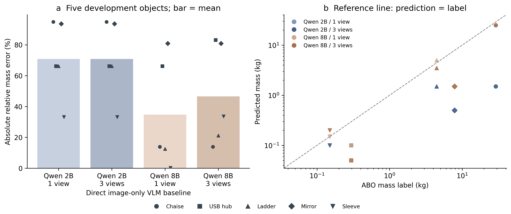
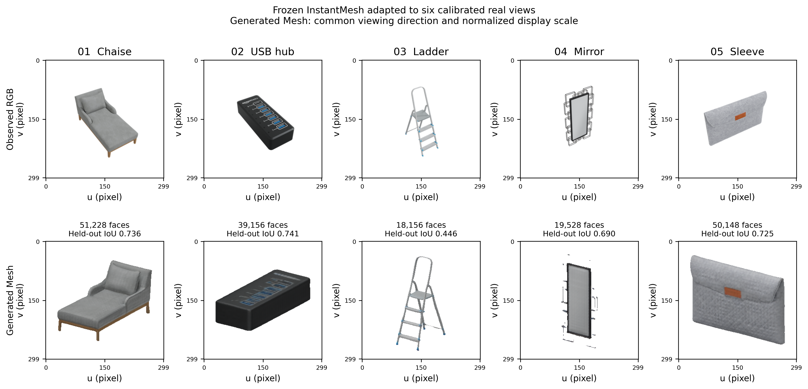
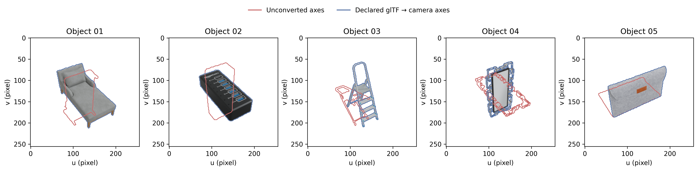
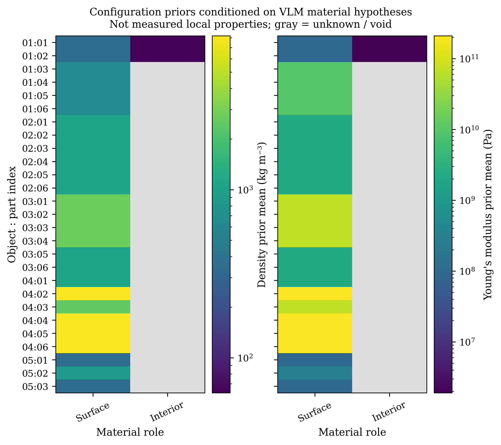

# 2026-11-06：五物体真实模型先导实验

这一轮完成了真实图片的VLM推理、六视角冻结重建器诊断，以及两步QLoRA
工程验收。**尚未完成从图片到精细部件、内部材料域和准确物理属性的联合方法。**
这些结果用于定位问题，不能代替完整论文实验或已发表方法的公平比较。

## 数据与实验边界

- 使用仓库冻结的5个ABO-500开发对象，每个对象30张原图和相机标定。
- 机器为单张RTX 4090 24 GB，主环境Python 3.10、PyTorch 2.6.0+cu124。
- Qwen3-VL分别采用2B和8B Instruct本地权重、BF16、SDPA、贪心生成、种子17。
- VLM单视角输入第00张，三视角输入00、10、20；没有输入尺寸或质量标签。
- 预测JSON先封存并保存SHA256，再由评价代码读取质量标签。
- 本队列已经反复用于开发，开发者也查看过标签；这不是未经接触的盲测集。
- 图片中的物体重量来自ABO元数据，尚未由我们用秤独立复测。
- 这一轮没有PUGS、NeRF2Physics、PhysVGGT的真实复现分数。

## 质量结果

APE为对象相对误差的算术均值：

\[
\mathrm{APE}=\frac{1}{N}\sum_i\frac{|\hat m_i-m_i|}{m_i}.
\]

下表将APE乘100表示为百分数。ADE为平均绝对质量误差，单位kg；ALDE采用
当前代码中的对数误差定义。具体公式实现见`mass_error_arrays`。

| 图像直接估计基线 | 对象数 | ADE↓ kg | APE↓ % | ALDE↓ |
| --- | ---: | ---: | ---: | ---: |
| Qwen3-VL-2B，1视角 | 5 | 7.6127 | 70.82 | 1.6580 |
| Qwen3-VL-2B，3视角 | 5 | 7.6127 | 70.82 | 1.6580 |
| Qwen3-VL-8B，1视角 | 5 | 2.2265 | 34.76 | 0.6020 |
| Qwen3-VL-8B，3视角 | 5 | 2.3228 | 46.53 | 0.8220 |



| 对象 | ABO质量标签 kg | 2B单/三视角 kg | 8B单视角 kg | 8B三视角 kg |
| --- | ---: | ---: | ---: | ---: |
| 躺椅 | 29.029888 | 1.5 | 25 | 25 |
| USB集线器 | 0.295969 | 0.1 | 0.1 | 0.05 |
| 梯子 | 4.440666 | 1.5 | 5 | 3.5 |
| 镜子 | 7.847142 | 0.5 | 1.5 | 1.5 |
| 毛毡保护套 | 0.149685 | 0.1 | 0.15 | 0.2 |

8B在该开发队列上优于2B，但多放两张图片没有改善质量估计。较大的模型也
没有解决集线器、镜子的质量错误。不能根据这5例声称统计显著、普遍优于2B，
也不能把8B的直接预测称为我们完整物理方法的结果。

原始预测、指标和封存记录保留在服务器运行目录及本地结果包中。
[逐物体CSV](mass_per_object.csv)和[运行指标/哈希](vlm_comparison.json)随源码发布。

## 真正生成的Mesh

这次实际执行了冻结InstantMesh重建网络，检查点SHA256为
`329f7aae9b583fd7c1b27d0221463db7b808a03c48a1f7aa26649af6a03b91a1`。
上游源码固定为`08822c52fdc399b93ea00e4fa9e596344ed52ccc`。

输入是六张真实标定视图，直接进入重建网络；没有执行Zero123，也没有把参考GLB
当作生成结果。这是**改变输入分布的观察视图适配诊断**，不是官方单图InstantMesh
全流程，也不是我们新训练的生成模型。我们的自适应生成预算尚未接入该解码器。

相机归一化只使用相机视轴的最小二乘中心、平均相机半径和已知内参。
没有用参考Mesh或质量做对齐、尺度拟合。六视角按照固定方向规则选择；其余24个
视角用于轮廓检查。选择展示视角的索引在查看分数之前确定。

| 对象 | 生成三角面数 | 水密 | 24个未输入视角平均轮廓IoU↑ |
| --- | ---: | --- | ---: |
| 躺椅 | 51,228 | 是 | 0.7356 |
| USB集线器 | 39,156 | 是 | 0.7406 |
| 梯子 | 18,156 | 是 | 0.4459 |
| 镜子 | 19,528 | 是 | 0.6900 |
| 毛毡保护套 | 50,148 | 是 | 0.7251 |
| 对象均值 | — | — | 0.6675 |



上下两行视角不同；下排为统一方向、各自归一化显示大小的生成Mesh。真实投影分数
来自固定相机下的轮廓评价，不从这张展示图估计。
[数值与Mesh哈希](reconstruction.json)。

梯子的细杆、连接和踏步，以及镜子的细框架有明显损失。水密仅表示闭合拓扑，
不能证明这些几何细节正确，也不能证明内部实心。轮廓IoU也不能替代三维表面、
壁厚、接口和真实物理量评价。

输出同时包含`model_space.ply`和`camera_space.ply`。`camera_unit_to_meter`为null，
还没有独立核验米制比例；体积字段只能解释为相机单位的三次方，不能直接称m³。
外部长度标定后才可用尺度的三次方转换体积。严禁使用测试质量反推该尺度。

物理积分路径不进行occupancy体素填充，但冻结InstantMesh内部仍使用
FlexiCubes规则网格查询/曲面提取；不能宣称整个重建流程从未使用规则网格。

## 坐标与材料检查

修复了通用ABO投影入口中glTF Y向上与ABO相机Z向上的坐标不一致。
采用显式刚体旋转，保持体积、面积和长度；不按每个对象搜索最优旋转。

5个参考GLB各3个固定视角的轮廓IoU均值从0.2383变为0.9073。
这是参考几何与相机的**坐标审计**，不是生成模型的精度，也不是论文创新贡献。
[审计JSON](reference_frame_audit.json)。



VLM输出仍有框重复、内部材料未知、实心声明与void内部冲突等问题。
8B三视角有2个对象、单视角有3个对象包含至少一个“solid且interior=void”的
部件。新增质量标记保留这些矛盾，不自动改成看起来合理的答案。
[不改动封存预测的事后语义审计](semantic_audit.json)。



图中密度和杨氏模量是**配置材料先验**，按VLM材料假设检索；不是材料实测值，
不是已训练的物性回归结果，也没有独立准确率。灰色表示未知或空腔。
[部件序号对应表](material_part_mapping.csv)。VLM框提议不构成精细部件分割。

## QLoRA实际验证

- 基座：本地Qwen3-VL-2B-Instruct，4bit NF4，LoRA rank=8、alpha=16。
- 数据：4个独立指定尺寸和密度的合成盒子，2个训练、2个验证，无ABO图像或标签。
- 仅执行2个优化步骤；只对assistant答案token计算损失。
- `train_loss=0.8701262`，196个LoRA_B张量非零；适配器17,490,168字节。
- 观测到峰值GPU分配约1.98 GiB，基座权重文件SHA256保持不变。
- 拒绝训练/验证对象重叠和跨划分重复图像，检查提示与答案token边界。

这些结果证明量化、前后向、损失mask和保存链路可运行，**没有证明专业材料微调
有效**。不能把两步合成训练的验证损失或token准确率作为ABO物理准确率。
[真实运行报告](qlora_integration.json)。

## 复现入口

两套Transformers环境的五物体回归已通过：三角拓扑相同，最大顶点差约
2.38×10⁻⁷个相机单位，文件字节并非完全相同。新入口不创建光栅器，主环境即可
运行，无需为此降级Transformers或编译CUDA插件。
[环境回归记录](unified_frontend_regression.json)。

主环境仍从项目根目录安装统一requirements。预训练模型权重另行下载，不能把
架构配置或空目录当成已准备好的模型。每次实验使用新的输出目录，保留失败日志。

```bash
python scripts/check_installation.py --training
python -m pytest -q
python scripts/download_model_snapshot.py \
  --model Qwen/Qwen3-VL-8B-Instruct --output weights/Qwen3-VL-8B-Instruct
python scripts/run_local_vlm_pilot.py \
  --model-path weights/Qwen3-VL-8B-Instruct \
  --output outputs/qwen8b_three --view-count 3
python scripts/run_local_vlm_pilot.py \
  --model-path weights/Qwen3-VL-8B-Instruct \
  --output outputs/qwen8b_one --view-count 1
```

`--prompt-mode typed_schema`为默认；保留数值示例的旧提示仅用于复核模型复制示例的
失败。2B和8B的最后受控对照均使用类型提示，未针对单个物体修改提示。

生成Mesh的依赖和固定资产配置见[重建复现说明](../../OBSERVED_FRONTEND_zh.md)。
评价与绘图不重新调用模型：

```bash
python scripts/evaluate_observed_mesh.py \
  --run outputs/reconstruction --output outputs/reconstruction_evaluation
python scripts/compare_vlm_pilots.py \
  --run "8B / 1 view=outputs/qwen8b_one" \
  --run "8B / 3 views=outputs/qwen8b_three" \
  --output outputs/qwen8b_view_comparison
```

单独验收QLoRA工程链：

```bash
python scripts/download_model_snapshot.py \
  --model Qwen/Qwen3-VL-2B-Instruct --output weights/Qwen3-VL-2B-Instruct
python scripts/smoke_qlora.py --model weights/Qwen3-VL-2B-Instruct \
  --output outputs/qlora_integration --execute
```

## 下一阶段的研究任务

1. 先核验尺度与细结构：针对梯子/镜子的薄杆、接口和框架建立标注、轮廓及三维
   对照，避免先堆更多模型。稀疏构造同时约束全局体积与局部接口误差。
2. 实现可审计的精细部件对应：多视角掩码映射到生成Mesh，保留可见性、遮挡和
   冲突；用独立标注评价mIoU、边界F分数和接口覆盖，不能用VLM框自证准确。
3. 将表皮/骨架/填充/空腔表示为互斥封闭材料域；加入可观测证据，输出候选构造
   与不确定性。质量由各域密度与体积积分，不再让VLM直接给最终质量充当主方法。
4. 给共享状态和编辑响应建立可信监督。先验证任务损失和干预是否改善可辨识性，
   再扩大训练；5个开发对象不足以证明专业VLM微调的泛化。
5. 同一对象、相同可用信息、独立封存预测下复现论文基线；同时评价原始质量和编辑
   后质量、COM、惯量、物性误差与更新时间。尚无物性真值的指标保持缺失。

目前可以确认工程路径可执行、基础数学检查通过；还不能确认完整方法有效、
超过相关论文或达到某一期刊的接收标准。
