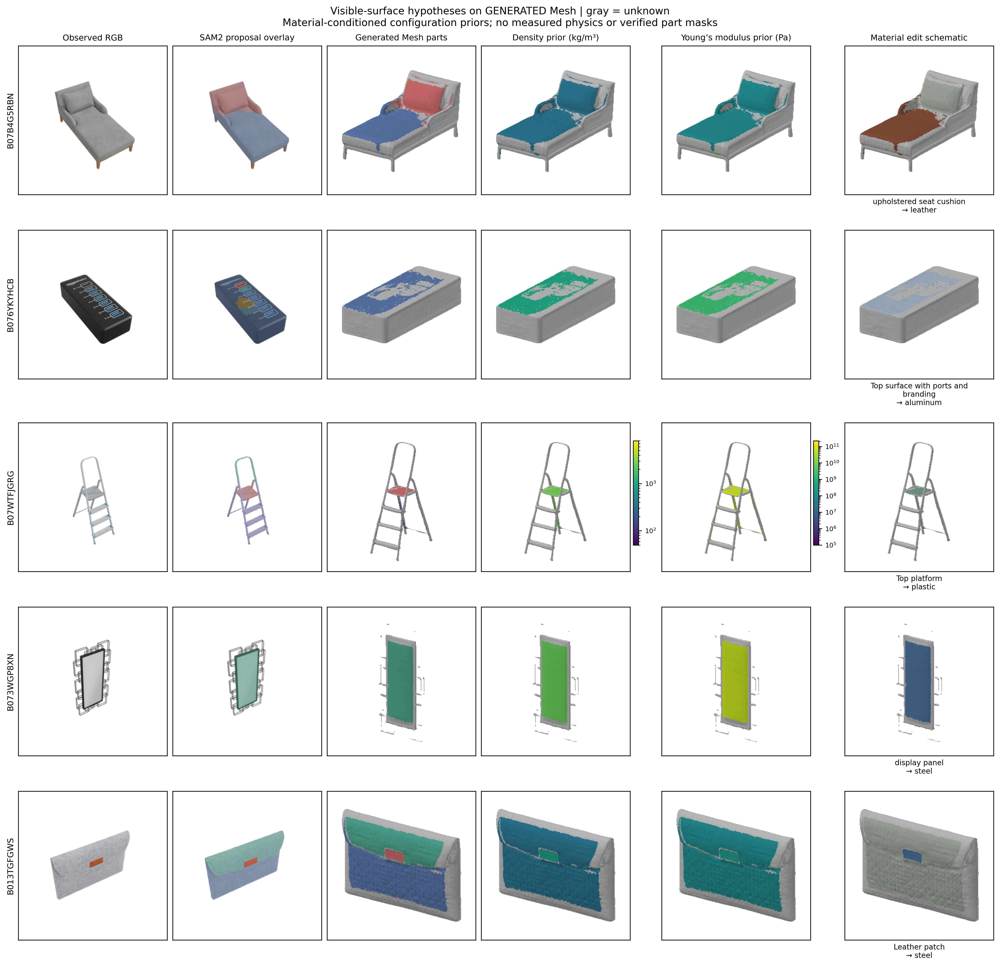
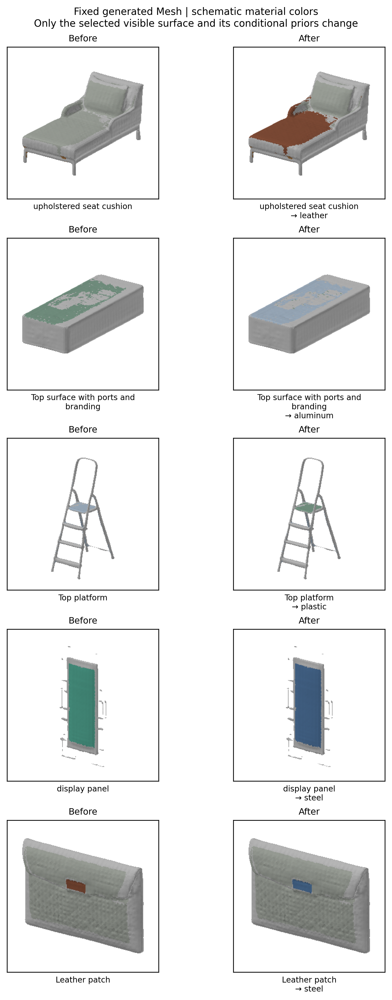
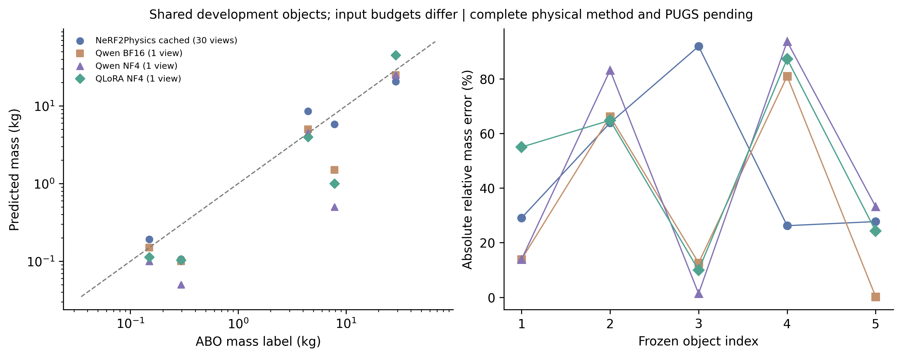
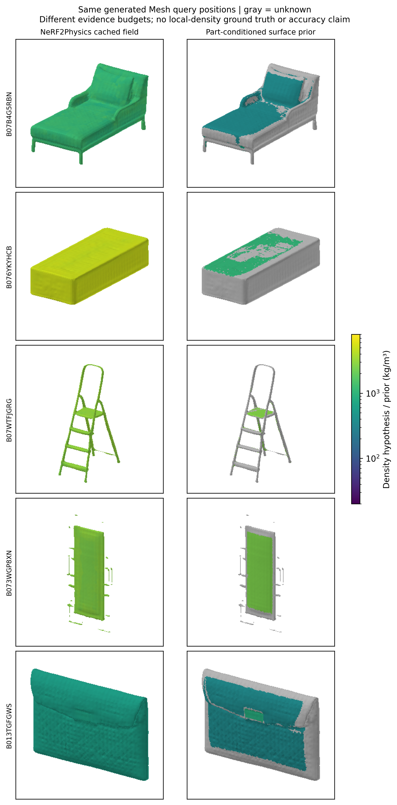

# 五物体表面物性、部件编辑和可运行对照

这是 2026-11-07 的实际运行记录，研究状态为开发验证。
先读 [逐项想法审计](../../RESEARCH_IDEA_AUDIT_20261107_zh.md)。

“实际运行”指确实执行模型与程序，不代表所有数据是实拍，也不代表实物力学验证。
这里使用 ABO-500 发布图像和商品目录质量标签，没有把商品拿来独立称重或拆解。

## 实际输出



每行：原图、SAM2 提议叠图、生成 Mesh 部件、密度先验、杨氏模量先验、换材。
灰色是未知，物性来自 `configs/material_priors.yaml`，不是实测属性。
颜色只是材料示意，不是物理渲染或材料纹理生成。



编辑目标是显式指定的、已有观测面的部件。目标外的面颜色、密度、杨氏模量和
像素变化均有断言检查。详见 [编辑记录](surface_edits.json)、[编辑命令](edit_specs.json)
及各物体目录的参数表。真实物品编辑后的质量仍为空：尚无已验证尺度和封闭材料域。

| 对象 | 最终获得标签的 Mesh 表面积 / 全面积 | 编辑目标 |
| --- | ---: | --- |
| B07B4G5RBN_ATVPDKIKX0DER，躺椅 | 29.13% | 坐垫表面→皮革 |
| B076YKYHCB_A1F83G8C2ARO7P，集线器 | 15.57% | 顶部表面→铝 |
| B07WTFJGRG，梯子 | 15.82% | 顶部平台→塑料 |
| B073WGP8XN，镜子 | 34.13% | 镜面→钢 |
| B013TGFGWS_A1F83G8C2ARO7P，保护套 | 32.43% | 皮革片→钢 |

面积比例不是 mIoU，也不是材料准确率。只有三张视角参与部件融合，未知区域不能
直接补成确定材料。细杆和镜框重建不佳、标签零散等失败没有被修图隐藏。
[完整拒绝与重复检查](surface_coverage_and_conflicts.json)。

新增串行入口已重新执行第一个对象，五步合计约 166 秒，未复用定位与分割输出；
[阶段时间和状态](pipeline_gate.json)、[单对象输出](pipeline_gate.png)。
本机和 Linux 服务器均通过 189 项测试，见 [检查记录](verification.json)；
[服务器实际库版本](environment.json)单独记录。

## 第一次失败与修正

[第一次的错误材料分配图](failure_initial_semantic_assignment.png)保留不覆盖。
主要问题是同一点被分别命名为“坐垫”和“木框”，以及大区域掩码吞没小部件。
后来增加可见点位材料问答、重复掩码拒绝和嵌套区域规则，生成最终图。
点位问答仍然是 VLM 假设；同一模型的回答一致不构成真实材料正确的证明。
各物体目录保留定位和材料问答 JSON，便于追查每个标注的来源。
规则在这些开发对象上调整过，最终覆盖率不可称为盲测表现。

## 实际对照





使用原始 NeRF2Physics `predict_physical_property_integral` 和
`predict_physical_property_query`，未修改其算法；源码固定为
`7311210f62b120f6896b3112b231c26003ce70e3`。
使用发布的 NeRF/CLIP 缓存、材料密度范围和厚度提示，默认温度 0.1、采样 0.005、
厚度积分与修正系数 0.6。质量范围中点用于点误差，范围本身不是校准置信区间。
未执行新的 NeRF 训练或 GPT 材料提议。上游见
[NeRF2Physics](https://github.com/ajzhai/NeRF2Physics)。

缓存源是 30 视角；Qwen 直接质量为 1 视角；我们的部件为 3 视角，生成 Mesh 为
6 视角。图是诊断对照，**输入预算不同，不能据此宣称公平领先**。
局部密度没有真值，密度图也不能用于排名。
[逐物体质量 CSV](mass_rows.csv)、[指标](mass_comparison.json)、
[第一个对象的协议](nerf_gate_protocol.json)、[其余四个协议](nerf_remaining_protocol.json)
及对应封存预测均随库发布。

PUGS 未复现，没有借用 NeRF2Physics 或自定义查表程序充当 PUGS；其分数为 null。
完整 PartPhy3D 尚未建立真实材料体积，质量分数同样为 null。

另核对了原论文 §4.2：质量点预测在计算指标前裁剪到 0.01–100 kg。
本次五物体预测全部在该范围内；100 物体微调对照另保存
[原始与同规则裁剪的双协议报告](mass_protocol_audit.json)。原始封存预测不修改。
裁剪后的微调 APE 仍为 60.46%，高于基座的 56.88%，没有反转失败结论。
这只能使一个评价细节对齐，不能弥补输入视角和测试开发使用历史的差异。
协议来源：[NeRF2Physics 原论文](https://arxiv.org/html/2404.04242v1#S4.SS2)。

## 无 GPU 的最短重放

在仓库根目录，Python 3.10：

```bash
python -m pip install -r requirements.txt
python -m pytest -q
python scripts/render_surface_maps.py \
  --fields examples/observed_surface_demo \
  --edit-spec examples/observed_surface_demo/edit_spec.json \
  --output outputs/my_surface_replay
python scripts/reproduce_mesh_native.py --output outputs/my_closed_regions
```

第一条绘图重放真实保护套的冻结推理结果；第二条验证已知闭合构造的体积、
质量、COM、惯量和换材更新。两个实验的证据范围不同，不能混称真实物体物性验证。

## 重新执行 GPU 部件推理

Linux 服务器使用统一 `requirements.txt`，已在 RTX 4090 24 GB 实际执行。
需要本地 Qwen3-VL-8B-Instruct、冻结前端生成的五个 `camera_space.ply` 和三个观察视角。
前端步骤见 [观察视图重建](../../OBSERVED_FRONTEND_zh.md)，
三视角部件材料假设见 [先导命令](../server_pilot_20261106/README_zh.md)。
权重不包含在代码库；下载 SAM2 与 CLIP 时先复制固定下载清单：

```bash
mkdir -p weights/sam2 weights/clip
cp configs/pretrained/sam2.1-hiera-small_manifest.json \
  weights/sam2/download_manifest.json
cp configs/pretrained/clip-datacomp_manifest.json \
  weights/clip/download_manifest.json
python scripts/download_model_snapshot.py \
  --model facebook/sam2.1-hiera-small --output weights/sam2
python scripts/download_model_snapshot.py \
  --model laion/CLIP-ViT-B-16-DataComp.XL-s13B-b90K --output weights/clip
```

`mesh_manifest.json` 是字典：每个 scene_id 对应 `{"path": "生成Mesh路径", "sha256": "哈希"}`。
必须绑定生成的 Mesh，不能改成数据集参考 GLB。建议重新生成统一输出路径后建立清单。
以下输出目录均须不存在；`outputs/qwen8b_three` 是之前真实三视角推理输出：

可使用串行入口一次完成下面五阶段，默认先运行第一个对象；已在服务器实际验收。
`--limit 5` 运行固定五个对象，每个阶段单独保存日志，失败即停止并保留失败阶段：

```bash
python scripts/run_observed_surface_pipeline.py \
  --predictions outputs/qwen8b_three --model weights/Qwen3-VL-8B-Instruct \
  --sam-checkpoint weights/sam2/sam2.1_hiera_small.pt \
  --clip-checkpoint weights/clip/open_clip_pytorch_model.bin \
  --mesh-manifest outputs/mesh_manifest.json \
  --edit-spec docs/results/surface_physics_20261107/edit_specs.json \
  --output outputs/my_surface_pipeline --limit 1
```

它接收已经生成的 Mesh 和先前材料假设，不执行完整重建或真实体积物理推断。
需要单独调试时，等价的阶段命令如下，二者任选一个新输出路径：

```bash
python scripts/run_part_surface_maps.py --phase locate \
  --predictions outputs/qwen8b_three --model weights/Qwen3-VL-8B-Instruct \
  --output outputs/my_parts --limit 5
python scripts/run_part_surface_maps.py --phase segment \
  --predictions outputs/qwen8b_three \
  --sam-checkpoint weights/sam2/sam2.1_hiera_small.pt \
  --mesh-manifest outputs/mesh_manifest.json --output outputs/my_parts --limit 5
python scripts/observe_part_points.py \
  --locations outputs/my_parts/locations --model weights/Qwen3-VL-8B-Instruct \
  --output outputs/my_point_materials
python scripts/refine_surface_conflicts.py \
  --source outputs/my_parts/fields \
  --checkpoint weights/clip/open_clip_pytorch_model.bin \
  --point-evidence outputs/my_point_materials --output outputs/my_refined_fields
python scripts/render_surface_maps.py --fields outputs/my_refined_fields \
  --edit-spec docs/results/surface_physics_20261107/edit_specs.json \
  --output outputs/my_surface_figures
```

SAM2 源码固定 commit `2b90b9f5ceec907a1c18123530e92e794ad901a4`；纯 Python
运行 wheel 和许可证随库发布，不需要为 SAM2 编译 CUDA 后处理。检查点及上游
SHA256 写在下载清单和脚本内；见 [SAM2](https://github.com/facebookresearch/sam2)。

## 重跑缓存基线

从 ABO-500 完整发布包准备同一五个对象的 `features/`、`ns/point_cloud.ply`、
`ns/dataparser_transforms.json`、`ns/renders/depth/*.npy.gz`、
`info.json`、`transforms.json` 和 `images/`。深度的实际相对路径由上游读取，
不能把缺少深度或 CLIP 特征的 5 物体轻量包当成完整缓存输入。
固定上游源码后运行：

```bash
python scripts/run_nerf_cached_baseline.py \
  --repository external/NeRF2Physics \
  --root data/nerf2physics_cached_five \
  --clip-checkpoint weights/clip/open_clip_pytorch_model.bin \
  --mesh-manifest outputs/mesh_manifest.json \
  --output outputs/nerf_cached --start 0 --limit 5
```

保存协议、输入哈希、预测封存及生成 Mesh 同位置的密度查询。
没有配置在线服务也可执行这条发布缓存对照；它不等价于从图像重新复现全部上游过程。
训练前后质量问答另见 [完整训练记录](../../ABO_MASS_TRAINING_zh.md)。
