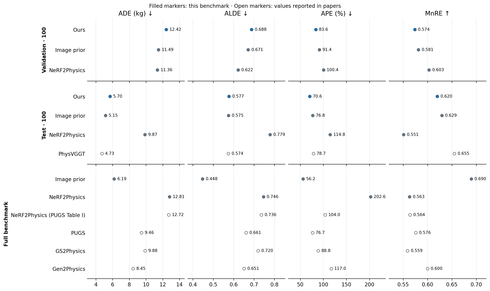
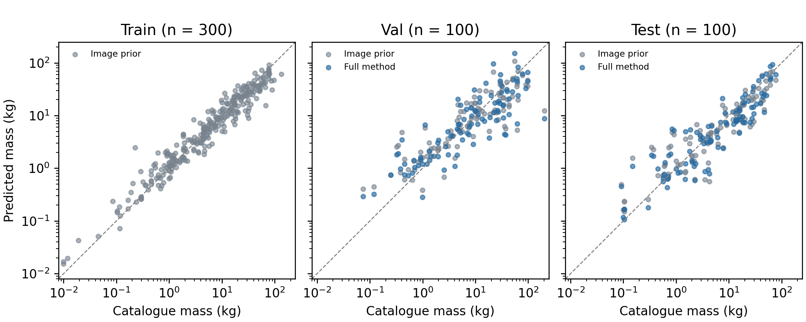
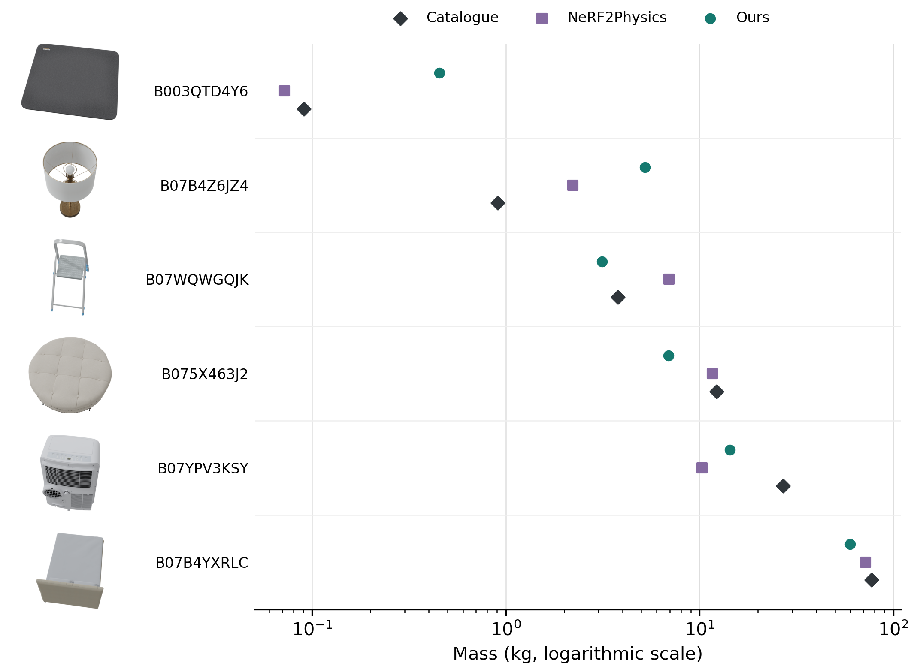
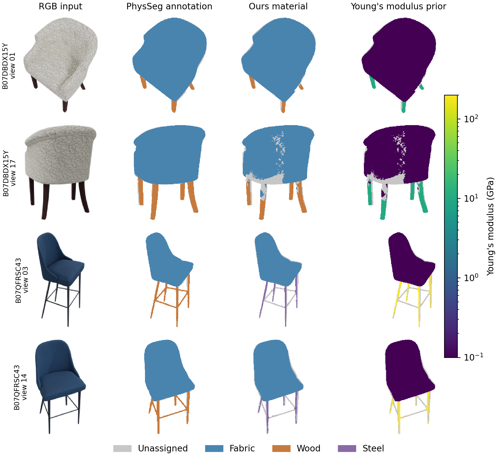
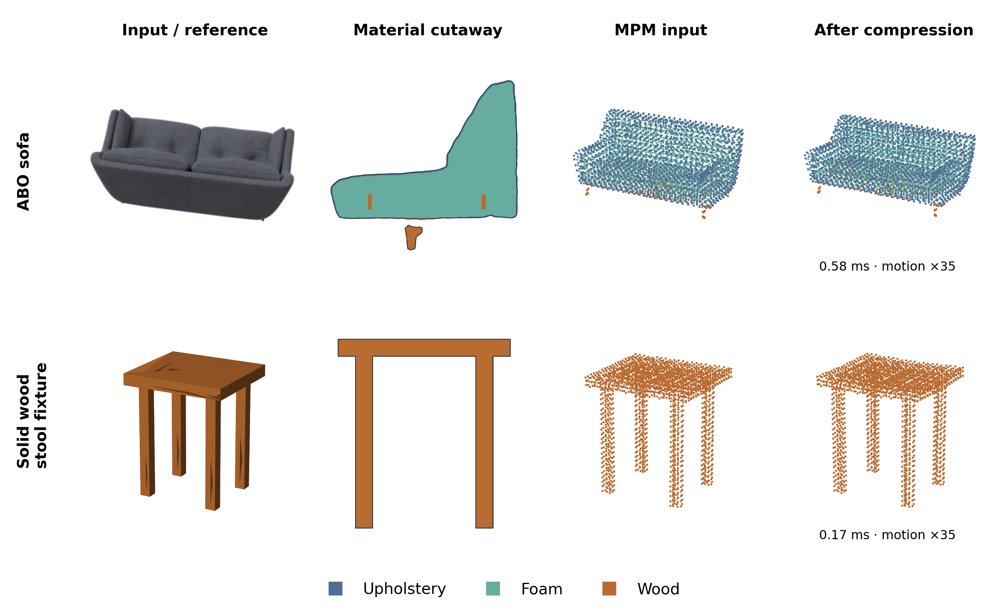
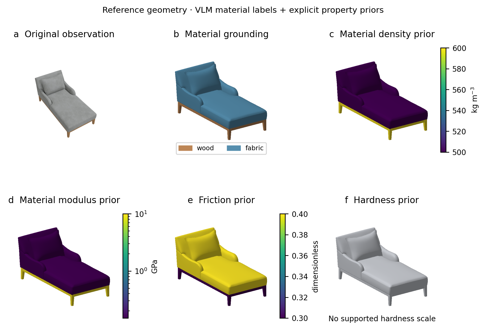

# ABO-500 质量估计

图像质量头在官方训练 300 件拟合，在验证 100 件选择正则系数。六视角重建及三视角物理推理沿用冻结设置。测试 100 件曾用于诊断。全体汇总含训练对象。

完整方法已纳入本页的封存预测为 375/500 件。图像先验有 500/500 件，训练及验证使用 CPU 重放冻结头，测试沿用原 GPU 预测。每张表仅在对应范围完整时给出本方法汇总。

## 表 1　训练集，300 件

| 方法 | 评测口径 | ADE (kg) ↓ | ALDE ↓ | APE (%) ↓ | MnRE ↑ |
|---|---|---:|---:|---:|---:|
| Ours，完整方法 | 已汇入 175/300，等待整组封存 | — | — | — | — |
| 仅图像先验（消融） | 同对象逐件评分 | 4.765 | 0.3308 | 37.55 | 0.7458 |
| NeRF2Physics 官方缓存 | 同对象逐件评分 | 14.280 | 0.7768 | 266.00 | 0.5539 |

## 表 2　验证集，100 件

| 方法 | 评测口径 | ADE (kg) ↓ | ALDE ↓ | APE (%) ↓ | MnRE ↑ |
|---|---|---:|---:|---:|---:|
| Ours，完整方法 | 同对象逐件评分 | 12.420 | 0.6880 | 83.61 | 0.5738 |
| 仅图像先验（消融） | 同对象逐件评分 | 11.486 | 0.6710 | 91.44 | 0.5814 |
| NeRF2Physics 官方缓存 | 同对象逐件评分 | 11.363 | 0.6217 | 100.45 | 0.6031 |

## 表 3　测试集，100 件

| 方法 | 评测口径 | ADE (kg) ↓ | ALDE ↓ | APE (%) ↓ | MnRE ↑ |
|---|---|---:|---:|---:|---:|
| Ours，完整方法 | 同对象逐件评分 | 5.696 | 0.5770 | 70.62 | 0.6199 |
| 仅图像先验（消融） | 同对象逐件评分 | 5.154 | 0.5747 | 76.82 | 0.6293 |
| NeRF2Physics 官方缓存 | 同对象逐件评分 | 9.871 | 0.7787 | 114.79 | 0.5511 |
| [PhysVGGT](https://arxiv.org/html/2609.18920v1#A1.T13) | 原文表 13，单图全局头；作者测试集 | 4.730 | 0.5740 | 78.70 | 0.6550 |

## 表 4　全体对象，500 件

| 方法 | 评测口径 | ADE (kg) ↓ | ALDE ↓ | APE (%) ↓ | MnRE ↑ |
|---|---|---:|---:|---:|---:|
| Ours，完整方法 | 已汇入 375/500，等待整组封存 | — | — | — | — |
| 仅图像先验（消融） | 同对象逐件评分 | 6.187 | 0.4476 | 56.18 | 0.6896 |
| NeRF2Physics 官方缓存 | 同对象逐件评分 | 12.815 | 0.7462 | 202.65 | 0.5632 |
| [NeRF2Physics](https://marcyu0303.github.io/assets/pdfs/gs_physics.pdf#page=5) | PUGS 表 I 报告的对照 | 12.725 | 0.7360 | 104.00 | 0.5640 |
| [PUGS](https://marcyu0303.github.io/assets/pdfs/gs_physics.pdf#page=5) | 原文表 I，全 500 件 | 9.461 | 0.6610 | 76.70 | 0.5760 |
| [GS2Physics](https://ieeexplore.ieee.org/document/11653536/) | 原文表 I，Test1–3 共 500 件 | 9.884 | 0.7200 | 88.80 | 0.5590 |
| [Gen2Physics](https://arxiv.org/html/2608.23869v1#S4.T1) | 原文表 1，ABO-500，参考资产输入 | 8.447 | 0.6510 | 117.00 | 0.6000 |

NeRF2Physics 的同对象行使用作者缓存的 30 视角属性阶段，区间取算术中点。论文原表按作者的数据范围列在表 3、4。物理输入、训练监督和测试对象的接触历史影响跨论文比较。

实心点为本实验逐对象评分，空心点为各论文报告值。全量面板的完整方法一行在 500 件封存后生成。[质量对比图 PDF](mass_baseline_comparison.pdf) · [可编辑 SVG](mass_baseline_comparison.svg)

测试集按目录质量排序，展示第 1、21、41、60、80、100 名。所有对象使用第 08 帧，依次比较目录质量、NeRF2Physics 缓存和 Ours。各面板的纵轴随物体质量范围变化，数值单位均为 kg。

RGB 来源为 Amazon Berkeley Objects，Collins 等，CVPR 2022，CC BY 4.0。使用原帧白底合成。[数据来源](https://amazon-berkeley-objects.s3.amazonaws.com/index.html)

## 材质、物性与模拟图

下图对应 PUGS、GS2Physics、Gen2Physics 的材质分区以及 PhysVGGT 的分属性视图。以两把有 PhysSeg 标注的椅子为例，每件固定取按帧编号排序的第 1、3 个标注视图；评测使用全部 10 张。用相同的相机和裁剪排列输入、公开标注、预测材质与按材质赋予的杨氏模量先验。两类 mIoU 为 64.13%（织物 95.55%、木材 32.71%）。蓝椅细腿被预测成钢，公开标注为木材，这个分歧同时影响材质评分和刚度图。该小样本来自原有外观补全诊断。

[PhysSeg-15 作者标注](https://github.com/momaiyc/GS2Physics) · [十视角计数](../abo50_coverage_20261119/appearance/physseg_overlap.json) · [材质与模量矢量图](physseg_material_modulus.pdf)

沙发和木凳图依次展示输入、构造剖面、内部粒子和压缩响应。沙发内部结构采用模型假设，木凳是有构造真值的合成对照，图中位移放大 35 倍。对应 Gen2Physics 的部件与模拟、PUGS 的物性到任务验证。

躺椅参考网格单例按固定视角展示材质及表面物性先验，对照 PhysVGGT 和 GS2Physics 按属性分列的画法。该例使用参考几何。不同量纲分别标尺，未知区域保留在图中。

NeRF2Physics 与 PUGS 的同视角示例、五篇论文来源、材质与标注的详细口径见[既有逐项对照](../../docs/results/abo50_physical_comparison_20261119_zh.md)。

[逐对象散点矢量图](split_mass.pdf) · [封存的测试实验](../../docs/results/abo100_role_replay_zh.md)
