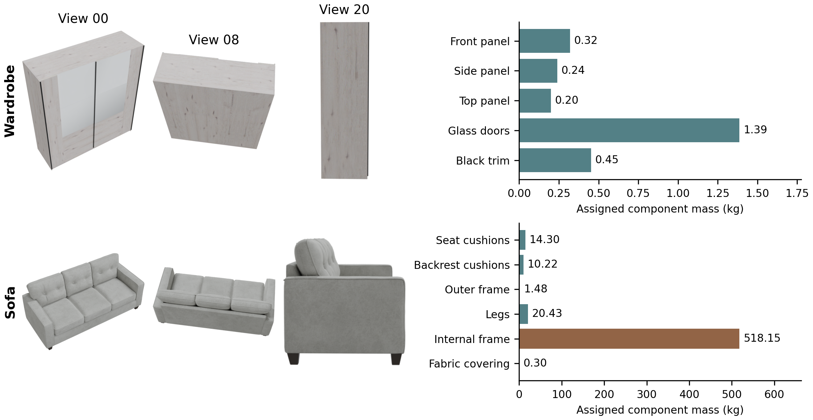

# 同视角结构复核：衣柜与沙发

从验证集选取冻结方法绝对误差最大的两件，专门检查失效原因。模型输出构件的分配质量，数据集只提供物体级质量。各行条形图独立使用 kg 标尺。照片来自 ABO 原始渲染，仅裁透明留白；三幅图保持 00、08、20 顺序。三帧与服务器复核的原图 SHA-256 一致。

| 验证案例 | 目录 kg | NeRF2Physics 作者缓存中点 kg | Ours 冻结版 kg | 物理分支 kg | 放弃结构修正、回退图像 kg |
|---|---:|---:|---:|---:|---:|
| 衣柜 B07H8VCM68 | 205.00 | 118.87 | 8.82 | 2.60 | 12.38 |
| 沙发 B07QHYD94M | 55.34 | 70.69 | 151.63 | 564.87 | 107.84 |

回退列测量两件已发现错误的案例上，单独去掉结构修正的效果。样本按冻结版误差选取，缺少面向全部对象的触发器，不能用来估算总体增益。

| 构造诊断 | 冻结物理分支 kg | 目录最长边，保持壁厚 kg | 目录最长边，壁厚同比例缩放 kg |
|---|---:|---:|---:|
| 衣柜 | 2.60 | 34.33 | 124.74 |
| 沙发 | 564.87 | 940.28 | 940.75 |

固定壁厚时使用 min(外包络分配体积, 构件面积 × 壁厚)，面积按长度比平方缩放，外包络按三次方缩放。重放原始尺度，两件都复现冻结物理分支。目录边长仅作尺度干预，不进入正式方法。衣柜若同时放大壁厚，2 mm 变为约 7.27 mm，两种不同的物理假设解释了两列差异。

## 同一模型的反向质询

用 Qwen3-VL-8B-Instruct 在 CPU 上独立生成一次回答。仅给同三张原图及通用结构质询，不给既有判断、目录、质量或物体 ID。模型使用 BF16 贪心解码。此次输入与主实验取相同视角，精度设置不同。模型未完整枚举要求的两个假设，原答保留。

- 衣柜的正面中缝和两块门面可辨；背视图显示木纹板面。冻结构件表包含前、侧、顶、玻璃门、黑边，没有显式背板构件。正面的反光不足以判定是透明玻璃，闭门看不到内隔层。模型把门数与内部隔层关联，现有像素不足以证实。下一步用板件图分别建模左右侧板、顶底、背板和门，板件交接处扣除重叠；开门图或装配图可验证隔板数量与空腔位置。
- 沙发原记录写了两个靠背，图 00 可以数到三个。复核改正了计数，并承认内部支撑材料不可见。图 20 只呈现一个侧面轮廓，推断连续靠背框架仍缺乏证据。当前构造将分配给内框的 94.29 L 包络按 70% 占据、钢密度计量，产生 518.15 kg。应将外轮廓与不可见框架区分，按候选杆长和截面核算，并报告木框与金属管架各自的条件估计。需要底部或装配证据来区分候选。

[原始复核回答](vlm_review.json) · [逐构件源数据](source.json) · [矢量图](case_plate.pdf) · [训练、验证、测试和全体四表及五篇原文对照](../README.md)

## 支配质量的隐含构件回退实验

在原模型构件描述明确写有推测、假定或不可见，且单个构件占物理质量超过 50% 时，回退至同一推理记录的图像估计。98 件能够把构件质量与选中分支配对，其余两件保留原预测，全部 100 件参与计分。部分记录的证据字段为布尔值，只有明确的文本描述才能触发本规则。三件触发，其中包括用于设计规则的沙发。衣柜没有触发。

| 验证 100 件 | ADE kg ↓ | ALDE ↓ | APE % ↓ | MnRE ↑ |
|---|---:|---:|---:|---:|
| 冻结版 | 12.420 | 0.6880 | 83.61 | 0.5738 |
| 支配质量的隐含构件回退 | 12.023 | 0.6831 | 82.53 | 0.5763 |

沙发单件减少约 43.79 kg 绝对误差，大于全组净减少的约 39.67 kg；剔除该设计案例后，其余 99 件的平均绝对误差反而略增。后续训练侧需区分承重骨架与软体填充，并评估可见性的判断一致性。[触发对象和原始指标](fallback_validation.json)
