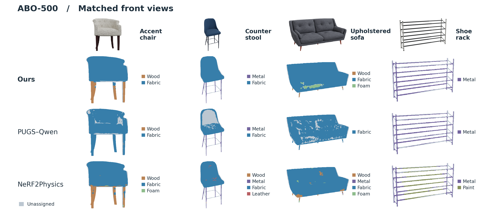

# ABO-500 质量对照与材质验证

## Ours 与五篇基线的质量指标

| 方法 | ADE (kg) ↓ | ALDE ↓ | APE (%) ↓ | MnRE ↑ |
|---|---:|---:|---:|---:|
| NeRF2Physics | 8.730 | 0.771 | 106.10 | 0.552 |
| PUGS | 9.461 | 0.661 | 76.70 | 0.576 |
| PhysVGGT | 4.730 | 0.574 | 78.70 | 0.655 |
| GS2Physics | 9.884 | 0.720 | 88.80 | 0.559 |
| Gen2Physics | 8.447 | 0.651 | 117.00 | 0.600 |
| **Ours** | 6.807 | 0.488 | 56.89 | 0.663 |

**表注。** Ours 使用官方训练 300、验证 100、测试 100 的全量 500 件，评分读取每件封存预测的 `updated` 字段。官方测试 100 件单列为 5.696 kg、0.577、70.62%、0.620，该批对象此前用于诊断。NeRF2Physics 和 PhysVGGT 使用原文各自的测试 100 件，后者为 global mass head。PUGS 使用原文全量 500 件，GS2Physics 合并 Test1–3 的 500 件，Gen2Physics 使用 500 件参考资产。各原论文的输入、监督和划分随所报成绩一起解释。 [预测与封存](../abo500_20261120/README.md) · [NeRF2Physics 表 1](https://arxiv.org/html/2404.04242#S4.T1) · [PUGS 表 I](https://marcyu0303.github.io/assets/pdfs/gs_physics.pdf#page=5) · [PhysVGGT 表 13](https://arxiv.org/html/2609.18920v1#A1.T13) · [GS2Physics 表 I](https://ieeexplore.ieee.org/document/11653536/) · [Gen2Physics 表 1](https://arxiv.org/html/2608.23869v1#S4.T1)

ADE 是平均绝对质量误差，ALDE 是平均绝对自然对数误差，APE 是平均绝对百分比误差，MnRE 是逐件取预测与参考质量两种相除方向中的较小值再求平均，越接近 1 越好。

## Ours 的方法与实现

方法说明给出相机选择、网格绕向修复、逐面投票和补全、三类材料体积、结构修正、有界融合的公式与代码。实例实验接着展示互斥材料域、局部换材的质量矩增量，以及内部粒子如何驱动 MLS-MPM。 [完整中文方法与实现](../../docs/PARTPHY3D_METHODS_zh.md) · [编辑与仿真](../part_edit_20261124/README.md)

## 同视角的物体材质对比

从每件物体的 30 张原始 RGB 图中，按椅腿、支架和坐面轮廓的可见性选择视角。花纹椅、高脚椅、沙发、鞋架分别取相机帧 26、09、10、10。每列三种方法共享相机、网格、前景、裁切和材料色板。灰色表示未赋值。PUGS–Qwen 使用作者的高斯重建与物性传播，并用 Qwen3-VL-8B 提议材料。换展示视角后重新栅格化网格，读取已有逐面分割与高斯预测，在同一组可见面中心查询 NeRF2Physics。沙发前缘的绿色表示 Ours 在该处预测泡沫，缺少对应位置的外表面材料真值。 [正面图 PDF](material_front.pdf) · [逐例相机与校验值](front_rasters/manifest.json) · [先前第 08 帧与区域特征](material_paper_baselines.pdf)

### 两把椅子的标注定量验证

| 方法 | Fabric IoU (%) ↑ | Wood IoU (%) ↑ | mIoU (%) ↑ |
|---|---:|---:|---:|
| NeRF2Physics | 96.33 | 34.57 | 65.45 |
| PUGS–Qwen | 81.34 | 0.03 | 40.68 |
| **Ours** | **95.55** | **32.71** | **64.13** |

从两把椅子各取五个 PhysSeg 视角，只在恰有一个人工标注类别的像素上评分。先汇总各类交集与并集，再把织物与木材 IoU 等权平均。NeRF2Physics 复用作者缓存与查询代码，PUGS–Qwen 在固定半径内将预测概率映射到同一网格。 [逐视角计数](paired_material.json) · [PhysSeg-15 数据](https://github.com/momaiyc/GS2Physics)

### 原论文的可视化与材质结果

| 方法 | Gen2Physics 表 2，PartNet-Material mIoU (%) | GS2Physics 表 II，PhysSeg-15 Eval1 / Eval2 / Eval3 mIoU (%) |
|---|---:|---:|
| NeRF2Physics | 14.54 | 48.5 / 31.1 / 41.2 |
| PUGS | 15.56 | 18.7 / 27.9 / 29.3 |
| GS2Physics | — | 68.9 / 58.7 / 81.7 |
| Gen2Physics | 48.27 | — |
| PhysVGGT | — | — |

| 论文 | 发表图 | 图中输出 |
|---|---|---|
| PUGS | [Fig. 5](https://arxiv.org/html/2502.12231v2#S3.F5) | ABO 物体的区域特征和材料分割 |
| GS2Physics | [Fig. 8](https://ieeexplore.ieee.org/document/11653536/) | 作者 ABO 示例的材质分割 |
| Gen2Physics | [Fig. 4](https://arxiv.org/html/2608.23869v1#S4.F4) | PartNet-Material 材质分割 |
| PhysVGGT | [Fig. 4](https://arxiv.org/html/2609.18920v1#S4.F4) | 摩擦、硬度、杨氏模量和密度 |

作者图沿用各自样本与拍摄视角。GS2Physics 公开的是人工标注与仿真示例。Gen2Physics 与 PhysVGGT 未查到作者用于这三件同视角样本的可复算结果。 [GS2Physics 作者仓库](https://github.com/momaiyc/GS2Physics)

## 本轮发现的问题与修正验证

- **PUGS 材料提议的复现条件。** 作者代码默认使用 GPT‑4o，需要 API 凭据。服务器尚未配置，直接对照沿用已封存的 PUGS–Qwen。PUGS 发表图中的推车、软包长凳和床经 RGB 检索匹配到 ABO-500 第 00 帧，可作为后续核对原版结果的候选。 [PUGS 作者说明](https://github.com/EverNorif/PUGS)
- **材质与几何有不同的失效原因。** 蓝椅的 8,900 个木材标注像素中，4,563 个看不到网格，3,844 个被赋成金属。剩下 493 个为无标签或其他材料，正确木材像素为 0。把冻结的亚像素轮廓网格投影到同五个留出视角，木材标注像素的几何命中从 **48.73% 提到 78.38%**，整件前景精度从 **96.86% 到 96.97%**。花纹椅的四个共同留出视角里，木材几何命中从 84.68% 到 95.53%，前景精度从 97.57% 降至 92.57%。因此本轮保留原网格的材质主结果。局部细件恢复具备潜力，仍需按部件转移材料证据并验证边界。 [逐视角几何和材质计数](paired_material.json)
- **质量验证集上的损失集中在错误方向的结构修正。** 对 100 件验证物体，用每件实际进入融合的图像质量作同对象对照。完整融合有 48 件误差变小、52 件变大，净增 0.932 kg ADE。`B07QHYD94M_ATVPDKIKX0DER` 的目录质量为 55.34 kg，图像支路为 107.84 kg，构造修正把结果推到 151.63 kg，单件新增 43.79 kg 绝对误差。单靠改变最终的融合权重无法识别这类异常，需约束输入物理支路的尺度、实体占用和材料密度。主表继续使用封存完整方法。 [结构质量修正对照](../abo500_20261120/fusion_validation/README.md) · [验证失败归因](../abo500_20261120/validation_failure_audit.json)

RGB 来自 Collins 等的 Amazon Berkeley Objects，CC BY 4.0。图像统一裁剪、缩放和白底合成。 [ABO 数据](https://amazon-berkeley-objects.s3.amazonaws.com/index.html)
