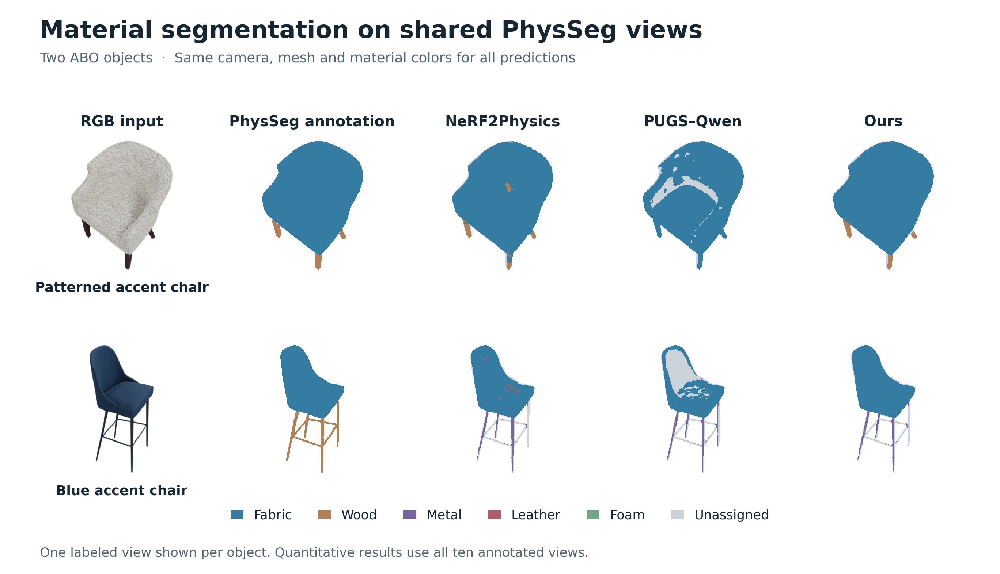

# ABO-500 质量对照与材质验证

## Ours 与五篇基线的质量指标

| 方法 | ABO-500 评估范围 | ADE (kg) ↓ | ALDE ↓ | APE (%) ↓ | MnRE ↑ |
|---|---|---:|---:|---:|---:|
| NeRF2Physics | 原论文测试集，100 件 | 8.730 | 0.771 | 106.10 | 0.552 |
| PUGS | 原论文全量，500 件 | 9.461 | 0.661 | 76.70 | 0.576 |
| PhysVGGT | 原论文测试集，100 件，global mass head | 4.730 | 0.574 | 78.70 | 0.655 |
| GS2Physics | 原论文 Test1–3 合并，500 件 | 9.884 | 0.720 | 88.80 | 0.559 |
| Gen2Physics | 原论文 ABO-500 参考资产，500 件 | 8.447 | 0.651 | 117.00 | 0.600 |
| **Ours** | **官方训练 300、验证 100、测试 100，全量 500 件** | **6.807** | **0.488** | **56.89** | **0.663** |

Ours 取 `predictions.json` 每件物体的 `updated`。重新核对文件 SHA-256、500 个对象 ID、官方划分与目录重量并重新评分，四个范围的分数与存档一致。499 件有可用的结构质量估计，1 件按固定规则回退图像支路。全量行包含图像质量头的训练对象。官方测试 100 件上的 Ours 为 **5.696 kg、0.577、70.62%、0.620**。该批测试集此前用于错误诊断。PhysVGGT 在其测试报告中的 ADE、ALDE 和 MnRE 点值更好，Ours 的 APE 较低。五篇基线采用各论文的输入、监督和评测划分。 [预测与封存记录](../abo500_20261120/README.md) · [NeRF2Physics 表 1](https://arxiv.org/html/2404.04242#S4.T1) · [PUGS 表 I](https://marcyu0303.github.io/assets/pdfs/gs_physics.pdf#page=5) · [PhysVGGT 表 13](https://arxiv.org/html/2609.18920v1#A1.T13) · [GS2Physics 表 I](https://ieeexplore.ieee.org/document/11653536/) · [Gen2Physics 表 1](https://arxiv.org/html/2608.23869v1#S4.T1)

ADE 是平均绝对质量误差，ALDE 是平均绝对自然对数误差，APE 是平均绝对百分比误差，MnRE 是逐件取预测与参考质量两种相除方向中的较小值再求平均，越接近 1 越好。

## Ours 的具体方法

| 环节 | 当前实现 | 对应证据 |
|---|---|---|
| 多视角几何 | 六个固定标定视角驱动 InstantMesh 得到三角网格。有向体积积分前检查网格闭合和绕向，修复分支保留原推理记录。 | ABO-500 质量流程。亚像素轮廓恢复在另一次 ABO-50 几何实验中验证。 |
| 材料与内部构造 | Qwen3-VL 基于 00、08、20 三张图提出部件、尺度、材料与实心、壳层、填充、空腔等构造假设。按物理域积分密度与有效材料体积。开放棚架、围板和家电走相应的局部约束。命中给定规则的覆盖层按薄壳处理。 | ABO-500 的构造支路。由图像推断的内部材料和尺度属于模型估计。 |
| 完整质量输出 | 冻结的 CLIP ViT-B/16 编码三张图像并平均特征，岭回归预测对数质量。再将图像先验与经过部件角色约束的构造质量做有界对数融合，构造失效时回退图像先验。质量头用训练 300 件拟合、验证 100 件选正则。 | 主表中唯一的 Ours 行。 [评分入口](../../scripts/score_abo500_full.py) |
| 表面材质 | 用 00、10、20 三个视图的部件掩码和候选材料，依照相机可见性投到网格三角面，做多视图投票及证据约束的三维外观补全。 | 下方 Ours 材质图。表面投票与质量构造积分共享部件与材料思想，使用各自的推理和评估产物。 |
| 局部编辑与仿真 | 用稳定部件 ID 更新指定材料域。用密度与占空体积计算总质量、质心和惯量。采样后把位置、材料、质量和刚度写入材料点，驱动 MLS-MPM 接触，或把质量、质心和惯量传给 MuJoCo。 | 躺椅数值一致性、坐垫模拟与已知构造控制。 [编辑和仿真图件](../part_edit_20261124/README.md) |

因此，本工作的质量、材质、几何修复、编辑和仿真都有自己的输出及实验范围。质量表使用 500 件目录质量验证完整质量流程。材质图用公开面具检验外表面。编辑和模拟展示使用我们的局部参数与粒子，物理精度还需要独立的实物称重、质心或变形测量。ABO-50 的薄结构修复尚未接入本表对应的 ABO-500 封存预测。

## 同视角的物体材质对比

| 方法 | Fabric IoU (%) ↑ | Wood IoU (%) ↑ | mIoU (%) ↑ |
|---|---:|---:|---:|
| NeRF2Physics | 96.33 | 34.57 | 65.45 |
| PUGS–Qwen | 81.34 | 0.03 | 40.68 |
| **Ours** | **95.55** | **32.71** | **64.13** |

对两把椅子的五个 PhysSeg 视角分别取公共相机和共享网格。仅在恰有一个人工标注类别的像素范围评分，逐类累计交集、并集后算 IoU，最后对织物和木材两类等权平均。NeRF2Physics 复用作者缓存和官方查询代码，PUGS–Qwen 使用 PUGS 原实现和 Qwen 材料提议，在固定半径内将预测概率转到同一网格。该两对象结果用于材料和几何归因。 [材料图 PDF](paired_material.pdf) · [10 视角计数](paired_material.json) · [PhysSeg-15 数据](https://github.com/momaiyc/GS2Physics)

### 其他基线的原文材质结果

| 方法 | Gen2Physics 表 2，PartNet-Material mIoU (%) | GS2Physics 表 II，PhysSeg-15 Eval1 / Eval2 / Eval3 mIoU (%) |
|---|---:|---:|
| NeRF2Physics | 14.54 | 48.5 / 31.1 / 41.2 |
| PUGS | 15.56 | 18.7 / 27.9 / 29.3 |
| GS2Physics | — | 68.9 / 58.7 / 81.7 |
| Gen2Physics | 48.27 | — |
| PhysVGGT | — | — |

GS2Physics 提供 PhysSeg-15 标注及论文分组成绩，Gen2Physics 给出 PartNet-Material 结果。当前未取得两者在上述两把椅子上的可复算预测。PhysVGGT 在原文展示连续物性图，未找到相同的材质类别 mIoU。这里按各自论文保留其验证范围。 [Gen2Physics 表 2](https://arxiv.org/html/2608.23869v1#S4.T2) · [GS2Physics 表 II](https://ieeexplore.ieee.org/document/11653536/) · [PhysVGGT 实验](https://arxiv.org/html/2609.18920v1#S4)

## 本轮发现的问题与修正验证

- **材质与几何有不同的失效原因。** 蓝椅的 8,900 个木材标注像素中，4,563 个看不到网格，3,844 个被赋成金属。剩下 493 个为无标签或其他材料，正确木材像素为 0。把冻结的亚像素轮廓网格投影到同五个留出视角，木材标注像素的几何命中从 **48.73% 提到 78.38%**，整件前景精度从 **96.86% 到 96.97%**。花纹椅的四个共同留出视角里，木材几何命中从 84.68% 到 95.53%，前景精度从 97.57% 降至 92.57%。因此本轮保留原网格的材质主结果。局部细件恢复具备潜力，仍需按部件转移材料证据并验证边界。 [逐视角几何和材质计数](paired_material.json)
- **质量验证集上的损失集中在错误方向的结构修正。** 对 100 件验证物体，用每件实际进入融合的图像质量作同对象对照。完整融合有 48 件误差变小、52 件变大，净增 0.932 kg ADE。`B07QHYD94M_ATVPDKIKX0DER` 的目录质量为 55.34 kg，图像支路为 107.84 kg，构造修正把结果推到 151.63 kg，单件新增 43.79 kg 绝对误差。单靠改变最终的融合权重无法识别这类异常，需约束输入物理支路的尺度、实体占用和材料密度。主表继续使用封存完整方法。 [结构质量修正对照](../abo500_20261120/fusion_validation/README.md) · [验证失败归因](../abo500_20261120/validation_failure_audit.json)

RGB 来自 Collins 等的 Amazon Berkeley Objects，CC BY 4.0。图像统一裁剪、缩放和白底合成。 [ABO 数据](https://amazon-berkeley-objects.s3.amazonaws.com/index.html)
