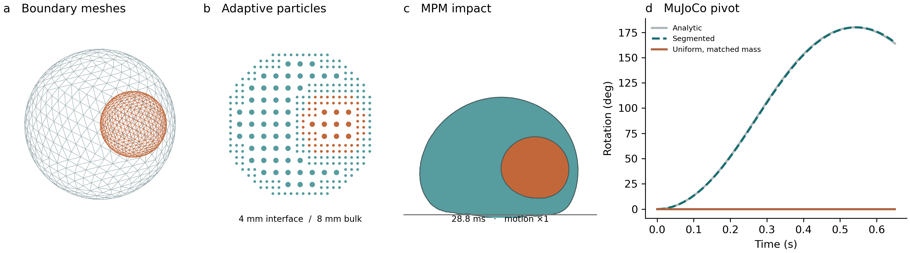
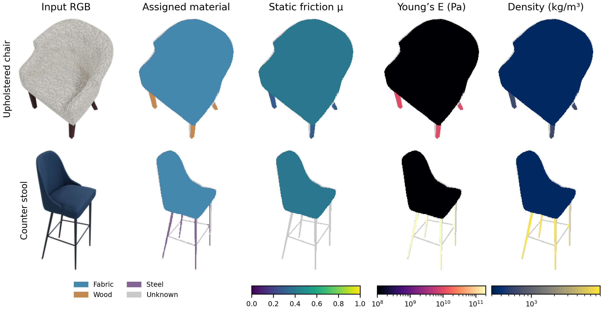

# 从网格边界到材料点与仿真

半径 50 mm 的球内，半径 22 mm 的内芯向右偏移 22 mm。外形与内芯分别用 642 个顶点构造凸三角网格。平面法向及截距用于计算单元中心对所有面的最大有符号偏移。与外表面或内部材料界面可能相交的 8 mm 单元八分为 4 mm 子单元。按网格内外测试剔除外部粒子并给其余粒子赋材料；粒子质量等于密度乘代表体积。此实验给定内部网格，检验几何到物理的转换。凸面半空间测试适用于本控制球。图 b 是穿过球心的薄层，点径随采样间距变化，青色为基体，橙色为偏心内芯。

3D MLS-MPM 使用可压缩 neo-Hookean 本构。基体和内芯分别采用密度 800、3200 kg/m³，杨氏模量 15、120 kPa，泊松比均为 0.30。球心初始距地面 60 mm，初速度朝下 1 m/s。背景网格间距 8 mm，无摩擦地面约束网格节点法向速度，时间步长 0.12 ms。动画每 20 步取一次真实位置，中心截面轮廓通过八个邻近粒子的位移插值显示，位移倍率为 1。

MuJoCo 用相同粒子的总质量、质心和中央惯量张量设置绕球几何中心的水平铰链。均匀对照有相同外形和相同总质量。两者均静止释放，重力是唯一驱动力。独立参考由理想球体加偏心球体密度差的解析矩和一自由度转动方程给出。质量匹配刻意使该对照只能检验分布。位于几何中心的均匀模型质心没有重力力臂，因此静止。合成算例的准确度不能推及照片中的未知内芯。

[动态响应](sphere.gif) · [数值误差](results.json) · [粒子参数与逐帧坐标](simulation.npz)

## 可见表面属性

两件 ABO 物体各取一个已有推理视角，使用相同相机与裁剪。材料列来自既有预测；蓝椅腿的钢标签是已知错分。密度按本项目材料库均值映射，杨氏模量读取原视图已导出的字段。摩擦列将既有躺椅材料询问中有效回答的中位数按同名材质迁移，接触条件为干燥不锈钢滑块、室温、轻载。无该材质先验或未赋值区域标灰。硬度缺少可用的 Shore 字段，故保留材料列。以上为条件先验，两件椅子的物性未实测。[原躺椅多属性图](../chaise_reference_20261111_final/dense_property_maps.pdf)
