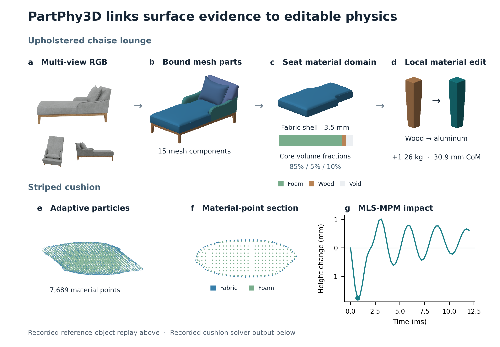
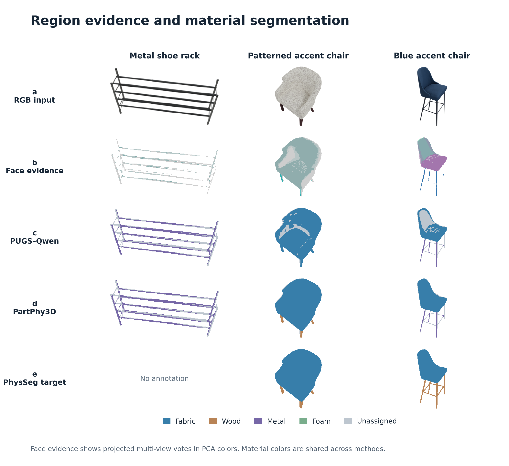
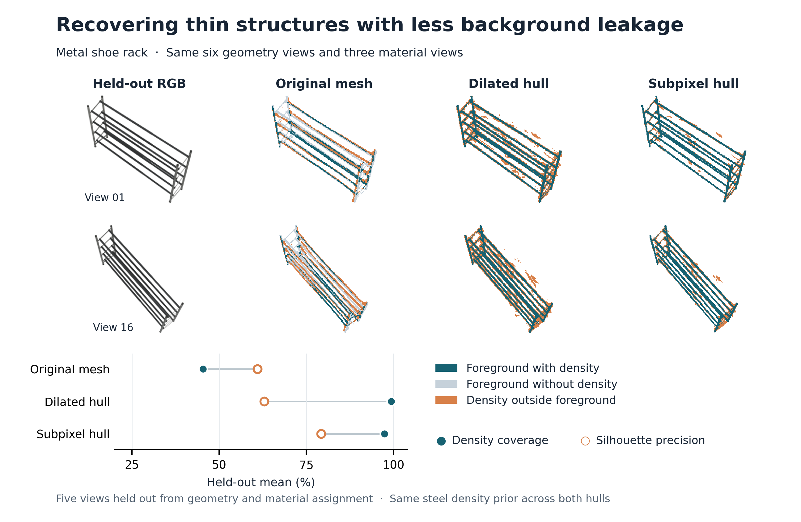
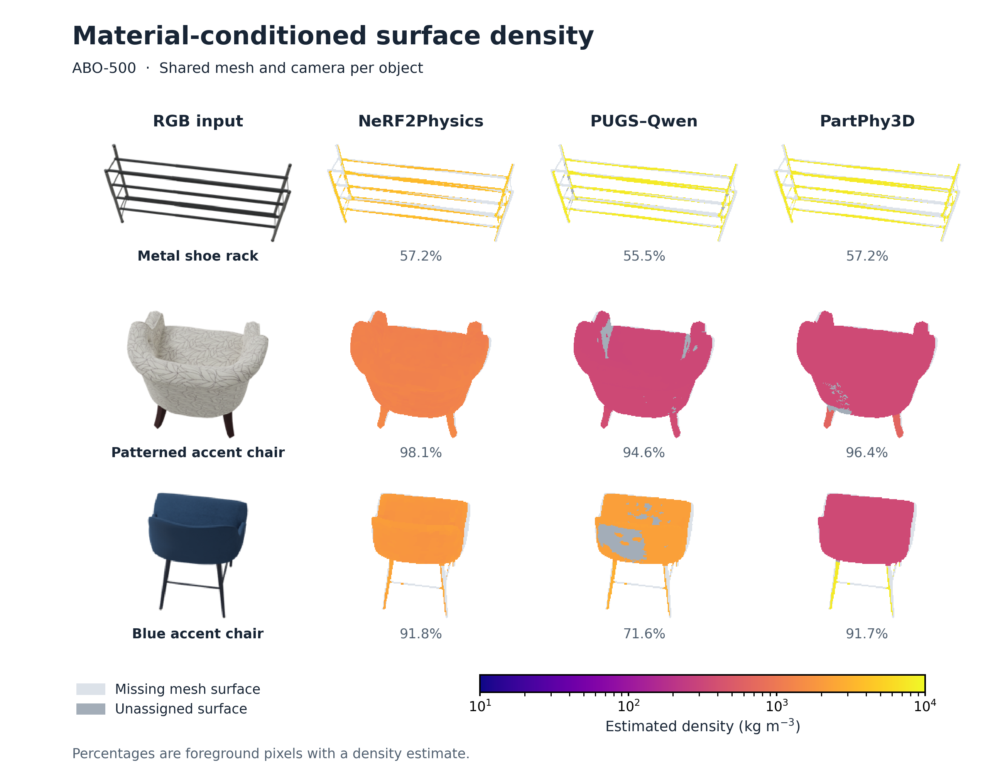
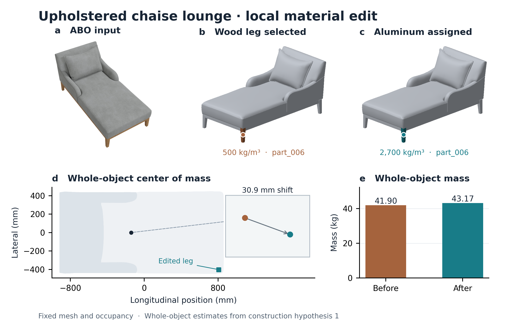
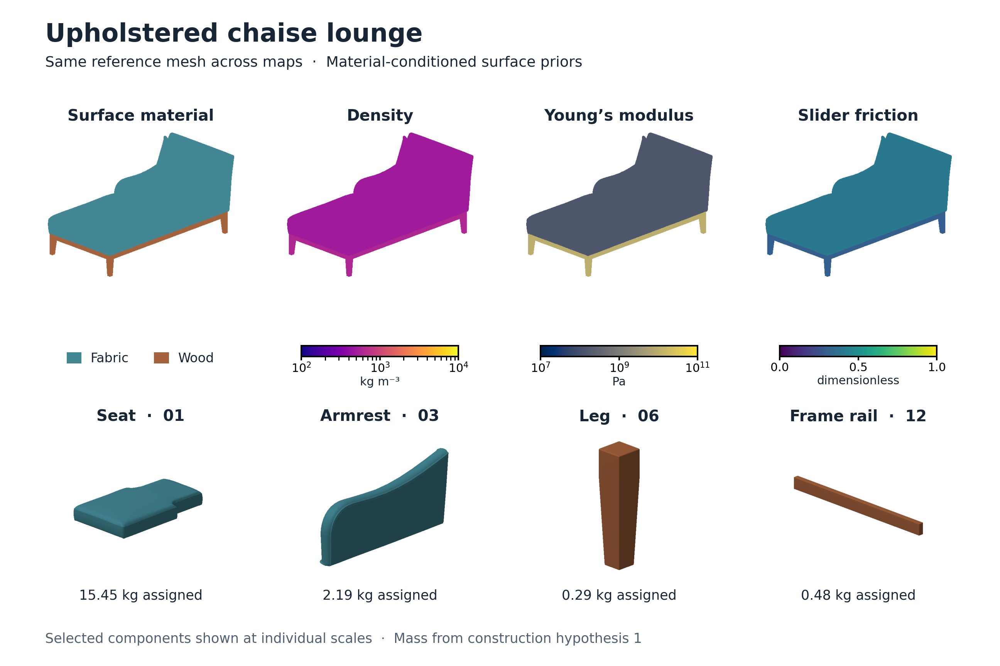

# PartPhy3D coverage, materials and editing audit

The top row follows the upholstered chaise lounge reference mesh. It shows three of the recorded input RGB views, the bound component surfaces, the conditional seat composition and the wood-to-aluminum density edit. The bottom row uses a separate ABO striped cushion and shows 7,689 recorded material points, a central section and a simulation height trace during the first 12 ms of impact. The cushion's deformation is a simulated response. [PDF](partphy3d_pipeline.pdf) · [Plot data](partphy3d_pipeline_data.json)

The face-evidence row displays PCA colors of the recorded multi-view part votes, with color intensity modulated by support. The material rows use a different, shared categorical palette. PUGS–Qwen labels come from the class probabilities transferred to the same mesh and camera. The striped chair legs and blue chair legs are both annotated as wood; the blue chair remains a material error for PartPhy3D. [PDF](region_material_comparison.pdf) · [Source registration](region_comparison_manifest.json)

## Thin-structure recovery

The six geometry and three material input frames are fixed. Five evaluation views are excluded from both stages. The original hull dilated each input silhouette by one pixel and rounded projected sample positions. On narrow bars this expands the reconstructed geometry into the gaps. The new hull intersects bilinearly interpolated signed distances at a zero contour. The same conditional steel density prior is used for both hulls. Orange shows assigned density projected outside the observed silhouette.

| Metal shoe rack, five held-out views | Density coverage ↑ | Silhouette precision ↑ | Silhouette IoU ↑ |
|---|---:|---:|---:|
| Original reconstructed mesh and local assignment | 45.41% | 60.97% | 0.426 |
| Dilated hull with material consensus | 99.39% | 62.92% | 0.627 |
| Subpixel hull with local assignment | 76.46% | 79.29% | 0.777 |
| Subpixel hull with material consensus | 97.46% | 79.29% | 0.777 |

At the separate 24-view evaluation, holding the voxel resolution and all inputs fixed, rack IoU rises from 0.486 for the original mesh and 0.550 for the dilated hull to 0.679 for the subpixel hull. Reapplying the previous input-IoU gate of 0.80 on 50 objects changes two meshes. Mean held-out IoU moves from 0.9178 to 0.9220 and mean precision from 94.38% to 94.54%. These are development diagnostics on previously inspected objects. The 240-grid variant increases compute and its three-object mean IoU was below the 144-grid configuration. Aligned images and source data are also available as [PDF](coverage_repair.pdf), [per-view counts](rack_subpixel_density.json) and [ABO-50 geometry scores](subpixel_gate_50.json).

## Density with runnable baselines

The four columns use the same camera and one shared mesh per object. NeRF2Physics values come from the author's cached property outputs, PUGS–Qwen uses the official PUGS reconstruction followed by a local Qwen proposal stage, and PartPhy3D uses its appearance-completion replay on the fixed shared surface. The methods estimate density from material priors. Coverage is the fraction of foreground pixels with a density estimate. The fixed-mesh control keeps the same geometry for all three methods, while the geometry study above varies it explicitly. [PDF](shared_density.pdf) · [Coverage counts](shared_density_data.json)

The frozen PUGS–Qwen queue has 17 sealed predictions out of 50 requested. Scoring those exact rows against the same catalogue masses gives the following diagnostic. The 17 objects had previously appeared in the development workflow.

| Same 17 objects | ADE (kg) ↓ | ALDE ↓ | APE (%) ↓ | MnRE ↑ |
|---|---:|---:|---:|---:|
| NeRF2Physics author cache | 6.655 | 0.561 | 66.15 | 0.623 |
| PUGS–Qwen | 43.938 | 1.721 | 1166.58 | 0.289 |
| PartPhy3D | 4.705 | 0.478 | 39.67 | 0.678 |

[Per-object predictions and pending IDs](paired_mass_prefix.json)

## Local editing and property inspection

A wood leg at stable part ID `part_006` is assigned nominal aluminum density. The full assembly is recomputed with the existing disjoint domains. A separate additive update of the mass, first moment and world-origin inertia reproduces the full recomputation across three sealed hypotheses. The whole-object center shift is 25.1–30.9 mm and the added mass is 1.264 kg. The mesh and material occupancy are held fixed. The 1,439 changed rendered pixels all belong to the target part. Material colors identify the edit region. [PDF](material_edit.pdf) · [Replay results and per-part masses](material_edit_data.json)

The figure separates surface material priors from the component masses obtained by integrating the conditional interior construction. Friction refers to the dry stainless-steel slider pair in the surface-prior protocol. Insets show individual components at independent scales. [PDF](part_property_fields.pdf)

The RGB renders are from Amazon Berkeley Objects, Collins et al., CVPR 2022, CC BY 4.0. The study applies white-background compositing and a shared crop across methods in each row. [ABO dataset](https://amazon-berkeley-objects.s3.amazonaws.com/index.html)
